# Manuel de mixage étape par étape

**Version 7.5.1 — révision critique de la version de travail 7.4 (13 novembre 2026)**  

Cette édition conserve la structure du manuel transmis et enrichit les contrôles terminologiques et techniques à l’aide de documents professionnels et normatifs accessibles. Les valeurs de réglage sont **des points de départ contextuels**, jamais des prescriptions universelles.

**Fiches visuelles :** les fiches sont numérotées en continu dans les titres de niveau 4 (`#### Fiche 1`, `#### Fiche 2`, etc.). Leur en-tête graphique ne comporte plus de numéro ; leurs fichiers JPEG ont des noms descriptifs. Le dossier `fiches/` accompagne ce `.md`. **Les illustrations SVG autonomes ont été supprimées.** Les interfaces stylisées des fiches restent des schémas pédagogiques, et non des captures certifiées de plug-ins.

## Comment utiliser ce manuel

> **Termes et concepts essentiels —** **[A/B](#glossaire-a-b) :** comparaison entre deux traitements, idéalement à niveau perçu égal · **[référence](#glossaire-reference) :** morceau commercial utilisé pour comparer les choix de tonalité et de balance à niveau égal · **[balance](#glossaire-balance) :** rapport audible des niveaux des différentes pistes ou instruments

Le manuel suit l'ordre naturel d'un mixage : on prépare l'écoute, on règle les niveaux, on construit la balance, on traite, on ajoute l'espace, on vérifie, puis on prépare le mastering. Chaque étape répond à trois questions : pourquoi, comment, comment vérifier.

Trois principes traversent tout le document :

- **Un traitement doit avoir une raison.** Si on ne peut pas dire ce qu'on entend et ce qu'on veut changer, on n'y touche pas.
- **Comparer à niveau égal.** Plus fort sonne presque toujours mieux. Tout A/B (bypass contre traité) se fait après avoir compensé le volume.
- **Vérifier en contexte et sur plusieurs systèmes.** Un son jugé en solo ou sur un seul système trompe.

Les valeurs chiffrées sont des points de départ, pas des règles. Les fiches le disent elles-mêmes : l'oreille tranche.

**Convention terminologique :** Le texte demeure en français, mais conserve les noms courants des fonctions de DAW et des plugins (*[gain staging](#glossaire-gain-staging)*, *[trim](#glossaire-trim)*, *[clip gain](#glossaire-clip-gain)*, *[headroom](#glossaire-headroom)*, *[sidechain](#glossaire-sidechain)*, *[comb filtering](#glossaire-comb-filtering)*, *[true peak](#glossaire-true-peak)*, etc.) lorsqu'un traduction littérale risque d’être méconnue ou ambiguë. Une explication française figure à la première utilisation et dans le [glossaire](#annexe-g-glossaire). 

Accès direct : [table des étapes](#table-des-etapes) · [glossaire A–Z](#annexe-g-glossaire) · [index des termes](#annexe-h-index) · [répertoire des fiches](#index-des-fiches) · [webographie](#webographie-professionnelle).

## Table des étapes

- [Étape 0 — Préparer la pièce et l'écoute](#sec-0)
- [Étape 1 — Structure de gain (gain staging)](#sec-1)
- [Étape 2 — Balance de base aux faders](#sec-2)
- [Étape 3 — Panoramique et largeur](#sec-3)
- [Étape 4 — Verrouiller la section rythmique (kick et basse)](#sec-4)
- [Étape 5 — L'EQ](#sec-5)
- [Étape 6 — La compression](#sec-6)
- [Étape 7 — Saturation et couleur](#sec-7)
- [Étape 8 — L'espace (réverbération et délais)](#sec-8)
- [Étape 9 — Automation, bus principal et finalisation du mix](#sec-9)
- [Étape 10 — Vérifier le rendu sur plusieurs systèmes d'écoute](#sec-10)
- [Étape 11 — Préparer et réaliser le mastering](#sec-11)

## Parcours condensé de session

> **Termes et concepts essentiels —** **[rough mix](#glossaire-rough-mix) :** première balance musicale, généralement réalisée avant la majorité des traitements · **[phase](#glossaire-phase) :** position relative des composantes périodiques ; dépend notamment du temps de parcours · **[bus](#glossaire-bus) :** canal de sommation recevant plusieurs pistes

1) vérifier les interactions de phase/polarité entre microphones et sources avec du *[bleed](#glossaire-bleed)* (captation d’autres instruments par un microphone) ; 

2) délimiter les débuts/fins et effectuer le nettoyage temporel (« pacing » dans la prise de notes) ; 

3) construire un *rough mix* ; 

4) décider si l'on travaille avec une chaîne de traitement sur le bus principal, puis la préparer sans exiger tous les modules ; 

5) doser [EQ dynamique](#glossaire-eq-dynamique), coloration, [compression parallèle](#glossaire-compression-parallele) et traitements ponctuels ;

6) mesurer le résultat et vérifier le rendu sur différents systèmes d’écoute.

**Important :** cette séquence exprime la méthode du cours, pas un protocole industriel obligatoire. Les notes ambigües (notamment les niveaux « −10 dB / −6 dB », les noms de plugins incertains et la signification d'« inner sampler peak ») sont annotées et non transformées en certitudes.

## Étape 0 : Préparer la pièce et l'écoute

> **Termes et concepts essentiels —** **[référence](#glossaire-reference) :** morceau commercial utilisé pour comparer les choix de tonalité et de balance à niveau égal · **[K-System](#glossaire-k-system) :** méthode de métrologie et de calibration d’écoute proposée par Bob Katz · **[DAW](#glossaire-daw) :** station audionumérique (Digital Audio Workstation), ex. Cubase ou Reaper
> 

#### Fiche 1 — Préparer la pièce et l’écoute

### 0.1 Placer les moniteurs

> **Termes et concepts essentiels —** **[stéréo](#glossaire-stereo) :** reproduction à deux canaux pouvant créer largeur et localisation · **[référence](#glossaire-reference) :** morceau commercial utilisé pour comparer les choix de tonalité et de balance à niveau égal

La pièce influence le son autant que le matériel. Avant d'acheter un plugin, corrigez l'installation.

1. **Symétrie.** Les deux enceintes à la même hauteur, à distance comparable du point d'écoute et, autant que possible, dans des conditions acoustiques semblables de chaque côté.
2. **Triangle équilatéral.** La distance entre les deux enceintes est à peu près égale à la distance entre chaque enceinte et vous (60° à chaque sommet).
3. **Tweeters vers les oreilles.** Visez la position d'écoute, pas droit devant.
4. **Placement vis-à-vis des murs.** Évitez les coins sans précaution ; testez la distance au mur selon les recommandations du fabricant et la réponse de la pièce. Placer l'enceinte systématiquement « le plus loin possible » du mur n'est pas toujours optimal.
5. **Ne pas s'asseoir contre le mur arrière.** Il provoque un renfort des graves. Gardez de l'espace derrière vous.
6. **Ne pas juger les graves sans tenir compte de la pièce.** Ce qui sonne bien chez vous peut être très différent ailleurs. Un traitement acoustique de base aide plus qu'un nouveau plugin.

Message clé : vous n'avez peut-être pas un mauvais mix, mais une mauvaise position d'écoute.

### 0.2 Calibrer le niveau d'écoute (une seule fois)

> **Termes et concepts essentiels —** **[dB](#glossaire-db) :** décibel, unité logarithmique de rapport de niveaux · **[K-System](#glossaire-k-system) :** méthode de métrologie et de calibration d’écoute proposée par Bob Katz · **[RMS](#glossaire-rms) :** root mean square, mesure énergétique moyenne d’un signal sur une fenêtre définie

Nous entendons moins les graves et les aigus à faible volume (courbes d'isosonie). Un mix fait à des volumes variables aura une balance tonale incohérente.

#### Tableau de référence — niveaux et mesures audio

| Mesure                                                                        | Ce que l'on mesure                                                                                 | Où la mesurer ?                                                                                                                                     | Ce qu'il faut retenir                                                                                                                                                                                                   |
| ----------------------------------------------------------------------------- | -------------------------------------------------------------------------------------------------- | --------------------------------------------------------------------------------------------------------------------------------------------------- | ----------------------------------------------------------------------------------------------------------------------------------------------------------------------------------------------------------------------- |
| **[dB](#glossaire-db)**                                                       | Rapport logarithmique entre deux niveaux.                                                          | Gain de piste, EQ, compression, différences de niveau.                                                                                              | « +3 dB » est une différence ; **dB seul n'indique aucune référence absolue**.                                                                                                                                          |
| **[dBFS](#glossaire-dbfs)** (*dB Full Scale*)                                 | Amplitude numérique par rapport à la pleine échelle.                                               | *[Peak meter](#glossaire-peak-meter)* d'une piste, d'un bus, ou d'un fichier numérique.                                                             | En PCM entier, 0 dBFS est le maximum d'amplitude d'échantillon ; −12 dBFS n'est ni une mesure SPL ni une mesure de loudness.                                                                                            |
| **[Sample peak](#glossaire-sample-peak)** (dBFS peak)                         | Plus grande valeur d'échantillon mesurée.                                                          | *Peak meter* réglé sur *[sample peak](#glossaire-sample-peak)*.                                                                                     | Peut être inférieure au *[true peak](#glossaire-true-peak)* après reconstruction du signal.                                                                                                                             |
| **[RMS](#glossaire-rms)** (*Root Mean Square*)                                | Niveau efficace/moyen énergétique sur une fenêtre définie.                                         | *[RMS meter](#glossaire-rms-meter)*, analyse de piste ou d'un fichier.                                                                              | Ce n'est pas une mesure perceptive normalisée de loudness ; la fenêtre et la convention d'étalonnage comptent.                                                                                                          |
| **[dBFS RMS](#glossaire-dbfs-rms)**                                           | Résultat d'un calcul RMS **exprimé par rapport à la pleine échelle numérique**.                    | Mesure d'un bruit rose ou niveau moyen d'une piste numérique.                                                                                       | Combine une **méthode** (RMS) et une **référence** (dBFS) ; ce n'est pas une unité autonome.                                                                                                                            |
| **[VU](#glossaire-vu)** / **[VU-mètre](#glossaire-vu-metre)**                 | Indication de niveau moyen avec une réponse temporelle lente, selon un étalonnage.                 | VU-mètre matériel ou plugin.                                                                                                                        | **0 VU ≠ 0 dBFS** : une convention fréquente est 0 VU = −18 dBFS, mais elle peut varier.                                                                                                                                |
| **[dB SPL](#glossaire-db-spl)**                                               | Niveau de pression acoustique dans la pièce.                                                       | Sonomètre au point d'écoute.                                                                                                                        | Échelle **acoustique** ; dépend des enceintes, de leur volume et de la distance. Aucun nombre de dBFS n'impose à lui seul un SPL.                                                                                       |
| **[dB(C)](#glossaire-ponderation-c)** / **[dB(A)](#glossaire-ponderation-a)** | Niveau SPL avec une pondération fréquentielle C ou A.                                              | Réglage du sonomètre ; ex. dB SPL (C), réponse lente.                                                                                               | La pondération et la vitesse de mesure (*Slow/Fast*) doivent être indiquées. Pondération A (dBA) : Atténue fortement les basses fréquences; Pondération C (dBC) : Réponse plus uniforme, conserve davantage les graves. |
| **[LUFS](#glossaire-lufs)**                                                   | Loudness du programme avec pondération K, selon les algorithmes de type ITU-R BS.1770 / EBU R 128. | *[Loudness meter](#glossaire-loudness-meter)* : **Momentary** (400 ms), **Short-term** (3 s), **Integrated** (sur la durée mesurée, avec *gating*). | Utile pour apprécier le niveau d'un mix ou master, **non interchangeable** avec RMS, dBFS peak ou dB SPL.                                                                                                               |
| **[LU](#glossaire-lu)**                                                       | Différence de *loudness* (unité relative).                                                         | Écarts entre deux mesures de loudness ; plage de loudness.                                                                                          | **+1 LU correspond à 1 dB d'écart de loudness mesuré** ; ce n'est pas une valeur absolue en LUFS.                                                                                                                       |
| **[LRA](#glossaire-lra)**                                                     | Étendue statistique des variations de loudness dans le temps.                                      | Analyse du morceau entier.                                                                                                                          | Indicateur de contraste global ; pas égal à l'écart simple entre pic et moyenne.                                                                                                                                        |
| **[dBTP](#glossaire-dbtp)** / **[true peak](#glossaire-true-peak)**           | Estimation du niveau maximal du signal reconstruit, y compris entre échantillons.                  | *True-peak meter*, sortie du master.                                                                                                                | Vérifier le plafond de livraison : il peut différer du *sample peak*.                                                                                                                                                   |
| **[PLR](#glossaire-plr)**                                                     | *Peak-to-Loudness Ratio* : différence entre true peak et LUFS intégré.                             | Analyse du master.                                                                                                                                  | Repère sur l'écart pic–loudness ; **ne remplace pas** le jugement musical ni le LRA.                                                                                                                                    |

**Repère pratique.** Pour **l'enregistrement ou le [gain staging](#glossaire-gain-staging)**, observez d'abord le *sample peak* et, selon la source, le RMS/VU ; pour **calibrer les enceintes**, mesurez en dB SPL ; pour **préparer une diffusion**, mesurez le LUFS intégré et le dBTP. Voir aussi les [étapes 1](#sec-1) et [11.5](#sec-11-5). Ne convertissez pas directement une mesure dans l'une de ces échelles vers une autre sans connaître le signal, la chaîne de reproduction et les conventions de mesure.

1. Générez du **bruit rose à −20 [dBFS RMS](#glossaire-dbfs-rms)** (ou -18 dBFS) et envoyez-le par votre interface et vos moniteurs.
2. Placez un sonomètre à la **position d'écoute, à hauteur d'oreille**, en **pondération C** et **réponse lente**.
3. Ajustez le volume jusqu'à lire la valeur cible : **73 à 79 dB SPL (C) en petite pièce**, **79 à 83 dB en pièce plus grande**.
4. **Marquez la position du bouton de volume.** C'est votre niveau de référence.
5. Utilisez cette position comme **repère reproductible**, sans vous imposer un niveau élevé pendant de longues sessions. Travaillez souvent à volume modéré, vérifiez très brièvement à d'autres niveaux et faites des pauses.

L'objectif n'est pas de mixer fort, mais d'avoir un point de départ constant.

**Précisions tirées de sources reconnues.** La fiche donne 73 à 79 dB SPL (pondération C) pour une petite pièce. La méthode de référence, le système K de Bob Katz, est plus précise :

- Le bruit rose doit être calibré à **-20 dBFS RMS**. Un bruit rose dont le niveau RMS n'est pas garanti rend la calibration approximative.
- Dans l'exemple du système K de Katz, on mesure **une enceinte à la fois**, en pondération C et réponse lente, à **83 dB SPL** dans le contexte de référence décrit. Cette valeur n'est **pas** une prescription universelle pour toutes les petites pièces ni une obligation d'écoute prolongée.
- Les deux enceintes jouant ensemble ajoutent environ 2 à 3 dB à la position d'écoute.
- Le système K place aussi le 0 du vumètre à un niveau choisi (K-20 : -20 dBFS ; K-14 : -14 dBFS ; K-12 : -12 dBFS) et privilégie les niveaux **RMS**, plus proches de la perception du volume que les crêtes.

Interprétation : les valeurs plus basses de la fiche correspondent à un niveau d'écoute réduit, courant en petite pièce. Retenez le principe commun : **un niveau fixe, mesuré, marqué et répété**. La constance compte plus que la valeur exacte.

### 0.3 Vérifier les réglages du projet

> **Termes et concepts essentiels —** **[DAW](#glossaire-daw) :** station audionumérique (Digital Audio Workstation), ex. Cubase ou Reaper · **[pan law](#glossaire-pan-law) :** règle de gain appliquée lors du déplacement d’une source entre gauche et droite

**Distinction essentielle :** le format d’un fichier enregistré (par exemple PCM 24 bits), la précision interne du moteur audio (32/64 bits à virgule flottante) et le format d’exportation sont trois paramètres différents. La documentation de [Cubase Pro 15](https://www.steinberg.help/r/cubase-pro/15.0/en/cubase_nuendo/topics/setting_up/setting_up_audio_vst_audio_system_r.html) confirme les deux précisions de traitement, mais ne rend pas le 64-bit float obligatoire.

- **Loi de panoramique (pan law).** Voir l'étape 3. Dans Cubase, elle se règle dans la configuration du projet. Réglez-la une fois, notez-la, et ne la changez plus en cours de mix.
- **Résolution et fréquence d'échantillonnage.** Pour le mixage, privilégier une précision de traitement interne de 32 bits à virgule flottante (32-bit float), qui offre une grande marge de calcul pour la sommation et les traitements audio. Cubase permet également le traitement en 64-bit float, facultatif selon les besoins et les ressources disponibles. Pour l'enregistrement, une résolution de 24 bits PCM demeure généralement suffisante. Conserver la fréquence d'échantillonnage native du projet (habituellement 44,1 ou 48 kHz). Pour transmettre un mix non masterisé destiné à des traitements ultérieurs, privilégier un export WAV en 32-bit float lorsque le destinataire accepte ce format.

### 0.4 Prévoir une écoute complémentaire

> **Termes et concepts essentiels —** **[mono](#glossaire-mono) :** somme ou lecture sur un seul canal plutôt que deux canaux séparés · **[référence](#glossaire-reference) :** morceau commercial utilisé pour comparer les choix de tonalité et de balance à niveau égal

Un seul système d'écoute ne suffit pas. Mike Senior (*Mixing Secrets for the Small Studio*) consacre un chapitre entier à l'écoute complémentaire : une petite enceinte de type Auratone, le casque et les « grotboxes » (enceintes grand public bon marché).

1. **Petite enceinte (idéalement mono)** : révèle vite la balance des médiums et ce qui disparaît.
2. **Casque** : montre les détails, les bruits et les clics, mais exagère les panoramiques extrêmes.
3. **Système grand public** (ordinateur, téléphone, voiture) : confirme le rendu sur un autre système d’écoute.

Règle : chaque système sert à répondre à une question précise, jamais à remplacer le niveau de référence des moniteurs.

### 0.5 Préparer la session avant de mixer

> **Termes et concepts essentiels —** **[édition](#glossaire-edition) :** modification de prises, coupes, raccords, niveaux ponctuels ou alignement · **[DAW](#glossaire-daw) :** station audionumérique (Digital Audio Workstation), ex. Cubase ou Reaper

Senior consacre trois chapitres à la préparation : le travail de base sur les pistes, les ajustements de timing et de justesse, puis le comping et l'arrangement. Une bonne préparation évite de se battre contre le matériel pendant tout le mix. MasteringBOX recommande aussi d'enlever le bruit inutile avant de régler les niveaux.

1. **Repartir d'une session propre**, regardée du point de vue du mixage seul (pistes consolidées, départs alignés).
2. **Organiser, nommer et colorer** les pistes (par exemple toute la batterie d'une couleur, toutes les basses d'une autre), puis les regrouper par familles.
3. **Nettoyer** : couper les silences et bruits, poser de courts fondus, retirer les clics.
4. **Corriger le timing et la justesse** là où cela nuit à la musique.
5. **Faire le *comping*** (choisir les meilleures prises) et **trancher l'arrangement** : retirer les parties qui se battent entre elles.
6. **Enregistrer une version de départ** de la session avant tout traitement.

Ce travail rejoint un principe des fiches : corriger la [phase](#glossaire-phase), le timing ou l'arrangement avant d'ajouter de la largeur ou du traitement.

### 0.6 Choisir des références et fixer des objectifs

> **Termes et concepts essentiels —** **[référence](#glossaire-reference) :** morceau commercial utilisé pour comparer les choix de tonalité et de balance à niveau égal · **[A/B](#glossaire-a-b) :** comparaison entre deux traitements, idéalement à niveau perçu égal

iZotope conseille d'écouter le mix brut et de rassembler ses références avant de traiter quoi que ce soit. Senior consacre une section à l'art de la référence (chapitre 4). Un critique du livre (Barry Rudolph) la décrit comme un contrôle de réalité contre l'isolement du studio.

1. **Choisir deux ou trois morceaux commerciaux** proches de votre style, en format sans perte audio (wav par ex.).
2. **Les importer dans la session**, sur des pistes hors du bus principal, avec un accès rapide à l'écoute comparative.
3. **Égaliser le niveau** avec le mix avant de comparer, comme pour tout A/B.
4. **Noter les objectifs** : balance des graves, présence de la voix, largeur, profondeur, dynamique.
5. **Comparer régulièrement**, au début, à mi-parcours et à la fin, puis ajuster votre mix, pas vos références.

L'objectif n'est pas de copier, mais de savoir où l'on se situe.

 

### 0.7 Préparer la cohérence multi-microphones

#### Fiche 2 — Cohérence des prises multi-microphones

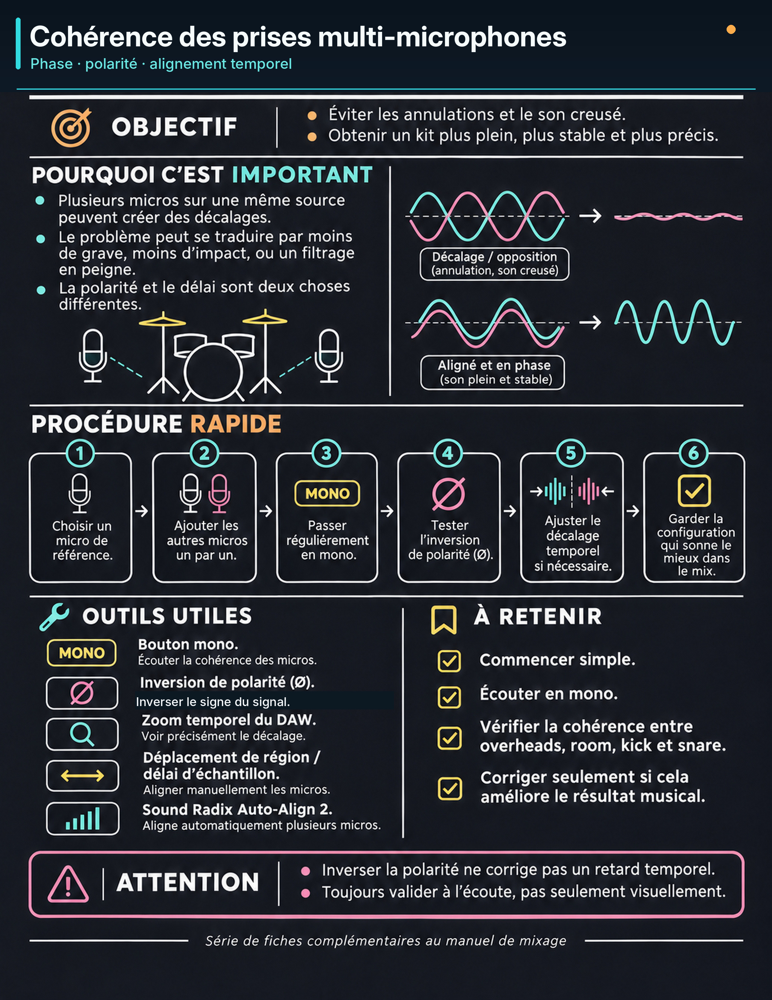

> **Termes et concepts essentiels —** **[phase](#glossaire-phase) :** position relative des composantes périodiques ; dépend notamment du temps de parcours · **[polarité](#glossaire-polarite) :** orientation positive/négative d’un signal ; inverser la polarité n’est pas décaler le temps · **[comb filtering](#glossaire-comb-filtering) :** alternance de renforcements et d’annulations spectrales causée par des signaux corrélés décalés

**Notes de masterclass — priorité élevée :** comparer les prises qui captent **une même source** ou qui présentent un *[bleed](#glossaire-bleed)* significatif (captation de sources voisines) : micros de batterie, [overheads](#glossaire-overheads), micros d'ambiance, [DI](#glossaire-di) + ampli, et certains groupes d'instruments. Il ne s'agit pas d'aligner aveuglément toutes les pistes d'un morceau.

1. **Isoler une famille de prises corrélées.** Écouter d'abord un micro de référence, puis ajouter un second micro **un par un**, sur une portion jouée simultanément.
2. **Comparer en mono.** Écouter le timbre, l'attaque, le poids du grave, les creux et la sensation de proximité ; garder le niveau d'écoute constant.
3. **Tester le bouton Ø (polarité).** Le basculement de polarité peut améliorer la somme de deux signaux corrélés, mais **ne résout pas à lui seul un décalage temporel**. Selon les notes de masterclass : comparer les deux états et noter celui qui conserve le mieux le corps/les transitoires. Ne pas choisir automatiquement celui qui a simplement le plus grand niveau [RMS](#glossaire-rms).
4. **Analyser le temps d'arrivée si nécessaire.** Examiner transitoires, corrélation et spectre (*comb filtering*), puis auditionner un décalage modéré si la situation le justifie. Éviter de déplacer des prises dont la distance participe volontairement à la profondeur de la salle.
5. **Contrôler le groupe entier, puis le mix.** Un réglage qui aide un duo de micros peut dégrader le kit complet ; vérifier les overheads, la caisse claire, le kick et les ambiances ensemble, puis l'ensemble instrumental en mono **et en stéréo**.
6. **Conserver une version A/B.** Noter la prise de référence, les inversions et le décalage appliqués ; le choix reste réversible.

**Outil :** *Sound Radix Auto-Align* (notamment Auto-Align 2) peut estimer et ajuster des décalages, et sa version récente propose aussi une optimisation spectrale de phase. Ne présumez pas que le résultat automatique respecte toujours le caractère d'ambiance recherché. [Référence fabricant](https://www.soundradix.com/products/auto-align/) ; [explication de Sound On Sound](https://www.soundonsound.com/techniques/phase-demystified).

**Règle des 3:1 à la prise de son :** pour deux micros visant **des sources distinctes**, commencer par une séparation inter-micros d'au moins **trois fois** la distance entre chaque micro et sa source respective. Exemple : si les micros sont à 20 cm de leurs sources, viser environ 60 cm de séparation entre micros. Cette heuristique **réduit le *bleed* et le risque d’interférences audibles**, mais n'empêche pas tous les problèmes de phase, notamment lorsque plusieurs micros enregistrent le même instrument. Source : [Shure, Microphone Techniques](https://www.shure.com/en-US/docs/education/Microphone-Techniques-for-Recording).

#### Outils à utiliser — cohérence multi-microphones

- **Bouton Ø / inversion de polarité (dans la DAW ou un plug-in de trim)** : permet d’inverser le signe d’un signal, **sans** décaler ses événements dans le temps. Écouter la combinaison avec et sans inversion, en mono ; ne retenir ni automatiquement la position la plus forte ni la position qui produit la forme d’onde la plus semblable.
- **Zoom sur les formes d’onde / édition temporelle dans la DAW** : observer les attaques d’une même source captées par des micros différents. Tester un décalage réversible lorsque les arrivées sont significativement différentes.
- **Sound Radix Auto-Align 2** : calcul et ajustement automatique des décalages et de la phase spectrale entre pistes liées. Commencer par vérifier le routage, la référence et les groupes concernés ; comparer le rendu du kit complet en mono **et** stéréo avant de valider le traitement.
- **Mesureur de corrélation et analyseur de spectre** : indices de diagnostic, pas arbitres absolus de qualité. Une ambiance éloignée peut conserver des différences utiles de temps et de phase.

**Procédure courte** : 

1. choisir un micro de référence ; 

2. ajouter les autres un à un ; 

3. écouter le groupe en mono ; 

4. tester Ø ; 

5. si nécessaire, évaluer un alignement temporel manuel ou Auto-Align 2 ; 

6. revenir au kit complet et au mix pour décider. 

   La règle **3:1** sert surtout lors du placement des micros à la prise de son ; elle n’évite pas à elle seule toutes les interactions.

### 0.8 Délimiter les morceaux et éditer les transitions

> **Termes et concepts essentiels —** **[pacing](#glossaire-pacing) :** dans les notes masterclass : édition des bords, débuts et fins des morceaux · **[édition](#glossaire-edition) :** modification de prises, coupes, raccords, niveaux ponctuels ou alignement · **[réverbération](#glossaire-reverberation) :** ensemble de réflexions qui prolongent un son et donnent une impression d’espace

**Notes de masterclass — « pacing » dans les notes :** sélectionner le début et la fin de chaque morceau. Ici, le mot est conservé comme appellation du masterclass ; dans un manuel, on parlera plus précisément de **délimitation/édition des bords du morceau**, éventuellement de *trim*, *fades* et *tails*.

1. Insérer des marqueurs `DÉBUT MUSICAL`, `FIN MUSICALE` et `FIN DE QUEUE D'EFFETS`.
2. Garder le *count-in*, la respiration, la réverbération finale et les résonances lorsqu'elles font partie de l'intention ; retirer seulement le silence inutile ou les bruits parasites.
3. Appliquer des fondus courts sans couper les attaques, les transitoires ou les fins de notes ; vérifier les clics.
4. Exporter la durée prévue, puis réécouter le début et les dernières secondes **après export**.

## Étape 1 : Structure de gain (gain staging)

> **Termes et concepts essentiels —** **[gain staging](#glossaire-gain-staging) :** gestion des niveaux d’entrée et de sortie à chaque étage du routage · **[dBFS](#glossaire-dbfs) :** décibels par rapport à la pleine échelle numérique, souvent pour les crêtes d’échantillons · **[headroom](#glossaire-headroom) :** marge disponible entre niveau courant et plafond de l’étage considéré
> 

#### Fiche 3 — Gain staging : méthode VU

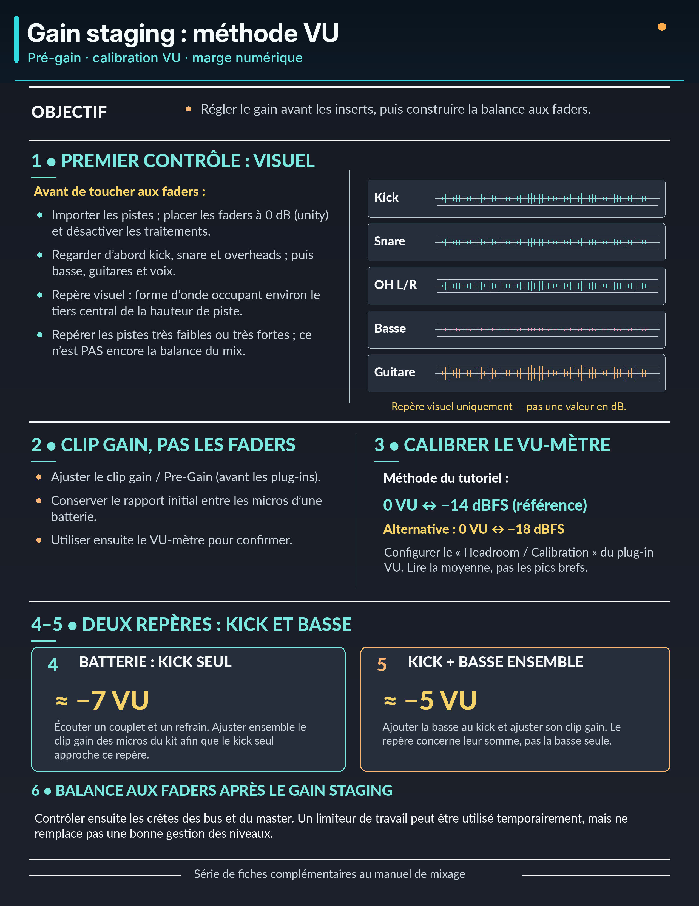

Objectif : garder les niveaux sous contrôle de l'entrée jusqu'au bus de mix.

1. **Niveau d'entrée raisonnable (une piste à la fois).** Ne cherchez pas le niveau le plus élevé possible. Contrôlez le niveau **pré-fader** de chaque piste sur un passage représentatif, puis le bus avec l’ensemble des pistes actives. Dans certaines chaînes analogiques modélisées, une moyenne voisine de **−18 [dBFS RMS](#glossaire-dbfs-rms)** ou un repère **0 [VU](#glossaire-vu) = −18 dBFS** est utile *si le vumètre ou le plugin est calibré ainsi* ; **−10 à −6 dBFS en crête** est un exemple possible, pas un objectif obligatoire (voir [§ 1.2](#sec-1-2)).
2. **Laissez de la marge (headroom).** Elle donne de l'espace au signal avant l'écrêtage numérique. Le traitement interne en *[floating point](#glossaire-floating-point)* de nombreux DAW offre une marge importante, mais les plugins non linéaires et les sorties ont leurs propres limites de niveau.
3. **Le traitement change le niveau.** EQ, compresseur et saturation peuvent monter ou baisser le volume. Surveillez la **sortie**, pas seulement l'entrée.
4. **Compensez à chaque étage.** Si un traitement ajoute du niveau, baissez le gain de sortie ou le [trim](#glossaire-trim). Ne laissez pas le « plus fort » décider si le traitement sonne mieux.
5. **Vérifiez toute la chaîne.** Entrée, EQ, compresseur, saturation, autres traitements, bus de mix. Cycle : traiter, vérifier, compenser, continuer.

Mot d'ordre : *headroom d'abord, volume en dernier.*

**Précisions tirées de sources reconnues.** Les repères varient selon l'étape du travail :

- **À l'enregistrement** : la fiche vise une moyenne autour de -18 dBFS et des crêtes de −10 à −6 dBFS.
- **En mixage de pistes déjà enregistrées** : le gain d'événement ([clip gain](#glossaire-clip-gain)) ou le trim permet d'alimenter les plugins à un niveau prévisible. Il ne faut pas confondre **[LUFS](#glossaire-lufs) intégré du mix** (mesure perceptive du programme) avec **dBFS RMS d'une piste** (mesure d'amplitude) ni les rendre interchangeables.
- **Pistes individuelles** : MasteringBOX cite des crêtes bien sous 0 dBFS, souvent entre -12 et -18 dBFS, et un guide de workflow mentionne −18 à −12 dBFS pour certaines pistes ; ce n'est pas une mesure de la marge du bus principal.

Ces chiffres proviennent de méthodes et de mesureurs différents ; **ils ne sont pas directement interchangeables**. Retenez l'objectif : conserver de la marge aux endroits qui en ont besoin, ne pas saturer les convertisseurs ni les plugins non linéaires, et travailler à un niveau répétable.

### 1.1 Deux approches de gain staging présentées dans des tutoriels

> **Termes et concepts essentiels —** **[VU](#glossaire-vu) :** Volume Unit, graduation d’un VU-mètre · **[gain staging](#glossaire-gain-staging) :** gestion des niveaux à chaque étage du signal · **[fader VCA](#glossaire-fader-vca) :** commande collective des faders, sans sommation audio · **[bus de groupe](#glossaire-bus-de-groupe) :** canal qui reçoit plusieurs pistes et permet de les traiter ensemble

Deux tutoriels d’ingénieurs du son proposent des méthodes différentes pour régler les niveaux **avant de construire la balance initiale du mix**. Il s’agit de repères de travail, et non de deux normes à appliquer simultanément. Choisissez les éléments pertinents pour votre session et conservez une méthode cohérente.

**Pourquoi le faire malgré la marge interne des DAW.** Dans un DAW utilisant une architecture de mixage en *[floating point](#glossaire-floating-point)* (32 ou 64 bits), un niveau interne peut dépasser 0 dBFS sans écrêtage immédiat du calcul ; les plugins non linéaires, les conversions vers un format PCM entier, les convertisseurs et les fichiers exportés restent soumis à leurs propres limites. Les sorties de bus doivent donc être vérifiées selon le routage réel. Effets possibles : distorsion subtile, attaques atténuées, accumulation de bas-médiums, mix sans relief. Signe d'alerte : des faders loin sous le zéro (vers -25 ou -30 dB). L'autre raison avancée est d'avoir une base répétable, session après session.

| Repère         | Méthode VU (« Eliminate Gain Staging Guesswork »)                                                                                                                                | Méthode −18 dBFS (« Gain Staging is IMPORTANT! »)                                                                                                                                                                                                                                                                                                                                     |
| -------------- | -------------------------------------------------------------------------------------------------------------------------------------------------------------------------------- | ------------------------------------------------------------------------------------------------------------------------------------------------------------------------------------------------------------------------------------------------------------------------------------------------------------------------------------------------------------------------------------- |
| Référence      | VU-mètre calibré pour que 0 VU corresponde à -14 dBFS (marge de 14 dB). Avec -18 dBFS : mêmes chiffres, mix environ 4 dB plus bas                                                | -18 dBFS = zéro analogique (0 VU), partout : DAW, matériel, console                                                                                                                                                                                                                                                                                                                   |
| Mesure         | Niveau moyen au VU-mètre, plus contrôle visuel des formes d'onde : viser le tiers central de la hauteur de piste                                                                 | Crêtes pour les sources à attaques très brèves, niveau moyen ([RMS](#glossaire-rms)) pour les sources soutenues                                                                                                                                                                                                                                                                       |
| Batterie       | Groupe batterie traité d'un bloc (le rapport entre pistes est préservé) ; kick autour de -7 VU                                                                                   | Kick, caisse claire, toms, [overheads](#glossaire-overheads), micros du kit : crêtes d'environ -6 dBFS ; charleston environ -10 dBFS                                                                                                                                                                                                                                                  |
| Basse          | Kick seul à -7 VU ; kick et basse ensemble vers -5                                                                                                                               | Environ -18 RMS ; sources riches en graves (comme un orgue) acceptables à -20 ou -25 RMS                                                                                                                                                                                                                                                                                              |
| Autres sources | Contrôle visuel, tiers central                                                                                                                                                   | Voix, guitares, claviers, cuivres : environ -18 RMS                                                                                                                                                                                                                                                                                                                                   |
| Bus principal  | Limiteur transparent de crête en fin de bus ; lecture de départ environ -13 à -14 [LUFS](#glossaire-lufs), mix final vers -12 LUFS (exemple de tutoriel, non objectif universel) | Autour du zéro analogique (-18 RMS), légèrement au-dessus pour un peu de saturation ; crêtes vers -3 à -2 dBFS                                                                                                                                                                                                                                                                        |
| Sous-groupes   | Non traités                                                                                                                                                                      | **Bus de groupe audio** plutôt que simple **[fader VCA](#glossaire-fader-vca)** si l’objectif est de traiter ensemble plusieurs pistes (EQ, compression, saturation). Dans le tutoriel, réglages initiaux du gabarit : batterie et basse ≈ −3 dB, guitares et claviers ≈ −7 à −6 dB, voix à 0 dB (*unity gain*) ; ces positions de fader ne sont pas des niveaux d’entrée universels. |

### Comprendre la différence entre fader VCA et bus de groupe

Un **[fader VCA](#glossaire-fader-vca)** (*Voltage-Controlled Amplifier*, dénomination héritée des consoles analogiques) permet de **commander simultanément le niveau de plusieurs pistes**, tout en conservant leur routage individuel. Dans un DAW comme Cubase, ce fader de contrôle **n’additionne pas lui-même les signaux audio** : on ne peut donc pas y insérer un compresseur pour traiter le son de tout le groupe. À l’inverse, un **[bus de groupe](#glossaire-bus-de-groupe)** reçoit le son de plusieurs pistes et offre des inserts utilisables pour les traiter ensemble. Attention : le terme « VCA » désigne également une **technologie de compresseur** (voir [compresseur VCA](#glossaire-compresseur-vca)) ; ce n’est pas le même usage. [Documentation Cubase : faders VCA](https://www.steinberg.help/r/cubase-pro/15.0/fr/cubase_nuendo/topics/vca_faders/vca_faders_c.html).

Points communs à retenir :

- **Cette étape fait partie du mixage, mais ce n’est pas encore la balance musicale.** Le *gain staging* règle le niveau envoyé à chaque étage (notamment à l’entrée des plugins) ; l’**équilibrage du mix**, réalisé ensuite avec les faders, détermine les rapports de niveau *entre* les instruments et les pistes. Les deux opérations sont complémentaires.
- **Point de départ :** garder les faders près de 0 dB (unity) pendant le pré-réglage au [trim](#glossaire-trim) facilite les réglages ultérieurs. Ils seront ensuite ajustés librement pour construire la balance ; un fader à −25 dB n'est pas à lui seul une preuve d'erreur technique.
- **Conservez une trace des réglages de gain** (notes de session, préréglage ou version enregistrée du projet). Vous pourrez ainsi rouvrir et reprendre le mix plusieurs années plus tard sans avoir à reconstituer la configuration initiale.
- **Vérifiez les mesureurs** : le temps d'intégration RMS varie selon les outils (500 ms ou 400 ms), ce qui explique des lectures différentes.
- **Domaine** : la méthode VU vise surtout les instruments acoustiques et électriques et les voix ; son auteur renvoie vers des ressources spécialisées pour l'EDM, la dance et le hip-hop.
- Le limiteur de crête du bus est un outil de travail (sans gain, style transparent, *[true peak](#glossaire-true-peak)* désactivé dans ce tutoriel). Ne le laissez pas sur un mix destiné à un ingénieur de mastering (voir [§ 6.11](#sec-6-11)).

Les deux méthodes ne donnent pas les mêmes niveaux : voir Annexe D.

### 1.2 Régler un niveau d’entrée raisonnable, piste par piste — outils et procédure

> **Termes et concepts essentiels —** **[dBFS](#glossaire-dbfs) :** référence numérique de niveau · **[RMS](#glossaire-rms) :** niveau efficace sur une durée donnée · **[peak meter](#glossaire-peak-meter) :** mesureur de crêtes · **[trim](#glossaire-trim) :** réglage du gain à un endroit défini de la chaîne · **[headroom](#glossaire-headroom) :** marge avant la limite de l’étage

Contrôlez d’abord **chaque piste individuellement**, puis les **bus de groupe** et le **bus principal** avec toutes les pistes actives. Les vumètres sont des outils de mesure du niveau : ils ne permettent pas, à eux seuls, de juger la qualité du mix.

#### Outils à utiliser pour cette étape

| Besoin                                               | Outil conseillé                                                                          | Utilisation concrète                                                                                                                                                                                                        |
| ---------------------------------------------------- | ---------------------------------------------------------------------------------------- | --------------------------------------------------------------------------------------------------------------------------------------------------------------------------------------------------------------------------- |
| **Vérifier une prise en cours d’enregistrement**     | Vumètre d’entrée de **l’interface audio**, puis vumètre d’entrée du DAW                  | Régler le **gain du préampli** ou le niveau de la source avant de lancer la prise. Un réglage logiciel après conversion ne répare pas une prise déjà écrêtée.                                                               |
| **Voir les crêtes d’une piste déjà enregistrée**     | **Peak meter** de la piste, réglé sur **Input** ou à un emplacement connu dans la chaîne | Lire les crêtes en dBFS pendant la lecture ; vérifier la position de mesure (*Input*, *pre-fader* ou *post-fader*).                                                                                                         |
| **Ajuster ce qui arrive aux plugins**                | **Gain d’événement** (*clip gain*) et/ou **Pre-Gain / Trim**                             | Dans Cubase, le contrôle **Pre-Gain** de la section **Pre** de la MixConsole agit avant l’EQ et les inserts. Pour une correction localisée sur un événement audio, utiliser sa poignée de volume.                           |
| **Mesurer la moyenne et la crête à un point précis** | **SuperVision** (Cubase Pro), ou un **peak/RMS meter** équivalent                        | Ajouter le mesureur **en premier insert** pour examiner le signal après les réglages d’entrée et avant les autres inserts ; sélectionner les modules **Level** ou **VU** et consulter les valeurs *Peak Max.* / *RMS Max.*. |
| **Vérifier les effets du regroupement**              | Mesureur du **bus de groupe** et du **bus principal**                                    | Lire les crêtes avec **toutes les pistes en lecture**, pas uniquement en solo.                                                                                                                                              |

**Dans Cubase Pro :** ouvrez la MixConsole, puis le menu **Paramètres globaux des vumètres → Position du vumètre → Entrée (Input)** pour surveiller un niveau d’entrée de voie. Dans les **voies audio**, la position « Input » mesure le signal **après le réglage du gain d’entrée (Pre-Gain)** ; dans une **voie d’entrée de l’interface**, elle sert à surveiller le signal entrant avant les traitements internes de la voie. Les deux cas ne désignent pas le même endroit du parcours du signal. Pour connaître précisément le niveau qui entre dans une chaîne de plugins, placez **SuperVision** en tête des inserts et comparez ensuite le niveau à la sortie des traitements. N’utilisez pas le *loudness meter* en LUFS pour régler systématiquement chaque piste : sa fonction principale est l’analyse du programme musical dans son ensemble. Voir la [documentation Steinberg : position des vumètres](https://www.steinberg.help/r/cubase-pro/15.0/fr/cubase_nuendo/topics/mixconsole/mixconsole_channel_meter_options_r.html), [Pre-Gain](https://www.steinberg.help/r/cubase-pro/15.0/en/cubase_nuendo/topics/mixconsole/mixconsole_making_input_gain_settings_t.html), [SuperVision](https://www.steinberg.help/r/cubase-pro/cubaseplugref/15.0/fr/_shared/topics/plug_ref/supervision/supervision_modules_signal_category_r.html).

#### Procédure de réglage

1. **Déterminez où mesurer le niveau et où agir sur le gain.** À l’enregistrement, surveillez l’entrée de l’interface audio et réglez le gain du préampli **avant la conversion A/N**. En mixage, repérez le parcours du signal : fichier audio ou instrument virtuel → gain d’événement / **Pre-Gain (trim)** → inserts → fader → bus de groupe → bus principal. Placez le mesureur à l’endroit correspondant au niveau que vous souhaitez corriger ; un vumètre de sortie ne remplace pas un contrôle à l’entrée du premier plugin.
2. **Lisez le niveau sur des passages pertinents.** Écoutez la piste seule pendant quelques mesures représentatives, puis rejouez son passage le plus fort. Réinitialisez la mémorisation des crêtes (*peak hold*) si votre mesureur en dispose. Ne vous fiez pas à un passage inhabituellement calme.
3. **Choisissez le mesureur correspondant à votre question.** Le **[peak meter](#glossaire-peak-meter)** indique les crêtes et le risque d’écrêtage ; le **[RMS meter](#glossaire-rms-meter)** renseigne sur le niveau efficace sur une fenêtre temporelle donnée ; le **[VU-mètre](#glossaire-vu-metre)** offre un repère lent à condition de connaître sa calibration. La hauteur visuelle de la forme d’onde ne constitue pas une mesure RMS fiable.
4. **Ajustez avec trim/clip gain si nécessaire**, pas en visant aveuglément un chiffre. Dans une session de musique enregistrée : commencez par laisser les crêtes des pistes fortes nettement sous 0 dBFS ; des valeurs autour de **−18 à −10 dBFS crête** sont un **point de départ possible** pour des sources dynamiques non traitées. Des sources très transitoires peuvent dépasser ce repère sans erreur ; des pads ou longues notes peuvent afficher des crêtes différentes.
5. **Si le plugin émule du matériel analogique**, consultez sa documentation : la référence d'entrée peut être **0 VU = −18 dBFS** (si l’étalonnage du mesureur est configuré ainsi) (ou −14, ou une autre valeur). Cette référence n'impose **ni** −18 dBFS crête **ni** −18 [LUFS](#glossaire-lufs) sur toutes les pistes. Baissez/montez le trim pour obtenir le caractère voulu.
6. **Compensez les inserts** : comparez traité/non traité à niveau proche, écoutez les saturations involontaires et surveillez les crêtes de sortie.
7. **Passez ensuite à la balance** au fader, puis inspectez **les sous-groupes et le mix bus** avec toutes les pistes actives. La sommation peut produire des crêtes bien plus hautes que chaque piste prise séparément.
8. **Consignez votre repère** : type de mesure, endroit de mesure, calibration éventuelle du VU, et nombre de dB de marge réellement disponible.

| Situation                          | Observer d'abord                                        | Ne pas confondre avec                                  |
| ---------------------------------- | ------------------------------------------------------- | ------------------------------------------------------ |
| Prise de son vers le convertisseur | crêtes d'échantillons **avant** écrêtage A/N            | niveau du fader, LUFS du morceau                       |
| Fichier déjà enregistré            | crêtes + RMS/forme d'onde au **gain de clip/trim**      | niveau moyen du programme entier                       |
| Plug-in de console / saturation    | entrée et sortie du plug-in, niveau calibré s'il existe | « 0 VU » universel pour tous les produits              |
| Groupe et bus principal            | crête et niveau moyen avec **toutes** les pistes        | somme des valeurs de crête des pistes prises isolément |

**Notes de masterclass — « rough mix : viser −10 dB, puis −6 dB à la fin ».** Les notes ne précisent ni **où** ni **comment** ces niveaux sont mesurés : crêtes du bus stéréo, crêtes des pistes ou position des faders. On ne peut donc pas en faire une règle. Si l'intention est de conserver de la marge au bus, **−10 dBFS crête au départ et environ −6 dBFS crête à une étape ultérieure** peuvent servir de repères de confort sur **un bus sans maximiseur actif**, mais le mix n'a pas à « monter » vers ces valeurs et le niveau final n'est pas une preuve de qualité. **À confirmer avec les notes ou l'enregistrement du masterclass.**

**Validation externe :** [Sound On Sound, *Gain Staging In Your DAW Software*](https://www.soundonsound.com/techniques/gain-staging-your-daw-software) ; [Waves, présentation de NLS](https://www.waves.com/console-mixing-in-the-box-with-nls).

### 1.3 Exemple concret de vérification à l'écran

> **Termes et concepts essentiels —** **[bus](#glossaire-bus) :** canal de sommation recevant plusieurs pistes · **[fader](#glossaire-fader) :** curseur de niveau d’une piste ou d’un bus · **[trim](#glossaire-trim) :** réglage de gain à un point de la chaîne, souvent avant les traitements

**Exemple fictif — batterie :** kick seul, [peak meter](#glossaire-peak-meter) pré-fader ; activer ensuite caisse claire, [overheads](#glossaire-overheads) et micros d'ambiance ; regarder la **sortie du bus batterie**. Un pic supplémentaire sur le bus ne signifie pas que chacune des prises est trop forte. Régler le **trim avant traitement** pour un plugin qui reçoit trop d'énergie, puis régler le **fader** pour la balance musicale.

**Contrôle à effectuer :** observez les crêtes de chaque piste individuellement, puis mesurez la sortie du bus batterie avec les pistes réunies. Vérifiez aussi le niveau du bus principal. Les mesures doivent être prises à des emplacements connus et comparables.

Le compteur du plugin peut indiquer des valeurs différentes du compteur de la piste selon l'ordre des inserts, la calibration et les niveaux pré/post-fader. **Évitez de comparer des chiffres lus à des endroits différents comme s'il s'agissait d'une seule mesure.**

## Étape 2 : Balance de base aux faders

> **Termes et concepts essentiels —** **[rough mix](#glossaire-rough-mix) :** première balance musicale, généralement réalisée avant la majorité des traitements · **[balance](#glossaire-balance) :** rapport audible des niveaux des différentes pistes ou instruments · **[fader](#glossaire-fader) :** curseur de niveau d’une piste ou d’un bus

Avant tout traitement, construisez la balance avec les faders seulement.

1. **Baissez le volume** des moniteurs (assez bas pour parler par-dessus) pendant environ 60 secondes.
2. **Écoutez ce qui tient** : la voix reste-t-elle devant ? L'impact de la batterie ? L'équilibre de la basse ? Les graves s'effacent à bas volume, c'est normal. Notez ce qui disparaît.
3. **Corrigez avec les faders d'abord, pas d'EQ.** Réglez les rapports de niveau avant de chercher un traitement.
4. **Jugez la basse à volume normal**, pas à bas volume.
5. **Revérifiez en boucle** : écoute basse, ajustement des faders, écoute au niveau de référence, et ainsi de suite.
6. **Vérifiez au casque aussi** et faites des pauses quand les oreilles fatiguent.

Si la voix est trop basse, la basse trop forte ou la batterie cachée, le problème se règle ici, pas au mastering.

#### Fiche 4 — Construire une balance aux faders

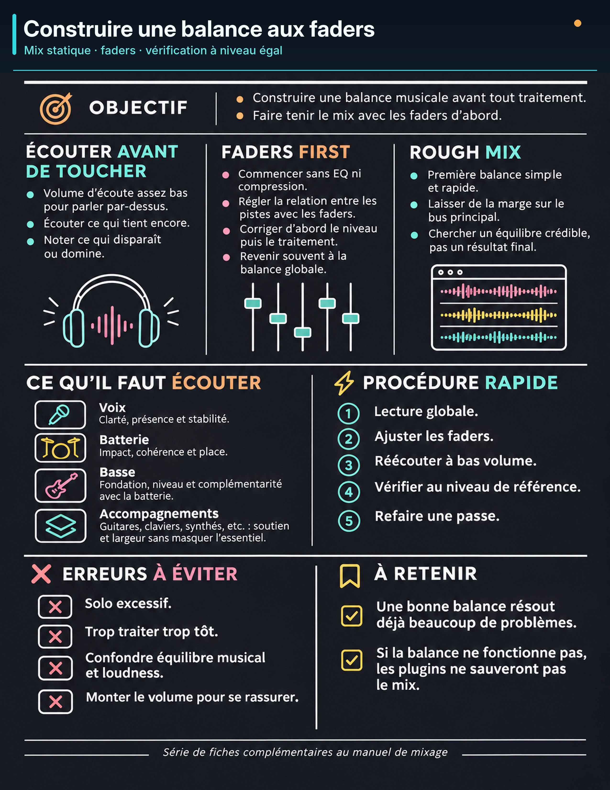

### 2.1 Écouter avant de toucher

> **Termes et concepts essentiels —** **[balance](#glossaire-balance) :** rapport audible des niveaux des différentes pistes ou instruments · **[A/B](#glossaire-a-b) :** comparaison entre deux traitements, idéalement à niveau perçu égal

Plusieurs tutoriels insistent sur la même habitude :

- **Écoutez quelques secondes de la piste brute** avant de la modifier. Sans « avant » en tête, on ne sait ni quand s'arrêter ni si le changement a aidé.
- **Fiez-vous à la première impression** au stade du mix statique (niveaux, panoramique, avant tout traitement), quand vous mettez une piste en solo ou dans la balance pour la première fois.
- **Surveillez les réactions du corps** (froncer les sourcils, plisser le nez, grimacer) : elles signalent souvent une zone problématique avant que l'esprit n'ait nommé le problème.
- **Contournez toute la chaîne d'une piste** quand le mix devient confus, puis réécoutez la source dans le contexte de la chanson : elle a souvent besoin de beaucoup moins qu'on ne pense.
- **Montez le fader avant de toucher à l'EQ** quand une piste paraît mince : à bas volume, l'oreille entend moins de graves et d'aigus.

### 2.2 Auditionner un groupe de pistes : l'exemple des micros d'ambiance

> **Termes et concepts essentiels —** **[micro d’ambiance](#glossaire-micro-d-ambiance) :** micro captant le son indirect et le caractère acoustique d’un lieu · **[comb filtering](#glossaire-comb-filtering) :** alternance de renforcements et d’annulations spectrales causée par des signaux corrélés décalés

Un tutoriel traite un mix avec six paires de micros d'ambiance. La méthode vaut pour tout groupe de pistes :

1. **Auditionner chaque piste isolément**, en écoutant ce qui pourrait poser problème plus tard ([phase](#glossaire-phase), creux sur le kick), pas seulement ce qui est séduisant.
2. **Catégoriser** : proche, lointaine, avec du caractère, effet spécial. Sachez ce que chacune apporte.
3. **Écarter tôt les pistes problématiques** (phase douteuse, brouillage) : désactivez-les et gardez-les en tête, par exemple pour changer l'énergie d'un refrain plus tard.
4. **Faire un mini-mix** : mélangez les pistes du groupe entre elles, puis envoyez-les à un bus avant de les ajouter au mix complet.
5. **Commencer sur une section clairsemée** (un couplet) pour entendre ce que fait le groupe, puis vérifier dans le refrain.

Remarques du tutoriel : il n'est pas obligatoire de tout utiliser ; une ambiance stéréo décalée peut être passée en mono ; avec assez de micros d'ambiance, une réverbération de salle devient inutile (il peut rester celle de la caisse claire et des toms) ; vérifiez ensuite avec la basse et les guitares.

### 2.3 Le *rough mix* et les repères de marge

> **Termes et concepts essentiels —** **[rough mix](#glossaire-rough-mix) :** première balance musicale, généralement réalisée avant la majorité des traitements · **[fader](#glossaire-fader) :** curseur de niveau d’une piste ou d’un bus · **[headroom](#glossaire-headroom) :** marge disponible entre niveau courant et plafond de l’étage considéré

Préparer d'abord une **balance de faders initiale** qui raconte déjà la chanson, avant le traitement détaillé. Faire jouer au moins un couplet et un refrain ; déplacer les faders des éléments importants jusqu'à ce que la voix, le groove et le point focal soient lisibles. Le mix statique est une **décision relative** : les faders n'ont pas à rester près de zéro une fois la balance commencée.

**Repères −10 dB et −6 dB des notes :** voir **1.2**. Tant que la référence de mesure n'est pas confirmée, ces nombres sont non transformés en objectif obligatoire.

## Étape 3 : Panoramique et largeur

> **Termes et concepts essentiels —** **[panoramique](#glossaire-panoramique) :** placement d’un son dans le champ gauche-droite · **[pan law](#glossaire-pan-law) :** règle de gain appliquée lors du déplacement d’une source entre gauche et droite · **[stéréo](#glossaire-stereo) :** reproduction à deux canaux pouvant créer largeur et localisation
> 

#### Fiche 5 — Panoramique et largeur stéréo

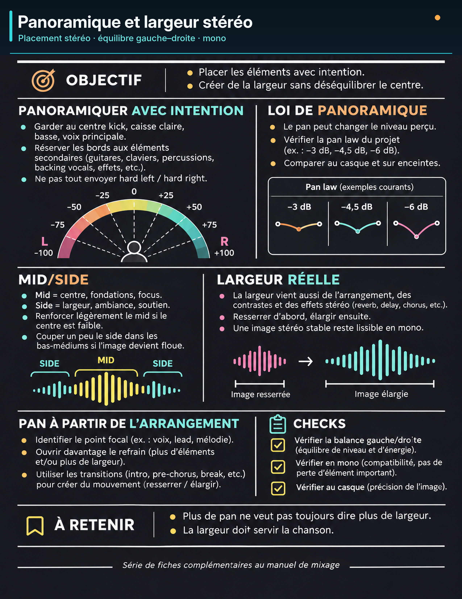

### 3.1 Panoramiquer avec intention

> **Termes et concepts essentiels —** **[panoramique](#glossaire-panoramique) :** placement d’un son dans le champ gauche-droite · **[stéréo](#glossaire-stereo) :** reproduction à deux canaux pouvant créer largeur et localisation

- Un panoramique **modéré** place un son tout en le laissant alimenter les deux canaux.
- Une fois le son isolé d'un côté, pousser davantage n'ajoute **aucune séparation utile**.
- Les placements extrêmes donnent un mix déséquilibré, surtout au casque.
- Placez chaque élément là où il sert l'arrangement, pas au bord par défaut.
- Pour une vraie largeur : parties complémentaires, sources stéréo ou traitement stéréo, pas plus de panoramique.

### 3.2 Comprendre la loi de panoramique

> **Termes et concepts essentiels —** **[pan law](#glossaire-pan-law) :** règle de gain appliquée lors du déplacement d’une source entre gauche et droite · **[mono](#glossaire-mono) :** somme ou lecture sur un seul canal plutôt que deux canaux séparés

La loi de panoramique atténue le centre pour que le niveau perçu reste stable quand on déplace un son.

| Valeur  | Effet                                      |
| ------- | ------------------------------------------ |
| 0 dB    | Pas d'atténuation au centre                |
| -3 dB   | Garde la puissance constante en stéréo     |
| -4,5 dB | Compromis entre les deux                   |
| -6 dB   | Garde le niveau constant en sommation mono |

Aucune valeur n'est idéale pour tous les mix. Avant de compenser un niveau :

- Vérifiez le réglage de la loi dans la session.
- Revérifiez la balance après l'avoir changée ou après de gros mouvements de panoramique.
- Si vous déplacez une session entre deux installations, confirmez que les lois correspondent.
- Voix, kick, caisse claire ou basse centrés qui sonnent trop faible : considérez la loi de panoramique comme une cause possible avant de toucher au niveau ou au traitement.

### 3.3 Mid/side : renforcer un centre faible

> **Termes et concepts essentiels —** **[mid/side](#glossaire-mid-side) :** représentation stéréo en composante commune M et différence S · **[mono](#glossaire-mono) :** somme ou lecture sur un seul canal plutôt que deux canaux séparés

Le mid/side sépare le centre (mid = gauche + droite) des côtés (side = gauche − droite). Il sert quand la voix, la caisse claire ou la basse manquent de présence au centre. On l'utilise avec un plugin M/S, souvent sur le bus principal.

1. **Diagnostiquer.** Écoutez le mid seul : qu'est-ce qui paraît faible ou mince ? Puis le side seul : y a-t-il du contenu stéréo trop fort ou trop large ?
2. **Ajuster par petits gestes.** Ce sont des points de départ, pas des réglages fixes.

| Geste            | Repère de départ              |
| ---------------- | ----------------------------- |
| Renforcer le mid | +1 à 2 dB entre 1 et 3 kHz    |
| Couper le side   | -1 à 2 dB entre 200 et 500 Hz |
| Comprimer le mid | 2:1, 1 à 2 dB de réduction    |

3. **Vérifier.** En mono, le side s'annule : l'EQ du side ne change donc pas la somme mono. Écoutez équilibre, niveau et clarté. Comparez avec une référence comme guide, sans copier ses réglages.
4. **S'arrêter** dès que le centre est équilibré et que les côtés soutiennent le mix.

Ce geste complète la règle « resserrer d'abord, élargir ensuite » (9.1).

### 3.4 Panoramiquer à partir de l'arrangement

> **Termes et concepts essentiels —** **[panoramique](#glossaire-panoramique) :** placement d’un son dans le champ gauche-droite · **[automation](#glossaire-automation) :** variation enregistrée de paramètres (volume, panorama, envoi, EQ) dans le temps

Avant d'utiliser un élargisseur, « interrogez l'arrangement » (tutoriel « 5 signes que votre mix est ennuyeux ») :

1. **Gardez les fondations mono au centre** : kick, caisse claire, basse, voix.
2. **Réservez les bords à une ou deux choses**, puis placez le reste entre le centre et les bords, plutôt que tout à gauche ou à droite.
3. **Distinguez les parties constantes** (guitares qui jouent tout le morceau) **des parties de soutien** (ornements, claviers qui n'entrent qu'au refrain), puis créez un jeu gauche-droite entre elles (une guitare à gauche, des claviers à droite).
4. **Profitez des transitions** : l'oreille capte le changement. Déplacer le point focal entre couplet et refrain (par exemple les claviers vers la droite au refrain) donne un moment de différence.
5. **Demandez-vous** : quel est le point focal à cet instant ? Que puis-je écarter vers les côtés, ou ramener vers le centre, pour séparer les éléments ?

Cela prolonge 3.1 et la règle « resserrer d'abord, élargir ensuite » (9.1).

## Étape 4 : Verrouiller la section rythmique (kick et basse)

> **Termes et concepts essentiels —** **[DI](#glossaire-di) :** boîte ou prise directe qui capte un instrument sans microphone d’amplificateur · **[transitoire](#glossaire-transitoire) :** événement très bref à l’attaque d’un son (coup de caisse claire, consonne) · **[sidechain](#glossaire-sidechain) :** signal de détection qui commande un processeur, parfois venu d’une autre piste
> 

#### Fiche 6 — Kick et basse : principes et paramètres

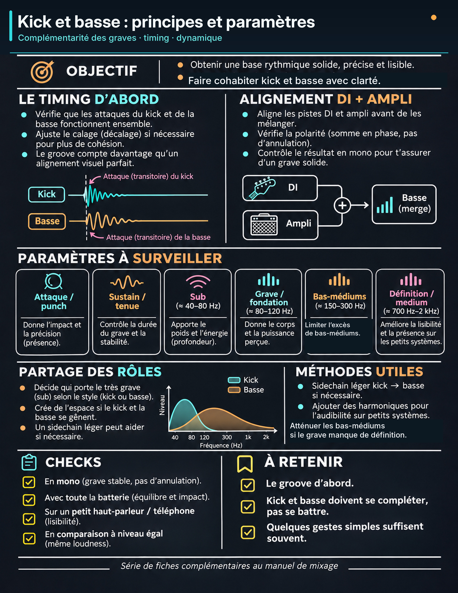

#### Fiche 7 — Kick et basse : outils et traitements

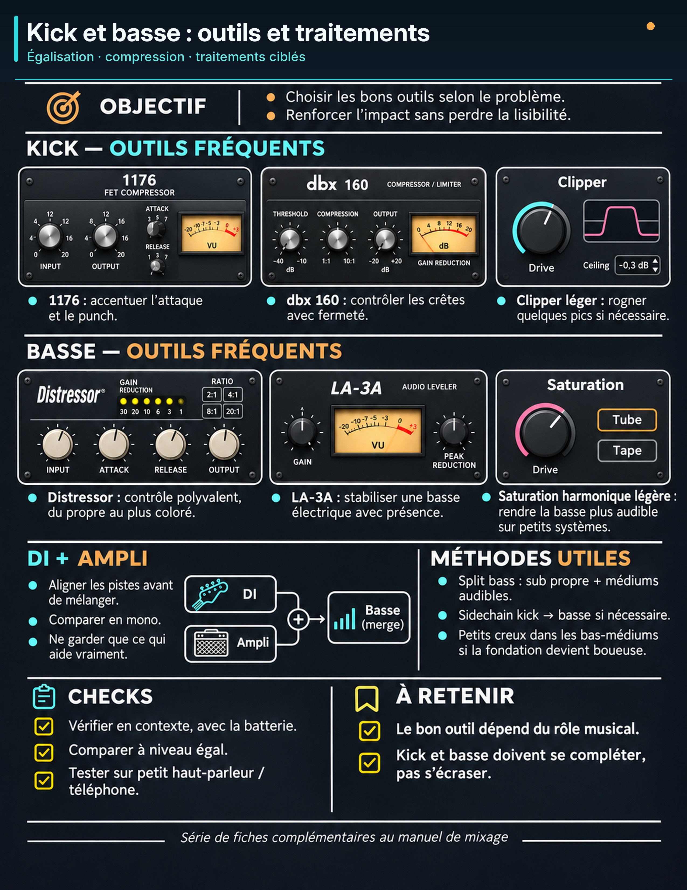

### 4.1 Le timing d'abord

> **Termes et concepts essentiels —** **[transitoire](#glossaire-transitoire) :** événement très bref à l’attaque d’un son (coup de caisse claire, consonne) · **[sidechain](#glossaire-sidechain) :** signal de détection qui commande un processeur, parfois venu d’une autre piste

Si la note de basse tombe légèrement à côté du kick ou déborde sur son attaque, le bas du spectre devient flou et perd de l'impact. Un bon timing réduit le traitement nécessaire.

Deux approches valables, à condition d'être cohérent :

- **Ensemble** : certaines attaques de basse coïncident musicalement avec le kick, selon l'intention rythmique.
- **Dans les trous** : les notes de basse se placent entre les kicks.

La forme d'onde peut aider à repérer un retard accidentel, mais **deux crêtes qui se chevauchent ne constituent pas en soi une erreur**. Écoutez le groove avant d'éditer le placement temporel. Décidez par section (couplet serré, refrain plus grand, pont plus aéré). Motifs courants : quatre temps au sol, basse à contretemps, demi-temps.

Le traitement vient ensuite : sidechain (le kick déclenche une petite réduction de gain sur la basse) ou EQ qui creuse un peu d'espace autour du kick, seulement si nécessaire.

#### Fiche 8 — Basse : DI, compression et harmoniques

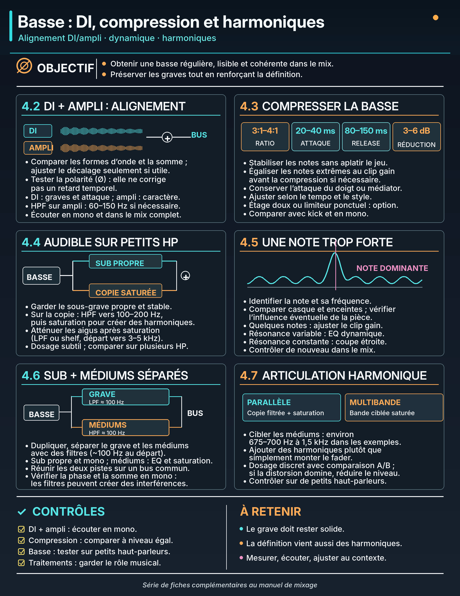

### 4.2 Basse en DI + ampli : aligner avant de mélanger

> **Termes et concepts essentiels —** **[DI](#glossaire-di) :** boîte ou prise directe qui capte un instrument sans microphone d’amplificateur · **[latence](#glossaire-latence) :** retard introduit par l’acquisition, le routage ou certains traitements · **[polarité](#glossaire-polarite) :** orientation positive/négative d’un signal ; inverser la polarité n’est pas décaler le temps

Le signal DI et le micro d'ampli peuvent être décalés (distance acoustique, latence de réamplification, traitement) ; **le sens et l'ampleur du décalage doivent être mesurés**, pas supposés. Mélangés sans alignement, les deux signaux se déphasent et le grave s'amincit.

1. Comparez les formes d'onde des prises corrélées et écoutez leur somme ; si besoin, ajustez **le décalage relatif** dans le sens approprié ou utilisez un outil d'alignement. Vérifiez que cela améliore le son **sans altérer le timing musical**.
2. **Comparez les deux polarités** (bouton Ø : inversion de polarité de 180°) et retenez la combinaison qui sert le son recherché. Attention : ce bouton ne réaligne pas les arrivées dans le temps ; une somme plus forte n'est pas le seul critère de qualité.
3. **Répartissez les rôles** : DI pour les graves, l'attaque et la définition ; ampli pour les médiums, les harmoniques et le caractère.
4. **Filtrez l'ampli** avec un passe-haut (environ 60 à 100 Hz pour un son propre ou moderne, 80 à 150 Hz pour un son sale ou vintage) si le grave devient confus, manque de définition.
5. **Écoutez en mono** et dans le mix complet.

#### Choisir un processeur pour la basse et le kick

- **dbx 160 (modèle/émulation)** : compresseur pour modérer les pointes du kick ; également proposé sur une basse ou une piste parallèle. *CHEAT Sheets_v2*, p. 17 ; *CHEAT Sheets_v1*, p. 16–19.
- **LA-2A (opto)** : lissage plus progressif des notes de basse et des claviers, si une dynamique plus stable est recherchée. *CHEAT Sheets_v2*, p. 17.
- **1176 (FET)** : réaction rapide utile sur une basse à attaques irrégulières ou sur une caisse claire ; contrôler la disparition éventuelle du transitoire. *CHEAT Sheets_v1*, p. 22, 24–25 ; *v2*, p. 13 et 17.
- **EQ dynamique** : ne corriger une note ou une fréquence gênante que lorsqu’elle dépasse le seuil.
- **Split bass (deux pistes, grave et médiums)** : permet de saturer/comprimer les médiums sans modifier autant le grave ; tenir compte des filtres et des interactions de phase. *CHEAT Sheets_v2*, p. 1–2.

Ces exemples sont des **choix de caractère et de contrôle**, pas des équipements obligatoires.

### 4.3 Compresser la basse

> **Termes et concepts essentiels —** **[ratio](#glossaire-ratio) :** rapport de compression entre changement de niveau en entrée et en sortie au-dessus du seuil · **[release](#glossaire-release) :** relâchement : retour du compresseur vers un gain non réduit après l’événement · **[RMS](#glossaire-rms) :** root mean square, mesure énergétique moyenne d’un signal sur une fenêtre définie

Objectif : que chaque note soit audible, sans aplatir le jeu.

- **Préparation** : égalisez les notes extrêmes au gain de clip ([clip gain](#glossaire-clip-gain)) ou par automation avant de compresser.
- **Ratio** 3:1 à 4:1, **attaque** lente (20 à 40 ms) pour laisser passer l'attaque du doigt ou du médiator, **relâchement** 80 à 150 ms, calé sur le tempo et la durée des notes.
- Visez **3 à 6 dB de réduction de gain** sur les notes fortes.
- **Deuxième plugin en chaîne optionnel** : un second compresseur plus doux (par exemple 2:1) ou un limiteur pour les pics occasionnels.
- Vérifiez avec le kick et en mono.

La compression ne sert pas à aplatir, mais à rendre cohérent.

**Autre jeu de repères (fiche sur la compression de basse).** Cette fiche propose des valeurs plus élevées :

| Source                             | Ratio      | Réduction | Attaque    | Relâchement |
| ---------------------------------- | ---------- | --------- | ---------- | ----------- |
| Basse [DI](#glossaire-di) (propre) | 2:1 à 10:1 | 6 à 10 dB | 10 à 30 ms | 30 à 100 ms |
| Basse ampli (avec grain)           | 2:1 à 6:1  | 2 à 6 dB  | 5 à 30 ms  | 30 à 100 ms |
| Basse synthé (808, sub)            | 4:1 à 10:1 | 6 à 10 dB | 10 à 30 ms | 30 à 100 ms |

Par genre (points de départ) :

| Genre          | Ratio      | Réduction | Attaque    | Relâchement |
| -------------- | ---------- | --------- | ---------- | ----------- |
| Hip-hop / trap | 4:1 à 8:1  | 6 à 10 dB | 10 à 20 ms | 50 à 100 ms |
| House / EDM    | 4:1 à 10:1 | 6 à 10 dB | 10 à 30 ms | 50 à 100 ms |
| Pop / R&B      | 2:1 à 6:1  | 3 à 6 dB  | 15 à 30 ms | 50 à 100 ms |
| Rock / live    | 2:1 à 4:1  | 3 à 6 dB  | 10 à 20 ms | 30 à 80 ms  |

Erreurs courantes selon cette fiche : dépasser 10 dB de réduction, utiliser une attaque très rapide (elle peut tuer le punch), laisser les niveaux de basse varier, ne pas compenser le niveau après compression, ignorer l'accumulation de graves avant de comprimer. Elle conseille aussi de couper le grondement avec un EQ avant la compression et de garder le sub (sous environ 80 Hz) constant et en mono.

**Interprétation** : les deux jeux de repères diffèrent par la quantité de réduction. Partez de 3 à 6 dB (4.3) et montez vers 6 à 10 dB seulement si le style (trap, EDM, 808) l'exige.

### 4.4 Rendre la basse audible sur petits haut-parleurs

> **Termes et concepts essentiels —** **[harmoniques](#glossaire-harmoniques) :** composantes de fréquence liées à une fondamentale ; certaines saturations en ajoutent · **[saturation](#glossaire-saturation) :** non-linéarité ajoutant des harmoniques et parfois de la compression modérée

Beaucoup de petits haut-parleurs restituent très peu de sous-graves, mais **la fréquence de coupure varie considérablement selon l'appareil**. La basse est dans le mix, mais on ne l'entend pas. Les harmoniques permettent à l'oreille de reconstituer le fondamental manquant.

1. **Gardez le sub propre.**
2. **Saturez une copie** passée dans un filtre passe-haut vers 100 à 200 Hz, puis mélangez en parallèle (traitement parallèle : bas propre, haut saturé).
3. **Filtrez le « fizz »** après la saturation avec un passe-bas ou un shelf (point de départ 3 à 5 kHz, jusqu'à 5 à 8 kHz pour un filtre plus fort). Ordre de la chaîne : saturer, puis filtrer.
4. **N'en ajoutez pas trop** : écoutez la clarté, pas la distorsion.
5. **Vérifiez** sur petits haut-parleurs et sur un système pleine gamme. S'applique aussi aux 808, basses synthétiques, toms graves et sub de kick.

Objectif : une basse entendue, pas simplement plus forte.

### 4.5 Corriger une note de basse qui ressort

> **Termes et concepts essentiels —** **[EQ dynamique](#glossaire-eq-dynamique) :** égaliseur dont le gain de bande change selon le signal ou un déclencheur · **[Q](#glossaire-q) :** facteur définissant la largeur relative d’une bande d’égalisation

Souvent une seule note saute : elle tombe sur un mode de la pièce (une onde stationnaire entre les murs) ou le son de la basse résonne lui-même à cette fréquence. Évitez d'égaliser toute la basse pour cela.

1. **Trouver.** Jouez la ligne de basse ou une gamme et repérez la note qui saute. Cherchez le pic dans l'analyseur (exemple de la fiche : autour de 110 Hz pour un La2 ; le vôtre sera différent).
2. **Confirmer.** Comparez au casque et sur d'autres enceintes. Si le phénomène n'existe qu'à une position d'écoute, suspectez d'abord la pièce ; un casque n'a toutefois pas la même réponse que des enceintes et ne constitue pas une mesure acoustique.
3. **Choisir la plus petite correction :**

| Outil                 | Quand                                                              |
| --------------------- | ------------------------------------------------------------------ |
| EQ dynamique          | Un boum qui vient et va : ne coupe que quand la note devient forte |
| Coupe étroite (notch) | Une résonance toujours présente : petite coupe statique            |
| Gain de clip          | Une ou deux notes simplement trop fortes                           |

Comparez ensuite dans le mix complet.

### 4.6 Séparer la basse en deux pistes

> **Termes et concepts essentiels —** **[crossover](#glossaire-crossover) :** filtre de séparation du spectre entre deux bandes de traitement · **[filtre passe-haut](#glossaire-filtre-passe-haut) :** filtre atténuant progressivement les basses fréquences sous une coupure · **[filtre passe-bas](#glossaire-filtre-passe-bas) :** filtre atténuant progressivement les hautes fréquences au-delà d’une coupure

**Précaution technique :** lorsque deux copies sont séparées par filtres passe-bas/passe-haut, utiliser des fréquences de coupure et des pentes compatibles. La recombinaison peut modifier la phase et la réponse près du point de croisement. La simple égalité des fréquences de coupure ne garantit pas une réponse plate : vérifier le résultat en mono et par écoute comparative à niveau égal.

L'idée : une couche sub (le grave) et une couche médiums (le haut de la basse, son caractère). Cela donne un grave plus serré, plus propre et plus contrôlable.

1. **Dupliquer** la piste de basse en deux copies identiques.
2. **Filtrer chaque couche** : passe-bas vers 100 Hz pour le sub, passe-haut vers 100 Hz pour les médiums. Partez de 100 Hz et ajustez à l'oreille.
3. **Grouper** les deux couches sur un bus basse pour un traitement commun (compression de groupe pour renforcer la cohésion sonore - *glue compression*, saturation, compression ou EQ d'ensemble).
4. **Vérifier la [phase](#glossaire-phase)** : sommez en mono ; la basse doit rester pleine et régulière, pas mince ni faible. Des filtres au même point de croisement peuvent déphaser autour de la coupure : le contrôle en mono n'est pas optionnel.
5. **Répartir les rôles** : sub propre (mono, sans effet large), médiums façonnés pour le ton et le caractère (saturation, EQ).

Cette technique prolonge 4.4 (saturer une copie et garder le sub propre).

### 4.7 Donner de l'articulation à la basse par les harmoniques

> **Termes et concepts essentiels —** **[harmoniques](#glossaire-harmoniques) :** composantes de fréquence liées à une fondamentale ; certaines saturations en ajoutent · **[masquage](#glossaire-masquage) :** situation où un son rend perceptuellement plus difficile l’écoute d’un autre

Problème décrit par un tutoriel (« Eliminate Muddy Bass Guitar For Good ») : la basse sonne pleine en solo, mais devient floue ou se perd dès que le kick et les guitares arrivent. Monter ou baisser le fader ne fait que déplacer le problème. L'EQ (coupe vers 250 Hz, passe-haut vers 70 Hz) et une compression optique aident, mais n'ajoutent rien. Ce qui rend une note identifiable, ce sont les harmoniques dans les médiums : on les ajoute par saturation.

|           | Distorsion parallèle                                                                                                                                     | Saturation multibande                                                                                 |
| --------- | -------------------------------------------------------------------------------------------------------------------------------------------------------- | ----------------------------------------------------------------------------------------------------- |
| Principe  | Dupliquer la basse et saturer la copie, passée en passe-bande (environ 675 Hz à 1,5 kHz dans la démonstration)                                           | Saturer une seule bande (environ 700 Hz à 1,5 kHz) sur la piste elle-même, par exemple en mode lampes |
| Avantages | Fader dédié, dosage par section (refrains) ; en filtrant fortement le grave de la copie, on évite les problèmes de [phase](#glossaire-phase) dans le bas | Une seule piste ; on peut automatiser le paramètre pour le même effet                                 |
| Placement | Copie sur sa piste                                                                                                                                       | Après l'EQ, pour profiter d'un boost vers 1,2 kHz qui nourrit la saturation                           |

À retenir :

- La copie peut sembler craquante en solo ; une fois dans le mix, le « croquant » disparaît. Si l'on en entend la distorsion, on a trop poussé.
- **Dosage** : montez la copie jusqu'à entendre à peine une différence, puis faites le **test de coupure** (couper et remettre) pour confirmer. On cherche des notes plus audibles, pas une basse distordue.
- Même principe pour une basse de synthé ou une 808.
- Autre chaîne mentionnée : [compression parallèle](#glossaire-compression-parallele) de basse (dbx 160) suivie d'un EQ de type Pultec avec boost vers 60 Hz et vers 3 kHz (le 3 kHz pour l'articulation, les bruits de doigts). Le tutoriel l'attribue à Joe Ciccarelli.

Pour juger du résultat sur petits haut-parleurs, voir [§ 9.4](#sec-9-4).

## Étape 5 : L'EQ

> **Termes et concepts essentiels —** **[EQ](#glossaire-eq) :** égaliseur modifiant le niveau de différentes bandes de fréquences · **[masquage](#glossaire-masquage) :** situation où un son rend perceptuellement plus difficile l’écoute d’un autre · **[spectre](#glossaire-spectre) :** répartition de l’énergie selon la fréquence
> 

#### Fiche 9 — Égalisation : principes fondamentaux

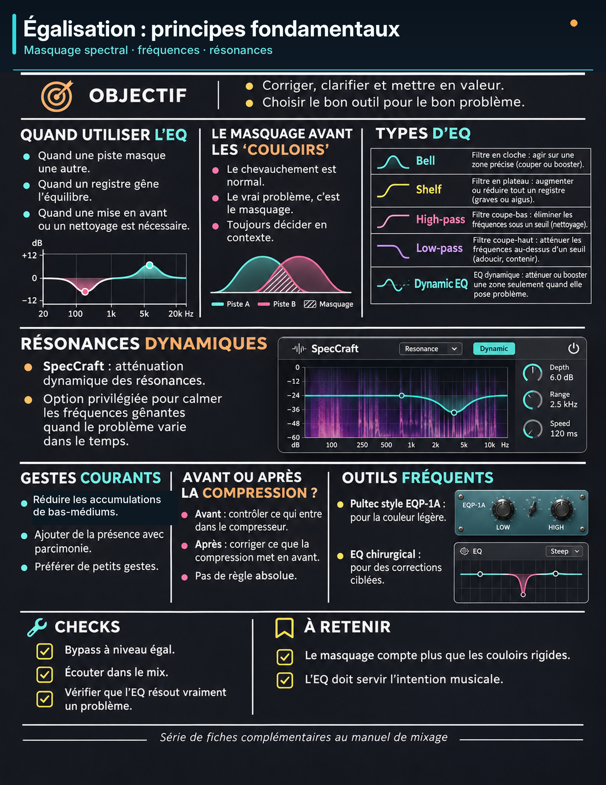

### 5.1 Quand utiliser l'EQ

> **Termes et concepts essentiels —** **[EQ](#glossaire-eq) :** égaliseur modifiant le niveau de différentes bandes de fréquences · **[balance](#glossaire-balance) :** rapport audible des niveaux des différentes pistes ou instruments

L'EQ ne se met pas sur chaque piste par défaut. Suivez le raisonnement :

1. Qu'est-ce que j'entends ?
2. Ai-je une raison de corriger ?
3. Non : laisser tel quel. Oui : donner un rôle à l'EQ.

Trois rôles possibles :

- **Retirer un problème** : résonances agressives ou excessivement prononcées
- **Façonner le ton** : changer le caractère volontairement.
- **Faire de la place** : réduire l'énergie concurrente quand un autre élément en a besoin.

Contrôle du résultat : égaliser le niveau, basculer en bypass, se demander si cela aide. Oui, on garde. Non, on annule.

#### Familles et outils d'EQ dans les fiches originales

- **EQ paramétrique** : corrections ciblées à fréquence, gain et Q réglables.
- **EQ de console (SSL 4000 E, API-style)** : gestes rapides, filtres et bandes au caractère propre à l’émulation ; la tranche de console (*channel strip*) SSL 4000 E rassemble aussi une section dynamique (*CHEAT Sheets_v2*, p. 7).
- **EQ type Pultec (EQP-1A)** : corrections larges du grave et de l’aigu ; la combinaison « boost + attenuation » à fréquence de grave comparable produit une courbe caractéristique. Une absence de réglage actif ne doit pas être présentée comme une coloration universelle : elle dépend de l’émulation.
- **EQ dynamique** : intervient seulement quand une zone spectrale devient problématique.
- **Three-Body Technology SpecCraft** : suppression dynamique automatisée de résonances, notamment voix, cymbales, guitares, sous-groupes ; ajuster depth et les régions d’action, puis comparer en bypass à niveau égal (*CHEAT Sheets_v2*, p. 12). **À distinguer de SpecCraft cité dans les notes** : ce sont deux versions.

**Provenance :** *CHEAT Sheets_v1*, p. 10–12 ; *CHEAT Sheets_v2*, p. 7, 12.

### 5.2 Choisir le bon type d'EQ

> **Termes et concepts essentiels —** **[Q](#glossaire-q) :** facteur définissant la largeur relative d’une bande d’égalisation · **[EQ dynamique](#glossaire-eq-dynamique) :** égaliseur dont le gain de bande change selon le signal ou un déclencheur
> 

#### Fiche 10 — Égalisation : outils et applications

| Type         | Force                    | Quand l'utiliser                                                                    |
| ------------ | ------------------------ | ----------------------------------------------------------------------------------- |
| Paramétrique | Précision et flexibilité | Contrôle détaillé de fréquence, gain et largeur                                     |
| Console      | Ton et caractère         | Gestes rapides et musicaux sur canaux et bus                                        |
| Dynamique    | Contrôle qui bouge       | Problème de fréquence qui va et vient (la bande n'agit que si un seuil est franchi) |
| Style Pultec | Large et musical         | Ajouter du poids dans le grave ou de l'air dans l'aigu                              |
| Graphique    | Rapide et fixe           | Façonnage large avec bandes fixes                                                   |

Le meilleur EQ est celui qui convient à la tâche.

### 5.3 Le masquage plutôt que les « couloirs » de fréquences

> **Termes et concepts essentiels —** **[masquage](#glossaire-masquage) :** situation où un son rend perceptuellement plus difficile l’écoute d’un autre · **[spectre](#glossaire-spectre) :** répartition de l’énergie selon la fréquence

Ne donnez pas à chaque instrument son couloir fréquentiel. Le chevauchement est normal ; c'est le **masquage** qui pose problème. Ne demandez pas « où cet instrument doit-il se placer ? », demandez : **« qu'est-ce qui gêne ce que je veux entendre ? »**

Pour kick et basse, l'ordre des solutions est : **niveau, arrangement, puis EQ ou traitement dynamique**. Créez de l'espace seulement quand le chevauchement cause un problème réel.

### 5.4 Ajouter du grave en coupant les bas-médiums

> **Termes et concepts essentiels —** **[bas-médiums](#glossaire-bas-mediums) :** région approximative 150–500 Hz, pouvant apporter corps ou encombrement selon la source · **[masquage](#glossaire-masquage) :** situation où un son rend perceptuellement plus difficile l’écoute d’un autre

Basse faible ? Ne montez pas tout de suite. Un excès entre 200 et 400 Hz masque la basse.

1. **Chercher le point d'accumulation excessive de bas-médiums (*mud*) d'abord** avant de toucher à l'EQ de la basse.
2. **Faire de petites coupes** autour de 250 Hz sur les guitares, claviers et nappes.
3. **Seulement ensuite**, retoucher l'EQ de la basse si nécessaire.

C'est l'application directe de 5.3 : ce qui gêne la basse est souvent ailleurs.

### 5.5 EQ avant ou après la compression

> **Termes et concepts essentiels —** **[EQ](#glossaire-eq) :** égaliseur modifiant le niveau de différentes bandes de fréquences · **[compression](#glossaire-compression) :** traitement qui réduit, modifie ou modèle la plage dynamique du signal

**Complément — phase minimale ou linéaire :** une EQ à phase linéaire peut être utile pour limiter certaines différences de phase lorsque des signaux corrélés sont traités en parallèle, mais elle introduit de la latence et peut créer une pré-oscillation (*pre-ringing*) autour des transitoires. Il ne s’agit pas d’un mode intrinsèquement supérieur. Voir la [documentation FabFilter Pro-Q 4](https://prod.fabfilter.com/help/pro-q/using/processingmode).

Les deux sont utiles ; ils résolvent des problèmes différents.

| Position          | Rôle                                                       | Exemples                                                                                                                                                  |
| ----------------- | ---------------------------------------------------------- | --------------------------------------------------------------------------------------------------------------------------------------------------------- |
| Avant (correctif) | Corriger ce qui dérange et ce qui déclenche le compresseur | Réduire les résonances, contrôler la confusion sonore, le manque de définition (*mud*) ou les fréquences agressives, changer ce qui pilote le compresseur |
| Après (tonal)     | Façonner le ton restant                                    | Ajouter brillance ou chaleur, façonner la présence vocale, affiner l'équilibre final                                                                      |

Devise de la fiche : corriger ce qui doit l'être, façonner le ton qui reste.

**Pas d'ordre unique.** Pour un tutoriel destiné aux débutants, comprimer d'abord revient à réagir à l'équilibre fréquentiel existant ; égaliser d'abord revient à comprimer un signal dont le ton est déjà façonné. Aucun ordre n'est faux : demandez-vous si vous voulez dompter la performance avant de façonner le ton, ou l'inverse. Un autre tutoriel décrit l'ordre par défaut d'une tranche de console (*channel strip*) (compression, EQ, puis filtres) et en donne deux raisons : les changements de gain de l'EQ ne déplacent pas le seuil du compresseur, et l'EQ placé après peut corriger le changement d'équilibre fréquentiel causé par le compresseur. L'EQ avant la dynamique se justifie, par exemple, pour une voix riche en graves (effet de proximité) : on la nettoie avant que le compresseur ne réagisse. Voir [§ 6.14](#sec-6-14).

### 5.6 Filtres passe-haut : cinq usages au-delà du nettoyage

> **Termes et concepts essentiels —** **[filtre passe-haut (*high-pass filter*)](#glossaire-filtre-passe-haut) :** filtre atténuant progressivement les basses fréquences sous une coupure · **[phase](#glossaire-phase) :** position relative des composantes périodiques ; dépend notamment du temps de parcours

La plupart n'utilisent le passe-haut que contre le grondement. Valeurs de la fiche, à ajuster à l'oreille :

| Usage                                                       | Réglage de départ                                           | Effet                                                                                                                                               |
| ----------------------------------------------------------- | ----------------------------------------------------------- | --------------------------------------------------------------------------------------------------------------------------------------------------- |
| Réverbération plus propre                                   | 300 à 600 Hz sur le retour                                  | Évite que la fin de réverbération (reverb tail) brouille le mix                                                                                     |
| [Bleed](#glossaire-bleed) entre les microphones de batterie | 100 à 200 Hz                                                | Réduit les fuites (*microphone bleed*) de kick et de toms dans la caisse claire et les [overheads](#glossaire-overheads), en gardant assez de corps |
| Effet téléphone                                             | Passe-haut (HPF) 500 Hz à 1 kHz, plus un passe-bas          | Le passe-haut amincit, le passe-bas (LPF) finit l'effet                                                                                             |
| Contrôle du compresseur                                     | Passe-haut du [sidechain](#glossaire-sidechain) vers 100 Hz | Le détecteur entend moins de basse, donc le grave déclenche moins de réduction                                                                      |
| Tension par automation                                      | De 20 Hz à 500 Hz sur 8 mesures                             | Faire monter l'attente, puis ramener le grave au drop                                                                                               |

### 5.7 Atténuer les résonances gênantes avec SpecCraft

> **Termes essentiels —** **[résonance](#glossaire-resonance)** : énergie concentrée autour de certaines fréquences ; **[EQ dynamique](#glossaire-eq-dynamique)** : correction qui dépend de l'évolution du signal ; **SpecCraft** : suppresseur de résonances dynamique et processeur spectral de Three-Body Technology.

**Objectif :** atténuer des résonances réellement gênantes (dureté, sifflantes, accumulation dans les bas-médiums), lorsque leur intensité évolue dans le temps. Le processeur ne remplace ni la balance, ni l'analyse de la source, ni un EQ paramétrique lorsque le problème est stable.

**Procédure d'écoute et de réglage :**

1. Repérez d'abord la fréquence ou le groupe de fréquences gênantes **dans le mix**. Comparez aussi à faible niveau d'écoute.
2. Insérez **SpecCraft** sur la piste ou le groupe concerné. Commencez par un réglage léger et vérifiez les outils de détection (*threshold*, profondeur de réduction, *sidechain*) plutôt que de chercher une valeur fixe.
3. Ajustez l'étendue et la priorité des bandes de correction à l'aide des commandes du plug-in ; écoutez le signal retiré lorsqu'un mode de monitoring le permet.
4. Évaluez l'effet de *attack/release* et du *lookahead* sur les transitoires. Une correction trop forte peut atténuer la présence, la texture ou le caractère des instruments.
5. Si le traitement assombrit le son, comparez avec prudence les réglages de compensation spectrale, de formants et d'aigus (*Treble Compensation*) ; ils ne doivent pas masquer un excès de réduction.
6. Faites l'A/B à **niveau perçu comparable**, puis vérifiez au casque, sur les enceintes et avec l'ensemble de l'arrangement.

**Applications possibles :** cymbales agressives, voix sifflantes, guitare acoustique criarde, piano trop résonant, room trop chargé. La pertinence et la profondeur du traitement dépendent de la prise.

**Référence fabricant :** [Three-Body Technology — SpecCraft](https://www.threebodytech.com/en/products/speccraft). 

### 5.8 Les quatre fréquences qui peuvent gêner un mix : les reconnaître à l'oreille

> **Termes essentiels —** **[fréquence](#glossaire-frequence)** : nombre d'oscillations par seconde (Hz) ; **[bas-médiums](#glossaire-bas-mediums)** : zone qui apporte du corps mais peut accumuler de la densité ; **[Q](#glossaire-q)** : largeur relative d'une bande d'EQ.
> 

#### Fiche 11 — Quatre zones fréquentielles à surveiller

Le document fourni **« Les 4 fréquences qui gâchent vos mix et comment les identifier »** décrit une méthode d'entraînement de l'écoute qui commence **dès la balance statique, avant la compression et l'EQ**. Les quatre fréquences sont des **points de départ pour chercher**, et non des zones à couper systématiquement.

| Zone repère                     | Impression auditive possible                                                                            | Pistes à examiner en premier                                          | Vérification                                                                                                                                      |
| ------------------------------- | ------------------------------------------------------------------------------------------------------- | --------------------------------------------------------------------- | ------------------------------------------------------------------------------------------------------------------------------------------------- |
| **100 Hz** (environ 80–150 Hz)  | Grave **gonflé**, envahissant, perte de netteté (*blooming*)                                            | Kick, basse, autres sources riches en grave ; vérifier aussi la pièce | Comparer les notes et attaques, vérifier au casque puis sur enceintes ; contrôler le niveau avant toute coupe                                     |
| **250 Hz** (environ 180–350 Hz) | Son **lourd**, congestif, comme recouvert d'une couverture (*blanket*)                                  | Guitares, claviers, pistes empilées, accumulation sur un bus          | Identifier quelle piste cause la densité : la couper légèrement peut suffire, sans retirer le corps de tous les instruments                       |
| **500 Hz** (environ 350–700 Hz) | Couleur **nasale**, creuse, « boîte » (*boxy/honky*)                                                    | Voix, guitares, caisse claire, room                                   | Balayer avec une cloche à Q modéré, puis remettre le niveau à zéro et confirmer en contexte                                                       |
| **4 kHz** (environ 3–6 kHz)     | **Stridence** ou résonances agressives/excessivement prononcées immédiatement perceptible (*harshness*) | Cymbales, guitare acoustique, attaque de caisse claire, voix          | Distinguer une bosse tonale d'une transitoire agressive ; comparer un EQ statique, un EQ dynamique ou un transient shaper seulement si nécessaire |

**Exercice de reconnaissance :**

1. Écoutez la prise brute à la première mise en balance. Décrivez la sensation avant de toucher à un plug-in.
2. Pour mémoriser ces quatre zones, vous pouvez utiliser du bruit rose et, à volume d'écoute modéré, effectuer des accentuations **temporaires** de chaque zone. Le tutoriel illustre des boosts importants (environ +9 dB, Q = 2) **à des fins de démonstration uniquement**, pas comme réglages de mixage.
3. Sur une piste musicale, essayez un balayage prudent avec un EQ et comparez avec le bypass. Déterminez si le problème vient de la **source**, de l'**arrangement**, de l'**acoustique** ou d'un **traitement**.
4. Si une correction est justifiée, faites le plus petit geste efficace et comparez à niveau égal dans le mix complet.
5. Ne confondez pas **l'emplacement d'une fréquence** avec un défaut universel : 100 Hz peut être essentiel à la basse, 250 Hz au corps d'un piano, 500 Hz au timbre d'une voix et 4 kHz à son articulation.

**Source fournie :** transcription du tutoriel *Les 4 fréquences qui gâchent vos mix et comment les identifier* (document Word). Les plages d'exploration ci-dessus sont indicatives ; le diagnostic reste auditif.

### 5.9 Sept leçons d'égalisation

> **Termes et concepts essentiels —** **[Q](#glossaire-q) :** facteur définissant la largeur relative d’une bande d’égalisation · **[A/B](#glossaire-a-b) :** comparaison entre deux traitements, idéalement à niveau perçu égal

Synthèse des tutoriels « 7 leçons d'égalisation que j'aurais aimé connaître à mes débuts » et « 5 choses qui obsèdent les débutants » :

| Leçon                                              | Ce qu'il faut retenir                                                                                                                                                                                                                                                                                                                                                                                                                                                              |
| -------------------------------------------------- | ---------------------------------------------------------------------------------------------------------------------------------------------------------------------------------------------------------------------------------------------------------------------------------------------------------------------------------------------------------------------------------------------------------------------------------------------------------------------------------- |
| 1. Fader avant EQ                                  | Une piste faible paraît mince. Montez le fader avant de chercher un EQ                                                                                                                                                                                                                                                                                                                                                                                                             |
| 2. Écouter d'abord                                 | Quelques secondes de signal brut avant de modifier (2.1)                                                                                                                                                                                                                                                                                                                                                                                                                           |
| 3. Le passe-haut est trop utilisé                  | Une cloche retire seulement le problème (la truelle), un passe-haut retire tout sous un point (la tondeuse). Sur kick et basse, envisagez un shelf bas à la place : un passe-haut peut déphaser juste au-dessus de la coupure. Fiez-vous à l'oreille plutôt qu'à l'analyseur ; inutile de filtrer toutes les pistes ; dans le doute, un point bas, vers 40 Hz                                                                                                                      |
| 4. La fréquence exacte compte moins qu'on ne croit | Une cloche large éclaire une zone, comme une torche : 360 Hz au lieu de 400 Hz donne presque le même résultat. Apprenez les grandes plages (graves, bas-médiums, médiums, médiums aigus, aigus) en balayant un passe-bande. Pour chercher : bande par défaut d'abord, plus étroite ensuite pour affiner (« large d'abord, précis ensuite »). Un boost très étroit (Q au-delà de 6 ou 7) fait sonner tout comme un problème. Égalisez dans le contexte du mix ou au moins du groupe |
| 5. La dureté n'est pas toujours tonale             | Couper les aigus, c'est mettre des lunettes de soleil : tout s'assombrit. Si la dureté vient des transitoires, essayez un compresseur à attaque assez rapide ou un [transient shaper](#glossaire-transient-shaper)                                                                                                                                                                                                                                                                 |
| 6. Égaliser la réverbération                       | Voir [§ 8.6](#sec-8-6)                                                                                                                                                                                                                                                                                                                                                                                                                                                             |
| 7. Toutes les pistes n'ont pas besoin d'EQ         | Contournez le traitement, comparez avec une référence et laissez tel quel si ça sonne juste                                                                                                                                                                                                                                                                                                                                                                                        |

**Cinq questions avant de couper des aigus** :

1. **Quand cela arrive-t-il ?** Constant : probablement tonal, l'EQ est un choix raisonnable. Seulement sur les attaques de médiator, les coups de caisse claire ou les mots forts : transitoires.
2. **À quoi cela ressemble-t-il ?** Des pics nets au-dessus du corps du son dans la forme d'onde indiquent un problème de dynamique.
3. **D'où cela vient-il ?** Coupez les parties une à une. Si cela n'apparaît qu'avec tout le mix, la solution est peut-être un fader ou une coupe de brillance sur une seule partie.
4. **Est-ce mon traitement ?** Contournez la chaîne : la dureté vient parfois d'un boost antérieur ou d'un plugin trop poussé.
5. **Est-ce mon niveau d'écoute ?** L'oreille est la plus sensible dans les médiums aigus, surtout à fort volume. Baissez et réécoutez.

## Étape 6 : La compression

> **Termes et concepts essentiels —** **[compression](#glossaire-compression) :** traitement qui réduit, modifie ou modèle la plage dynamique du signal · **[ratio](#glossaire-ratio) :** rapport de compression entre changement de niveau en entrée et en sortie au-dessus du seuil · **[threshold](#glossaire-threshold) :** seuil à partir duquel un compresseur, gate ou limiteur commence à agir
> 

#### Fiche 12 — Compression : paramètres essentiels

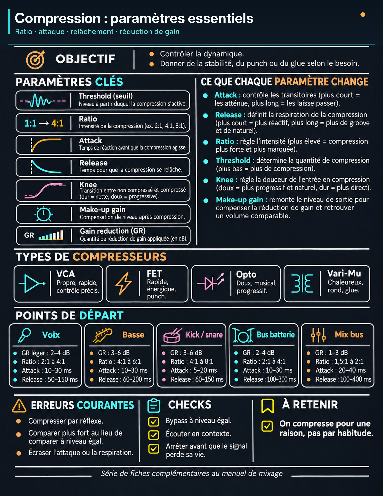

### 6.1 Choisir le type de compresseur

> **Termes et concepts essentiels —** **[compresseur FET](#glossaire-compresseur-fet) :** compresseur utilisant un transistor à effet de champ pour la réduction de gain · **[compresseur optique](#glossaire-compresseur-optique) :** compresseur dont le contrôle de gain repose sur un élément optique · **[compresseur VCA](#glossaire-compresseur-vca) :** compresseur utilisant un amplificateur contrôlé en tension

Le circuit change la manière dont la dynamique bouge. Choisissez selon le comportement voulu, pas selon la réputation.

| Type               | Caractère                     | Utile quand on veut                                   |
| ------------------ | ----------------------------- | ----------------------------------------------------- |
| VCA                | Contrôlé, percutant, précis   | Un contrôle ferme et prévisible sans perdre le groove |
| FET                | Rapide, agressif, énergique   | Un contrôle rapide des transitoires avec attitude     |
| Optique            | Lisse, musical, naturel       | Une compression douce, dépendante du programme        |
| Vari-mu            | Lisse, épais, collant         | Un contrôle qui rend un mix ou un bus plus cohésif    |
| Pont de diodes     | Dense, ferme, caractériel     | Un contrôle fort avec densité et caractère            |
| Numérique / propre | Transparent, flexible, précis | Contrôler la dynamique en gardant le ton intact       |

Exemple sur une caisse claire : un style 1176 (FET) donne plus de claquant et de mordant qui traverse le mix ; un style LA-2A (opto) donne un son plus rond, plus de corps, qui colle au mix (compression de groupe pour renforcer la cohésion sonore). Ce n'est pas la quantité de réduction qui compte, mais la manière dont le compresseur l'obtient.

### 6.1 bis Klanghelm MJUC : Mk1, Mk2 et Mk3

Le plug-in **Klanghelm MJUC** propose trois architectures de compression **variable-mu** différentes. Il ne s'agit pas de trois préréglages interchangeables : chacune possède son propre circuit modélisé et ses contrôles.

| Modèle       | Caractère décrit par le fabricant                                                                                 | Contextes d'essai                                                               | Précaution                                                                                   |
| ------------ | ----------------------------------------------------------------------------------------------------------------- | ------------------------------------------------------------------------------- | -------------------------------------------------------------------------------------------- |
| **MJUC Mk1** | Inspiré des circuits des années 1950 ; le plus **coloré**, dense et épais, avec une compression plutôt naturelle  | Voix douce, basse, instruments acoustiques, sous-groupes, coloration recherchée | Vérifier que la densité n'assombrit pas l'arrangement                                        |
| **MJUC Mk2** | Inspiré d'appareils à lampes des années 1960 ; plus **présent** et harmonique ; ratios et *Density* configurables | Voix qui doit avancer, basse électrique, batterie et rock                       | Le bouton *Density* et le transformateur *iStage* peuvent modifier sensiblement le caractère |
| **MJUC Mk3** | Conception moderne, plus **hi-fi**, moins colorée, plus flexible ; peut accentuer l'attaque                       | Bus batterie, mix bus, piano et instruments où la précision compte              | Contrôler la réponse transitoire et l'interaction avec le groove                             |

**Procédure comparative :** insérer les trois modèles à tour de rôle sur **la même source**, viser un ordre de grandeur similaire de réduction de gain, puis ajuster le *make-up gain* pour comparer à niveau égal. Écouter la texture, les attaques, la tenue, la distorsion et le centre stéréo. Essayer éventuellement le *mix* pour doser le traitement parallèle. Ne pas déduire le meilleur modèle de la seule valeur du vumètre.

La commande **CAL** de MJUC définit la référence de niveau de l'interface et influence le comportement du traitement : vérifiez le réglage avant de comparer des presets. Le fabricant propose un [manuel en français](https://klanghelm.com/docs/MJUC-manuel_FR.pdf) et [une description détaillée des trois modèles](https://klanghelm.com/contents/products/MJUC).

#### Fiche 13 — Compresseurs : familles et modèles

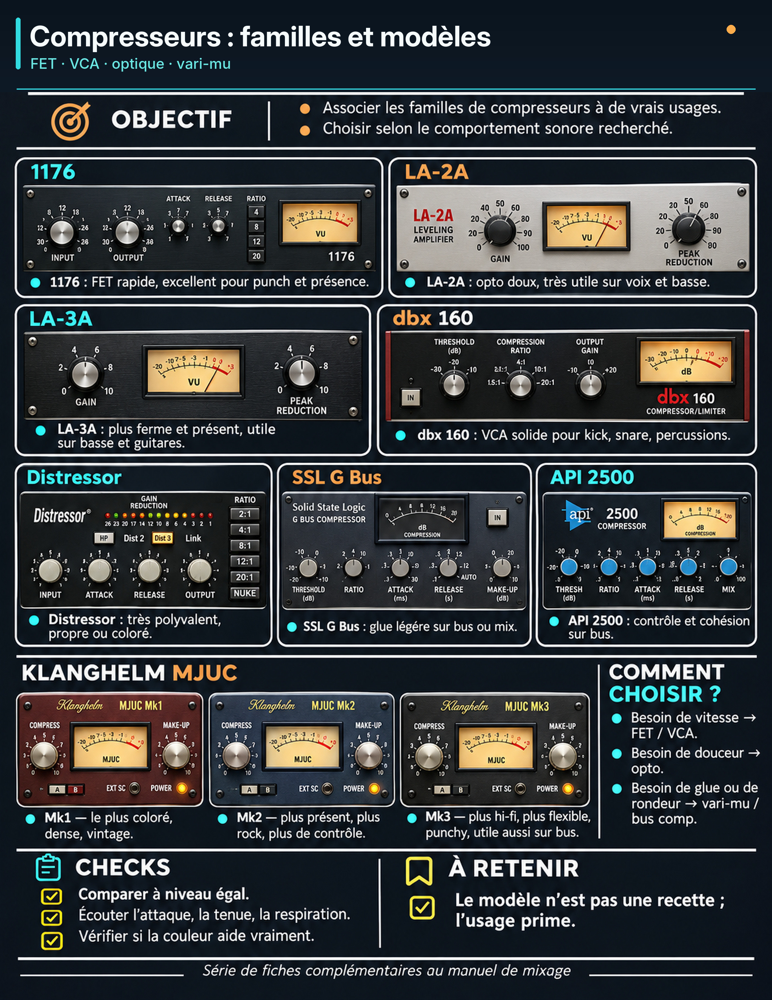

### 6.2 Points de départ par source

> **Termes et concepts essentiels —** **[ratio](#glossaire-ratio) :** rapport de compression entre changement de niveau en entrée et en sortie au-dessus du seuil · **[attaque](#glossaire-attaque) :** durée de réaction du compresseur après dépassement du seuil, selon son architecture · **[release](#glossaire-release) :** relâchement : retour du compresseur vers un gain non réduit après l’événement
> 

#### Fiche 14 — Compression : points de départ selon la source

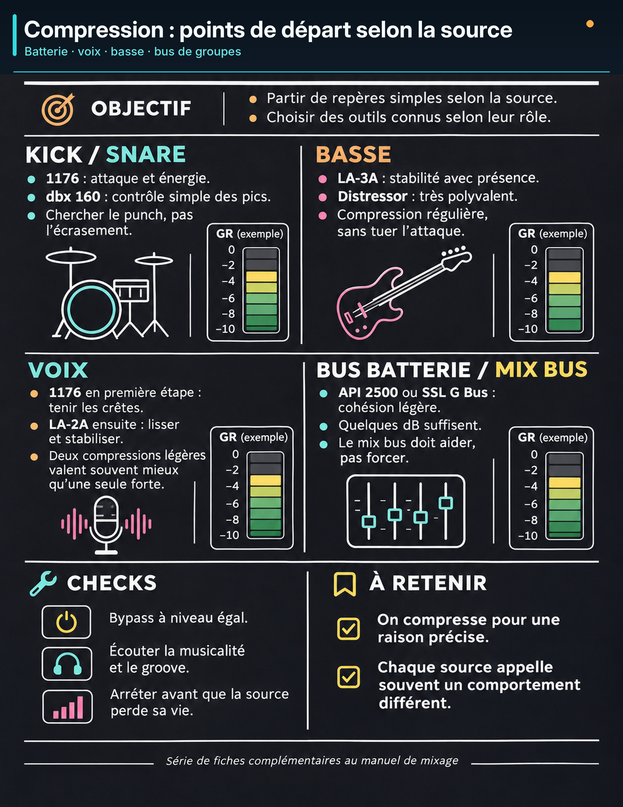

| Source                                                    | Seuil        | Ratio       | Attaque    | Relâchement  | Réduction visée      |
| --------------------------------------------------------- |:------------ | ----------- | ---------- | ------------ | -------------------- |
| Voix principale                                           | -15 à -10 dB | 3:1 à 4:1   | 5 à 15 ms  | 50 à 150 ms  | 3 à 6 dB             |
| Bus de batterie                                           | -10 à -6 dB  | 2:1 à 4:1   | 10 à 30 ms | 50 à 120 ms  | 2 à 4 dB             |
| Kick                                                      | -20 à -10 dB | 4:1 à 6:1   | 10 à 30 ms | 50 à 120 ms  | 3 à 6 dB             |
| 808 / basse                                               | -18 à -8 dB  | 3:1 à 5:1   | 10 à 30 ms | 60 à 200 ms  | 3 à 6 dB             |
| Caisse claire                                             | -15 à -8 dB  | 4:1 à 6:1   | 5 à 20 ms  | 50 à 120 ms  | 3 à 6 dB             |
| Guitare / pincés                                          | -18 à -10 dB | 2:1 à 4:1   | 10 à 30 ms | 80 à 200 ms  | 2 à 4 dB             |
| Bus de mix (*glue compression*)                           | -6 à -3 dB   | 1,5:1 à 2:1 | 20 à 50 ms | 100 à 300 ms | 1 à 3 dB             |
| Bus master (léger)                                        | -6 à -2 dB   | 1,5:1 à 2:1 | 30 à 80 ms | 100 à 300 ms | 1 à 2 dB             |
| [Compression parallèle](#glossaire-compression-parallele) | -25 à -15 dB | 6:1 à 10:1  | 1 à 10 ms  | 50 à 120 ms  | Forte, puis mélangée |

Les seuils dépendent du niveau du signal ; ajustez-les pour atteindre la réduction de gain visée. Les gains de compensation se règlent pour égaliser le niveau avec le bypass.

### 6.3 Une ou deux compressions sur la voix

> **Termes et concepts essentiels —** **[compression](#glossaire-compression) :** traitement qui réduit, modifie ou modèle la plage dynamique du signal · **[automation](#glossaire-automation) :** variation enregistrée de paramètres (volume, panorama, envoi, EQ) dans le temps

- **Un seul compresseur** : flux simple, un seul jeu de réglages. Convient si l'interprétation est déjà assez régulière et si un étage suffit sans forte réduction. Poussé fort, il peut aplatir.
- **Deux en série** (par exemple 1176 puis LA-2A) : le premier attrape les pics rapides, le second lisse le niveau global. Chaque étage travaille moins fort. Attention : deux étages à surveiller, plus facile d'exagérer.

Réglez en comparant à niveau égal et reculez si la voix perd son mouvement naturel.

#### Répertoire rapide des compresseurs explicitement nommés dans les PDF

| Appareil / plug-in                | Principe courant                                    | Emploi à tester                                                  |
| --------------------------------- | --------------------------------------------------- | ---------------------------------------------------------------- |
| **1176** (FET)                    | Attaque et release très rapides, caractère possible | Voix, caisse claire, kick, batterie parallèle                    |
| **Empirical Labs Distressor**     | Compression flexible + modes Dist 2 / Dist 3        | Voix, batterie, rooms ; contrôler transitoires et couleur        |
| **LA-2A** (opto)                  | Régulation douce, dépendante du programme           | Voix après 1176 ; basse/claviers                                 |
| **LA-3A** (opto)                  | Compression optique au caractère différent du LA-2A | Guitare, sources tenues                                          |
| **FabFilter Pro-C 3** (numérique) | Contrôle polyvalent, flexible                       | Un seul compresseur sur voix quand cela suffit                   |
| **dbx 160** (VCA)                 | Contrôle direct des pics                            | Kick, basse, parallèle                                           |
| **API 2500** (VCA)                | Compresseur de bus ; détecteur **Thrust**           | Cohésion bus batterie, préserver l’impact du grave selon réglage |
| **SSL G-Series Bus Compressor**   | Compression légère de bus                           | Cohésion discrète, souvent faible réduction                      |

**Précisions utiles :** sur un 1176 classique, les boutons Attack et Release deviennent généralement **plus rapides en tournant dans le sens horaire**. Sur un Distressor, « Dist 2 » et « Dist 3 » décrivent des couleurs harmoniques différentes ; le traitement n’est pas seulement une réduction de dynamique. Les exemples chiffrés des fiches restent des points de départ.

### 6.4 Les compresseurs classiques en pratique

> **Termes et concepts essentiels —** **[compression](#glossaire-compression) :** traitement qui réduit, modifie ou modèle la plage dynamique du signal · **[bus](#glossaire-bus) :** canal de sommation recevant plusieurs pistes

**1176 (FET).** Le bouton d'entrée règle l'intensité : plus d'entrée, plus de réduction. Visez 3 à 7 dB. La sortie sert à égaliser le niveau. Attaque et relâchement : dans le sens horaire, c'est plus rapide. Départ : attaque 3, relâchement 5 à 7. Ratio de départ 4:1 pour voix et basse ; tous les boutons enfoncés peuvent convenir en [compression parallèle](#glossaire-compression-parallele) de batterie.

**Distressor.** Ratio de départ 3:1 à 4:1, attaque 3 à 5, relâchement 4 à 6, réduction de 3 à 6 dB. Dist 2 et Dist 3 ajoutent de la couleur harmonique (seconde ou troisième harmonique) : réglez d'abord la dynamique, ajoutez la couleur ensuite. Si les basses fréquences font « pomper » la réduction, essayez le passe-haut du détecteur ; la bande du détecteur aide à désesser.

**Fairchild 670.** Contrôle doux des crêtes avec des constantes de temps variables (position 1 : attaque 0,2 ms, relâchement 0,3 s ; positions 5 et 6 : relâchement plus long après des crêtes répétées). Attention : sur le 670, monter le seuil signifie plus de compression. Le mode Lat/Vert traite séparément centre et côtés.

**API 2500.** Le Thrust filtre le détecteur seulement (il ne retire pas de basse du son) : utile quand kick et basse déclenchent trop de réduction. Old (rétroaction) donne une réponse plus caractérielle, New (anticipation) une réponse plus directe. Le *knee* change seulement la transition vers la compression. Le Mix règle le dosage entre signal sec et comprimé.

**SSL bus compressor.** Point de départ : 2:1 ou 4:1, attaque 10 à 30 ms, relâchement en Auto, pour 1 à 3 dB de réduction. Une attaque plus lente laisse passer l'impact. Utilisez le filtre [sidechain](#glossaire-sidechain) pour que le kick ne fasse pas pomper tout le mix. Si le bus est constamment retenu, reculez.

#### Complément vintage et bus : Fairchild 670, API 2500 et SSL G-Series

- **Fairchild 670 (vari-mu)** : les positions de *Time Constant* règlent la récupération du compresseur selon le programme ; la reproduction de l’appareil peut offrir un réglage *Lat/Vert*, ainsi qu’un filtre passe-haut dans le détecteur sur certaines émulations. Ce filtre **ne coupe pas le grave du signal audio**. Le comportement des boutons dépend du modèle exact (*CHEAT Sheets_v1*, p. 27).
- **API 2500** : Thrust modifie la sensibilité du détecteur aux basses fréquences ; les modes Old/New, le *knee*, le lien stéréo et le réglage *mix* servent à sculpter la compression du bus (*CHEAT Sheets_v1*, p. 28).
- **SSL G-Series Bus Compressor** : compresseur de bus à tester pour une cohésion discrète, avec un réglage de release adapté au groove (*CHEAT Sheets_v1*, p. 29 ; *v2*, p. 17).
- **Distressor** : son filtrage du détecteur (HP) aide quand le grave déclenche trop de réduction ; l’option *Detector Band* permet d’accentuer la sensibilité à une zone de présence/sibilance (*CHEAT Sheets_v1*, p. 26).

#### Chaînes de compression à comparer en contexte

- **Voix :** FabFilter Pro-C 3 seul pour une régulation polyvalente **ou** 1176 → LA-2A pour séparer le contrôle des pointes de celui du niveau moyen. Deux appareils ne sont pas systématiquement meilleurs. (*CHEAT Sheets_v1*, p. 23.)
- **Kick :** dbx 160 pour un contrôle compact, ou 1176 pour sculpter l’attaque et le sustain. Sur un 1176, la réduction dépend du gain d’entrée ; remettre le gain de sortie au niveau comparable avant A/B. (*CHEAT Sheets_v2*, p. 13, 17.)
- **Bus batterie :** API 2500 (Thrust si le grave déclenche trop la réduction) **ou** un autre compresseur de bus léger ; vérifier que la batterie reste vivante.
- **Rooms parallèles :** compresser davantage une piste d’ambiance puis la mélanger discrètement sous les micros proches ; vérifier la cohérence de phase avant le traitement. (*CHEAT Sheets_v2*, p. 18.)
- **Bus principal :** SSL G-Series ou équivalent à faible réduction selon le morceau, éventuellement sans compression.

**Note de méthode :** écouter l’attaque, le mouvement de la réduction et le résultat du **groupe complet**, pas seulement les chiffres du plug-in.

### 6.5 Le bus de batterie

> **Termes et concepts essentiels —** **[compression](#glossaire-compression) :** traitement qui réduit, modifie ou modèle la plage dynamique du signal · **[transitoire](#glossaire-transitoire) :** événement très bref à l’attaque d’un son (coup de caisse claire, consonne)

1. **Routez** kick, caisse claire, charleston et toms vers un bus commun.
2. **Compression modérée** : une légère réduction de gain renforce la cohésion sonore entre les éléments de la batterie tout en préservant leur impact. Si les transitoires perdent en définition ou si un effet de pompage apparaît, réduisez l'intensité de la compression ou ajustez les temps d'attaque et de relâchement.
3. **Poids par la saturation** : ajoute densité et harmoniques. Comparez à volume égal ; si kick et toms deviennent troubles ou si les cymbales durcissent, réduisez le drive.
4. **EQ large** : écoutez l'accumulation dans les bas-médiums de tout le kit avant de couper. Couper les fréquences qui nuisent à la clarté ne doit pas amincir le kick, ajouter de l'air ne doit pas durcir les cymbales.
5. **Jugez dans le mix complet.** Un bus qui sonne gros en solo peut encombrer la basse ou la voix.

Le bus de batterie doit mettre en valeur le kit, pas sauver une mauvaise balance.

### 6.6 Le gate déclenché par une autre piste (*key*)

> **Termes et concepts essentiels —** **[gate](#glossaire-gate) :** traitement qui atténue un signal lorsqu’il passe sous un seuil · **[sidechain](#glossaire-sidechain) :** signal de détection qui commande un processeur, parfois venu d’une autre piste

| Cas                          | Principe                                         | Réglages de départ                                            |
| ---------------------------- | ------------------------------------------------ | ------------------------------------------------------------- |
| Kick ouvre la basse          | La basse ne passe que quand le kick frappe       | Attaque 1 à 5 ms, relâchement 50 à 150 ms                     |
| Caisse claire ouvre les toms | Réduit les fuites de toms                        | Attaque rapide, relâchement 50 à 200 ms, filtrer l'entrée clé |
| Voix ouvre les effets        | Pas de réverbération constante entre les phrases | Relâchement 100 à 500 ms, maintien (hold) 50 à 100 ms         |

Écoutez l'entrée clé, filtrez-la, commencez avec un seuil élevé puis baissez-le. En cas de vibrations (chatter), seuil trop bas ou signal clé trop bruité. L'automation de mute est préférable pour les parties très irrégulières, les éditions précises ou si l'on veut un silence total.

### 6.7 Compléments : compresser pour une raison, dé-essage, sidechain, parallèle

> **Termes et concepts essentiels —** **[dé-esseur](#glossaire-desesseur) (*de-esser*):** processeur atténuant de façon sélective certaines sifflantes · **[compression parallèle](#glossaire-compression-parallele) :** mélange d’un chemin audio direct et d’un chemin traité séparément

Les repères chiffrés sont des points de départ.

- **Compresser avec un objectif précis.** Avant d'appliquer une compression, définissez le résultat recherché : réduire les variations de niveau, modifier l'attaque ou le maintien du son (*sustain*), renforcer la cohésion sonore entre plusieurs éléments ou augmenter la densité perçue. Une compression appliquée sans intention précise risque de réduire inutilement les contrastes dynamiques et de diminuer l'expressivité du mix.
- **Dé-essage.** La sibilance (« s », « ch ») est une zone étroite qui dépasse. Réduisez-la avec un compresseur dont le détecteur se concentre sur cette bande (voir la bande du détecteur du Distressor, 6.4) ou un [EQ dynamique](#glossaire-eq-dynamique) (5.2), plutôt qu'avec un EQ fixe qui ternit toute la voix. Repère courant : zone aiguë d'environ 5 à 9 kHz selon la voix, à trouver à l'oreille.
- **[Sidechain](#glossaire-sidechain) au-delà du [gate](#glossaire-gate).** Un élément peut en faire baisser légèrement un autre (la voix sur un instrument concurrent, le kick sur la basse, voir [§ 4.1](#sec-4-1)). Gardez l'effet discret et vérifiez qu'il ne pompe pas.
- **Compression parallèle.** Mélangez un signal très comprimé avec l'original (voir le tableau 6.2). Vérifiez que le plugin n'introduit pas de décalage de latence entre les deux voies, sinon le grave se déphase comme en 4.2.

### 6.8 Associer source et compresseur

> **Termes et concepts essentiels —** **[compresseur FET](#glossaire-compresseur-fet) :** compresseur utilisant un transistor à effet de champ pour la réduction de gain · **[compresseur VCA](#glossaire-compresseur-vca) :** compresseur utilisant un amplificateur contrôlé en tension

Une fiche associe sept sources à un compresseur type. Ce sont des points de départ, pas des règles ; les types sont décrits en 6.1.

| Source           | Compresseur (style) | Repère                                      | Objectif                                                       |
| ---------------- | ------------------- | ------------------------------------------- | -------------------------------------------------------------- |
| Kick             | dbx 160             | Compression modérée                         | Contrôler les crêtes, garder l'impact                          |
| Caisse claire    | 1176                | 4:1                                         | Façonner punch et sustain                                      |
| Basse / claviers | LA-2A               | Nivellement optique doux                    | Garder des niveaux réguliers                                   |
| Voix             | 1176 puis LA-2A     | Contrôle des crêtes, puis nivellement lisse | Voix devant et contrôlée (voir [§ 6.3](#sec-6-3))              |
| Guitare          | LA-3A               | Compression optique douce                   | Contrôler la dynamique, garder le caractère                    |
| Bus de batterie  | API 2500            | 2:1                                         | Renforcer la cohésion sonore entre les éléments de la batterie |
| Bus de mix       | SSL G (bus)         | 2:1, 1 à 2 dB de réduction                  | Cohésion subtile                                               |

### 6.9 Le kick : compresser au 1176, écrêter avant le limiteur

> **Termes et concepts essentiels —** **[transitoire](#glossaire-transitoire) :** événement très bref à l’attaque d’un son (coup de caisse claire, consonne) · **[limiteur](#glossaire-limiteur) :** processeur limitant les niveaux les plus forts, généralement à ratio très élevé

**Compresser le kick au 1176 (cinq conseils) :**

1. **Ratio** : partez de 4:1 pour un contrôle mesuré, essayez 8:1 pour un effet plus ferme. Plus haut n'est pas automatiquement mieux.
2. **Préserver le click initial** : l'attaque est plus lente vers la gauche, plus rapide vers la droite. Partez lent pour garder le click, plus rapide pour dompter le pic. Même l'attaque la plus lente d'un 1176 reste sous 1 ms ; les valeurs en millisecondes du tableau 6.2 ne se règlent donc pas telles quelles sur cet appareil.
3. **Relâchement au groove** : plus rapide vers la droite. Un relâchement rapide récupère entre les coups, mais trop rapide peut distordre ou pomper. Ajustez dans le mix complet.
4. **Entrée, puis compensation** : montez l'entrée pour pousser le compresseur, mettez le METER sur GR pour lire la réduction. Autour de 3 à 4 dB est un point de départ, pas une cible. Compensez avec la sortie, puis comparez.
5. **Comparer les deux révisions** (Bluey et Blacky) à volume égal et choisir à l'oreille selon le kick et le mix.

**Écrêter le kick avant le limiteur.** Un limiteur qui travaille fort sur les crêtes du kick baisse tout le mix : pompage audible, moins de punch.

- **Solution** : écrêtez le kick (ou le bus de batterie) d'environ 1 à 3 dB pour raser les transitoires les plus rapides. Le limiteur fait alors moins de réduction (environ 1 à 3 dB) et le mix reste plus stable.
- **Écrêteur** : un vrai écrêteur (plus marqué ou doux). Ne domptez que les crêtes les plus rapides.
- **Contrôles** : écoutez la distorsion, le grain ou la dureté, surtout dans l'attaque du kick, et reculez si le son devient flou ou écrasé. Comparez limiteur seul et écrêteur plus limiteur à volume égal.

Le principe est le même que pour le master en 10.3 : écrêter les crêtes, pas l'énergie.

### 6.10 Bus de batterie : cohésion sonore et micros d'ambiance

> **Termes et concepts essentiels —** **[micro d’ambiance](#glossaire-micro-d-ambiance) :** micro captant le son indirect et le caractère acoustique d’un lieu · **[bus](#glossaire-bus) :** canal de sommation recevant plusieurs pistes
> 

#### Fiche 15 — Compression sur les bus de groupes

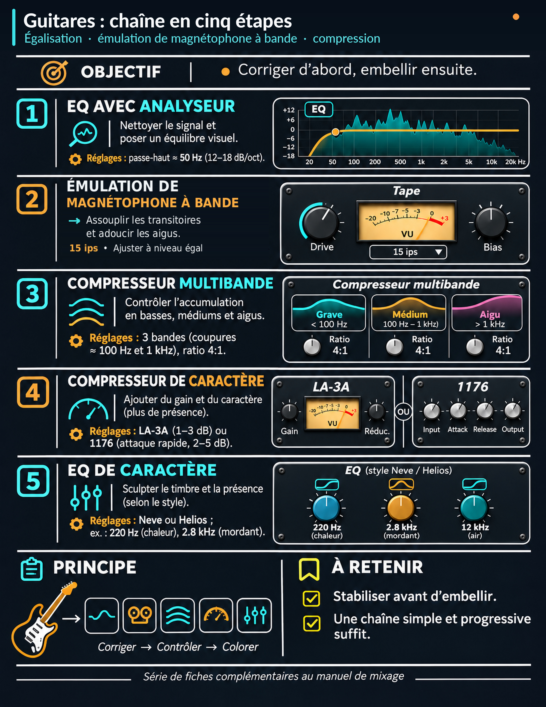

***Glue compression* (compression de cohésion) (« 2 dB suffisent »).** Une compression légère qui lie le kit sans aplatir la dynamique.

- Ratio 2:1 à 4:1, attaque 10 à 30 ms pour laisser passer les transitoires.
- Relâchement d'environ 50 à 200 ms, ou en auto, calé sur le groove pour que la réduction « respire » avec le battement.
- Réduction de 1 à 3 dB (environ 2 dB). Elle doit suivre le rythme par petits creux, pas rester constamment lourde.
- Si ça pompe : relâchement plus lent ou auto. Départ : 2:1, attaque d'environ 20 ms, relâchement d'environ 100 ms.

Interprétation : le tableau 6.2 indique 2 à 4 dB pour le bus de batterie, cette fiche 1 à 3 dB. Visez environ 2 dB et ne dépassez 4 dB que si le kit le demande.

**Micros d'ambiance (exception voulue).** Ici la compression est forte : attaque rapide, relâchement rapide à moyen, ratio élevé, 10 dB ou plus de réduction. Filtrez avec un passe-haut pour garder le grave serré, puis mélangez bas, sous les micros proches. Cela ajoute taille et énergie sans noyer le kit.

### 6.11 Compresseur ou limiteur

**Nuance :** un limiteur numérique avec anticipation (*lookahead*) et plafond de crête vraie peut servir à sécuriser un fichier de livraison ; un limiteur ordinaire ne garantit pas à lui seul l’absence de crêtes inter-échantillons. La mesure en dBTP reste nécessaire après export (voir [§ 11.8](#sec-11-8)).

> **Termes et concepts essentiels —** **[limiteur](#glossaire-limiteur) :** processeur limitant les niveaux les plus forts, généralement à ratio très élevé · **[compression](#glossaire-compression) :** traitement qui réduit, modifie ou modèle la plage dynamique du signal
> 

#### Fiche 16 — Compresseur et limiteur : différences

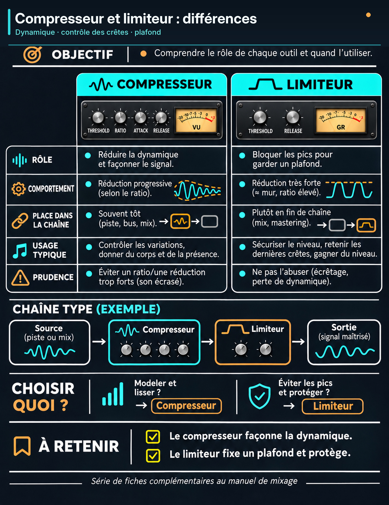

|        | Compresseur                                                     | Limiteur                                                                                                                                 |
| ------ | --------------------------------------------------------------- | ---------------------------------------------------------------------------------------------------------------------------------------- |
| Rôle   | Réduit la dynamique selon un ratio (par exemple 4:1)            | Se comporte comme un compresseur à ratio extrêmement élevé (10:1 ou plus selon la fiche) pour empêcher les crêtes de dépasser le plafond |
| Effets | Contrôle la dynamique, ajoute de la constance, façonne le punch | Évite l'écrêtage, fixe un plafond, relève le volume sans écrêter                                                                         |
| Place  | Partout dans la chaîne                                          | Souvent en fin de chaîne                                                                                                                 |

Conseil : un compresseur pour façonner et uniformiser, un limiteur comme filet de sécurité final sur le master. Ne le laissez pas sur un mix destiné à un ingénieur de mastering.

### 6.12 Tranches de console : SSL 4000 E et API Vision

> **Termes et concepts essentiels —** **[trim](#glossaire-trim) :** réglage de gain à un point de la chaîne, souvent avant les traitements · **[EQ](#glossaire-eq) :** égaliseur modifiant le niveau de différentes bandes de fréquences · **[compresseur VCA](#glossaire-compresseur-vca) :** compresseur utilisant un amplificateur contrôlé en tension
> 

#### Fiche 17 — Tranches de console : SSL et API

Une tranche de console regroupe filtres, EQ, dynamique et sortie dans un ordre de travail.

**SSL 4000 E**

- **Filtres** : passe-haut de 20 à 350 Hz, passe-bas de 3,5 à 12 kHz. Montez le passe-haut jusqu'à ce que ça s'amincisse, puis reculez un peu.
- **Quatre bandes d'EQ** : LF (30 à 450 Hz) pour le poids, LMF (200 Hz à 2,5 kHz) pour le corps, HMF (600 Hz à 7 kHz) pour la présence, HF (1,5 à 16 kHz) pour le détail. LF et HF peuvent passer en cloche. Balayez une cloche étroite pour trouver un problème avant de couper.
- **Dynamique** : le compresseur contrôle les moments forts, l'expandeur ou [gate](#glossaire-gate) réduit le matériel de bas niveau.
- **Ordre** : par défaut dynamique, filtres, EQ, sortie. PRE DYN place EQ ou filtres avant la dynamique. DYN SC les place seulement sur le [sidechain](#glossaire-sidechain) de la dynamique : sur les filtres, il empêche la basse de faire pomper le compresseur.

**API Vision**

1. **Entrée et filtres** : micro ou ligne, pad, gain, puis passe-haut (20 à 600 Hz) et passe-bas (500 Hz à 20 kHz). Réglez un niveau sain, puis retirez les graves et aigus inutiles.
2. **Dynamique** : gate/expandeur (baisse le signal de bas niveau entre les coups) puis compresseur/limiteur (la compression resserre les écarts de niveau, la limitation arrête les crêtes à un plafond).
3. **EQ graphique** à dix bandes fixes pour les gestes larges. PREDYN place l'EQ avant la dynamique.
4. **Sortie** : vérifiez le niveau et écoutez les sauts de niveau indésirables.

À relier à 5.5 (EQ avant ou après) et 6.6 (gate).

### 6.13 Où placer chaque type de compresseur (retour de praticien)

> **Termes et concepts essentiels —** **[compression](#glossaire-compression) :** traitement qui réduit, modifie ou modèle la plage dynamique du signal · **[ratio](#glossaire-ratio) :** rapport de compression entre changement de niveau en entrée et en sortie au-dessus du seuil
> 

#### Fiche 18 — Choisir une famille de compresseurs

Le tutoriel « Comprendre les types de compresseurs » insiste sur trois idées : choisir selon le son et le rôle, décider puis avancer, et essayer plusieurs types sur une même piste pour entendre la différence. Voir [§ 6.1](#sec-6-1) pour les caractéristiques générales.

| Type           | Où l'utiliser                                                                                                                                                                                                                                                     | Exemples de réglages cités                                                                                                                                                                                                                  |
| -------------- | ----------------------------------------------------------------------------------------------------------------------------------------------------------------------------------------------------------------------------------------------------------------- | ------------------------------------------------------------------------------------------------------------------------------------------------------------------------------------------------------------------------------------------- |
| Vari-mu        | Bus de mixage, bus de groupes, cordes, ensembles orchestraux, nappes, guitares et voix présentant des variations dynamiques importantes : adoucir les variations de niveau, apporter de la densité sonore et renforcer la cohésion entre les différents éléments. | Fairchild 670 sur des cordes : monter le gain d'entrée génère des harmoniques ; monter le seuil augmente la réduction ; baisser le filtre [sidechain](#glossaire-sidechain) pour que la contrebasse excite moins le compresseur             |
| Optique        | Voix, basse, guitare acoustique, piano : lissage naturel qui épaissit sans se faire remarquer. LA-2A (lampes) plus chaud, LA-3A (semi-conducteurs) plus orienté médiums                                                                                           | Souvent la première option pour piano et guitare acoustique ; sur une voix, en série après un FET                                                                                                                                           |
| FET (1176)     | Batterie, micros d'ambiance, pics de voix, guitares électriques pour donner du corps                                                                                                                                                                              | Guitare : attaque la plus lente, relâchement le plus rapide, 4:1, environ 3 dB. Voix : 20:1, attaque et relâchement rapides (rôle de limiteur), puis LA-2A. Ambiance : 8:1, attaque lente, relâchement rapide, ou tous les boutons enfoncés |
| VCA            | Bus de mix, bus de batterie, sources à fort transitoire : propre, précis, peu coloré                                                                                                                                                                              | Distressor sur la batterie ; dbx 160 en parallèle mono sur kick et caisse claire, 5 à 10 dB de réduction                                                                                                                                    |
| Pont de diodes | Parallèles de batterie et de guitares : poids, épaisseur, mordant, avec un caractère vintage moins moelleux qu'un vari-mu (Neve 33609, Lindell 254)                                                                                                               | Guitares en parallèle : relâchement lent (400 à 800 ms) pour lisser. Bus de batterie : relâchement de 100 ms, 3:1, 2 à 3 dB, un peu de filtre sidechain                                                                                     |

Rappels : une [compression parallèle](#glossaire-compression-parallele) change le niveau, donc surveillez le [gain staging](#glossaire-gain-staging). Sur un 1176, même une attaque dite « lente » reste de l'ordre de la microseconde (voir [§ 6.9](#sec-6-9)). Jugez toujours en contexte.

### 6.14 Tranches de console : méthode, choix et rôle

> **Termes et concepts essentiels —** **[gain staging](#glossaire-gain-staging) :** gestion des niveaux d’entrée et de sortie à chaque étage du routage · **[trim](#glossaire-trim) :** réglage de gain à un point de la chaîne, souvent avant les traitements
> 

#### Fiche 19 — Tranches de console : méthode et choix

Voir [§ 6.12](#sec-6-12) pour les modules. 

- **Des choix limités** accélèrent les décisions et aident à rester dans un état créatif plutôt qu'analytique. Évitez de chercher un compresseur ailleurs : tout est dans la tranche de console (*channel strip*).
- **Des bandes d'EQ fixes** (modèles de style Neve, API, Pultec) suffisent à des milliers de disques. Restez à quatre ou six bandes, filtres compris.
- **Pas d'analyseur** : on s'en remet à l'oreille. Balayer un boost entre quelques fréquences fixes entraîne à reconnaître ce que fait 1,4 kHz ou 2,8 kHz sur une guitare. Sur une API, les incréments de dB sont fixes : le saut est net et facile à entendre.
- **Les harmoniques** de saturation rapprochent le mix du son « disque ». Augmenter le gain d'entrée pousse davantage de signal dans l'électronique modélisée (+8 dB dans la démonstration, pour mieux l'entendre).

**Méthode**

1. Lisez le manuel et repérez l'**ordre de signal par défaut**. Commencez par celui-ci.
2. **Vérifiez que chaque module est activé** (compresseur, EQ, filtres).
3. **Compensez le niveau** avec la sortie avant de comparer.
4. Utilisez le bouton de **[polarité](#glossaire-polarite) (ø)** pour contrôler vite la [phase](#glossaire-phase) entre pistes de batterie.
5. Au besoin, déplacez les modules avec PRE DYN (EQ avant la dynamique) ou DYN SC (EQ sur le [sidechain](#glossaire-sidechain), utile pour dé-esser ou empêcher une fréquence de faire pomper).

Ordre par défaut : le tutoriel décrit la SSL 4000E ainsi : entrée, dynamique, EQ, puis filtres. La fiche de 6.12 indique dynamique, filtres, EQ. Vérifiez avec votre plugin.

**Choisir selon la source** (tutoriels) :

| Source           | Choix                                                  | Réglages cités                                                                                                                                                                                                                                        |
| ---------------- | ------------------------------------------------------ | ----------------------------------------------------------------------------------------------------------------------------------------------------------------------------------------------------------------------------------------------------- |
| Fûts de batterie | SSL 4000E                                              | Kick : 3 à 6 dB de réduction (environ 3 dB dans la démonstration), 5:1 par défaut, attaque rapide désactivée pour garder le transitoire. [Overheads](#glossaire-overheads) et ambiance : 6 à 10 dB avec attaque rapide pour contenir la caisse claire |
| Cymbales         | SSL 9000J (haut plus ouvert) ou 4000E (haut plus sale) |                                                                                                                                                                                                                                                       |
| Basse            | Amek 9099 (plein et clair)                             | Passe-haut 55 Hz avant le compresseur plus 93 Hz interne, environ 6 dB, boost vers 80 Hz, coupe vers 275 Hz, boost de présence vers 1,5 kHz, shelf à 3 kHz de +3 dB                                                                                   |
| Guitares         | Style Neve (Lindell 80), Helios ou Trident             | Acoustique : shelf 16 kHz, boosts vers 7,2 kHz et 110 Hz, passe-haut 70 Hz, sidechain 75 Hz, 2:1, relâchement auto, 3 à 4 dB. Électrique : boost 220 Hz, passe-haut 45 Hz, sidechain 80 Hz, 3:1, environ 5 dB, relâchement 800 ms                     |
| Piano            | Focusrite                                              |                                                                                                                                                                                                                                                       |

Caractères entendus dans la comparaison : la SSL est claire, serrée, percutante ; la Neve plus épaisse, ronde, chaude avec des aigus étincelants ; l'API proche de la SSL mais avec moins de grave moelleux et des transitoires un peu moins tranchants ; la 9000J a des aigus plus étendus, la 4000E plus de « thump » sur le kick. Pour choisir, demandez-vous si la source a besoin de contrôle, de chaleur, de clarté ou de punch : SSL ou API pour du propre et punchy, Neve pour la chaleur et la richesse. Si vous n'en avez qu'une, maîtrisez-la. On peut aussi combiner un EQ spécialisé (Pultec, Neve 1073) avec un compresseur de caractère (1176, LA-2A), et saturer les bus de groupes pour retrouver l'effet console.

### 6.15 Guitares : chaîne en cinq étapes

> **Termes et concepts essentiels —** **[EQ](#glossaire-eq) :** égaliseur modifiant le niveau de différentes bandes de fréquences · **[compression](#glossaire-compression) :** traitement qui réduit, modifie ou modèle la plage dynamique du signal · **[saturation](#glossaire-saturation) :** non-linéarité ajoutant des harmoniques et parfois de la compression douce
> 

#### Fiche 20 — Guitares : chaîne en cinq étapes

Tutoriel « Effortless Guitar Mixing Using My 5-Plugin Strategy » : d'abord corriger (stabiliser), ensuite embellir. Démontré sur du rock lourd, la même logique vaut pour les guitares acoustiques. Écoutez d'abord, décidez ensuite, et jugez dans le mix complet.

| #   | Outil                             | Rôle                                                                                                       | Réglages cités                                                                                                                                                                                                       |
| --- | --------------------------------- | ---------------------------------------------------------------------------------------------------------- | -------------------------------------------------------------------------------------------------------------------------------------------------------------------------------------------------------------------- |
| 1   | EQ avec analyseur                 | Nettoyage et diagnostic visuel                                                                             | Passe-haut doux vers 50 Hz, sans effet sur le ton                                                                                                                                                                    |
| 2   | Émulation de magnétophone à bande | Adoucir les transitoires durs, ajouter des aigus sans dureté, atténuer des artefacts de simulation d'ampli | 15 ips ; compteurs sans entrer dans le rouge (environ -10 à -7) ; le paramètre de couleur ajoute de la saturation                                                                                                    |
| 3   | Compresseur multibande            | Contrôler automatiquement l'accumulation de bas-médiums (sans coupe statique) et les pointes de haut       | Trois bandes, croisements à 100 Hz et 1 kHz, 4:1, seuil -18 par défaut, plage limitée à 6 dB ; 1 à 2 dB de réduction ; remonter le seuil si cela ternit                                                              |
| 4   | Compresseur de caractère          | Lisser l'attaque de médiator, donner du corps                                                              | LA-3A (deux boutons) : 1 à 3 dB, 5 dB au maximum. Le 1176 est une alternative                                                                                                                                        |
| 5   | EQ de caractère                   | Forme finale ; on peut booster sans risque puisque le signal est corrigé                                   | Neve (chaud) ou Helios/type 1073 (médiums, plus agressif) : shelf 12 kHz, 220 Hz pour la chaleur, 2,8 kHz pour le mordant. Des EQ différents pour des guitares différentes aident à les séparer. Compensez le niveau |

### 6.16 Compression parallèle et compression en série

> **Termes et concepts essentiels —** **[compression parallèle](#glossaire-compression-parallele) :** mélange d’un chemin audio direct et d’un chemin traité séparément · **[bus](#glossaire-bus) :** canal de sommation recevant plusieurs pistes · **[latence](#glossaire-latence) :** retard introduit par l’acquisition, le routage ou certains traitements
> 

#### Fiche 21 — Compression parallèle et compression en série

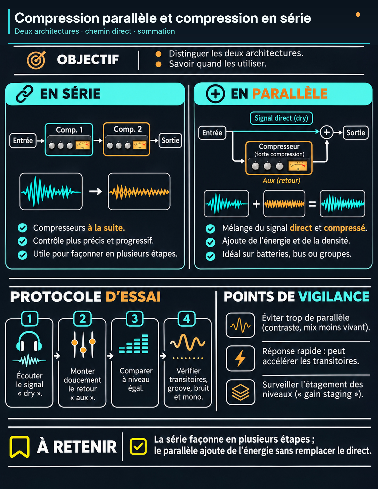

Compresseurs **en série** sur le bus, et compression **parallèle rapide** sur un retour auxiliaire, éventuellement pour l'ensemble de la batterie ou d'un groupe. Il s'agit de deux architectures distinctes :

- **Série :** chaque compresseur reçoit la sortie du précédent. Le premier peut contrôler les variations lentes (par ex. ratio 1,5:1, attaque ~40 ms, relâchement ~500 ms dans le schéma de bus noté en cours), tandis que l'autre intervient ponctuellement. **Ne jamais additionner deux compresseurs par réflexe.**
- **Parallèle :** une copie envoyée vers un auxiliaire subit une compression plus énergique, puis est réintroduite sous le signal direct. Le retour est réglé à bas niveau ; surveiller la latence et la compensation de délai du DAW, surtout sur la batterie.

**Protocole d'essai :** écouter direct → monter doucement le retour parallèle → comparer à niveau global égal → revérifier transitoires, groove, bruit et mono. Une compression parallèle trop forte peut enlever du contraste. Le « rapide » concerne généralement la réponse du compresseur, pas une obligation de régler toutes les attaques au minimum.

## Étape 7 : Saturation et couleur

> **Termes et concepts essentiels —** **[saturation](#glossaire-saturation) :** non-linéarité ajoutant des harmoniques et parfois de la compression douce · **[harmoniques](#glossaire-harmoniques) :** composantes de fréquence liées à une fondamentale ; certaines saturations en ajoutent · **[émulateur de magnétophone à bande (*tape simulator*)](#glossaire-tape-simulator) :** émulateur numérique de certains effets de bande magnétique
> 

#### Fiche 22 — Saturation et couleur sonore

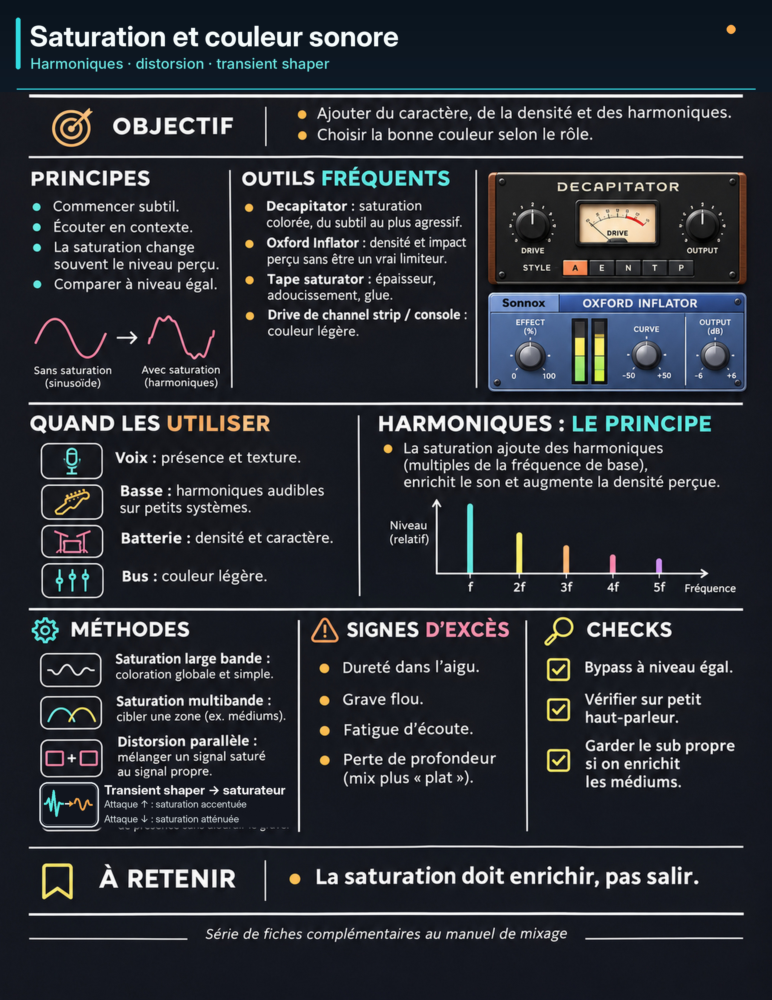

### 7.1 Principes

> **Termes et concepts essentiels —** **[saturation](#glossaire-saturation) :** non-linéarité ajoutant des harmoniques et parfois de la compression douce · **[harmoniques](#glossaire-harmoniques) :** composantes de fréquence liées à une fondamentale ; certaines saturations en ajoutent

La saturation réagit surtout aux parties les plus fortes du signal : les transitoires décident de la quantité de grain, d'harmoniques et de distorsion. Elle ajoute densité et loudness (niveau sonore perçu). Comparez toujours à niveau égal.

*Pour la saturation de la bassse, voir la section [§ 4.7](#sec-4-7)*

### 7.2 Saturation multibande

> **Termes et concepts essentiels —** **[crossover](#glossaire-crossover) :** filtre de séparation du spectre entre deux bandes de traitement · **[saturation](#glossaire-saturation) :** non-linéarité ajoutant des harmoniques et parfois de la compression douce

Un saturateur multibande sépare le signal en bandes par des croisements, applique un drive propre à chaque bande, puis recombine.

- **Graves (20 à 200 Hz)** : propres et serrés, saturation légère, préserver l'impact.
- **Médiums (200 Hz à 2 kHz)** : chaleur, corps, grain, présence. C'est là que se joue l'essentiel.
- **Aigus (2 à 20 kHz)** : doses subtiles, éviter le sifflant ou la dureté, un peu d'air au besoin.

Points de croisement courants : bas 80 à 200 Hz, milieu 200 Hz à 2 kHz, haut 2 à 6 kHz. Écoutez les bosses ou creux aux jonctions. Utile sur basse (grain dans les médiums, graves propres), batterie, synthés et mix complet.

#### Fiche 23 — Outils de saturation et de coloration

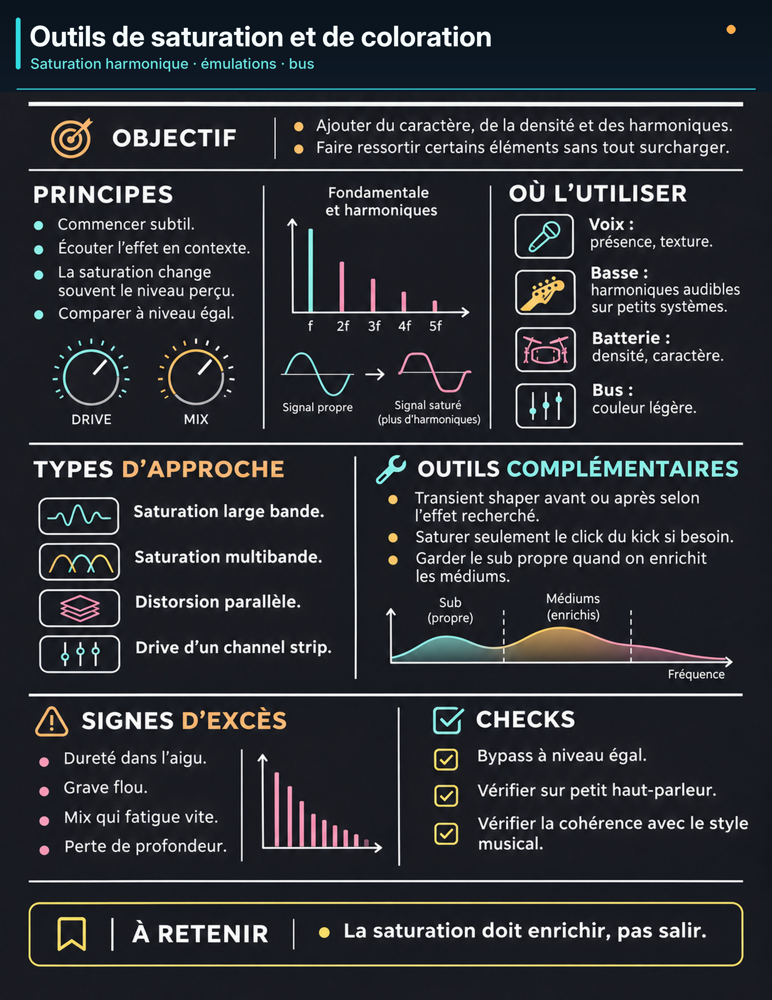

### 7.3 Transient shaper avant la saturation

> **Termes et concepts essentiels —** **[transient shaper](#glossaire-transient-shaper) :** processeur qui amplifie ou atténue l’attaque et/ou le maintien d’un son · **[transitoire](#glossaire-transitoire) :** événement très bref à l’attaque d’un son (coup de caisse claire, consonne)

**Interaction à surveiller :** augmenter l’attaque avant un saturateur peut accentuer la quantité de distorsion sur les transitoires ; l’atténuer peut au contraire réduire la saturation des crêtes. Le résultat dépend du saturateur et de son niveau d’entrée. Faire une comparaison à volume égal, puis décider dans le mix complet.

Placez un *transient shaper* avant le saturateur pour contrôler la force avec laquelle le signal le frappe.

- Moins d'attaque (réglage de départ d'environ -20 à -50 %) : saturation plus lisse, ton plus chaud, moins de dureté.
- Plus d'attaque : plus de harmoniques, de croquant et de mordant.
- Sustain de 0 à +20 % ; mélange 100 % (ou dosé).

Partez d'un petit réglage et ajoutez. Façonnez d'abord, saturez ensuite.

#### Outils de coloration nommés par les sources

- **Soundtoys Decapitator** : saturation harmonique réglable par entrée/drive, style et mix ; peut servir sur voix, guitares, batterie, bus en contexte (*CHEAT Sheets_v1*, p. 34).
- **Transient shaper** : ajuste l'attaque ou le sustain avant une saturation ; utiliser seulement si la modification du signal d’entrée sert le résultat (*CHEAT Sheets_v1*, p. 35).
- **Émulations de bande (tape)** : saturation, compression et modification des transitoires variables selon le modèle ; à comparer aux émulations de circuits à lampes (*CHEAT Sheets_v2*, p. 21).
- **Sonnox Oxford Inflator** : augmente la densité/sonie (*loudness*, intensité sonore) perçue par un traitement différent d’un limiteur ; ne remplace pas un véritable plafond de crête (*CHEAT Sheets_v1*, p. 30).
- *Waves NLS Buss* (drive/couleur), *Ozone Vintage Tape* et éventuel *Pultec* sans réglage actif selon l’émulation.

### 7.4 Utiliser un saturateur de type Decapitator

> **Termes et concepts essentiels —** **[saturation](#glossaire-saturation) :** non-linéarité ajoutant des harmoniques et parfois de la compression douce · **[A/B](#glossaire-a-b) :** comparaison entre deux traitements, idéalement à niveau perçu égal

Chaîne de raisonnement : **forme, caractère, drive, contrôle, mélange.**

1. **Façonner l'entrée** : le Low Cut contrôle la quantité de grave qui atteint la saturation (plus de grave en entrée, plus de saturation dans le grave) ; Tone change l'équilibre tonal qui l'alimente.
2. **Choisir le caractère** : lisse (A, Ampex), costaud (E, EMI), focalisé (N, Neve), chaud et percutant (T, triode), agressif et harmonique (P, pentode).
3. **Pousser** avec le drive ; Punish ajoute environ 20 dB de gain supplémentaire.
4. **Contrôler** le résultat avec le High Cut et le niveau de sortie (égaliser avec le bypass).
5. **Mélanger** : plus de saturation ne veut pas toujours dire plus de mélange.

### 7.5 Saturer seulement le « click » du kick

> **Termes et concepts essentiels —** **[harmoniques](#glossaire-harmoniques) :** composantes de fréquence liées à une fondamentale ; certaines saturations en ajoutent · **[transitoire](#glossaire-transitoire) :** événement très bref à l’attaque d’un son (coup de caisse claire, consonne)

Le kick a un sub profond (environ 20 à 120 Hz) et un click (ou frappe) plus aigu (environ 2 à 5 kHz). Saturer seulement le click ajoute harmoniques et punch, surtout sur petits haut-parleurs, sans rendre le grave confus et manquant de clarté.

Deux méthodes :

- **Diviser le kick en parallèle** : une voie basse propre (20 à 120 Hz) et une voie haute saturée (2 à 5 kHz), puis on somme.
- **Saturation multibande** : bas propre, médium/haut saturé (2 à 5 kHz), air optionnel.

Réglages de départ de la fiche :

| Bande             | Drive                                           |
| ----------------- | ----------------------------------------------- |
| Bas (20 à 120 Hz) | 0 % (propre)                                    |
| Click (2 à 5 kHz) | 20 à 50 % typique ; commencer subtil, 10 à 30 % |
| Air (optionnel)   | 0 à 20 %                                        |

Trouvez la fréquence du click de votre kick (souvent 2 à 5 kHz), gardez le bas inchangé et comparez à volume égal. L'objectif est l'équilibre, pas la quantité.

### 7.6 Saturation à bande ou à lampes

> **Termes et concepts essentiels —** **[tape simulator ou émulateur de magnétophone à bande](#glossaire-tape-simulator) :** émulateur numérique de certains effets de bande magnétique · **[saturation](#glossaire-saturation) :** non-linéarité ajoutant des harmoniques et parfois de la compression douce

|                 | Bande                                                                                                            | Lampes                                                                                       |
| --------------- | ---------------------------------------------------------------------------------------------------------------- | -------------------------------------------------------------------------------------------- |
| Principe        | Support d'enregistrement magnétique ; l'audio devient des variations magnétiques relues par les têtes de lecture | Tubes à vide dans un circuit ; leur réponse non linéaire change le signal quand on le pousse |
| Quand on pousse | Saturation plus forte, crêtes traitées plus doucement                                                            | Distorsion harmonique ajoutée, ton et dynamique changent plus nettement                      |
| Son             | Chaleur, attaques atténuées, densité harmonique, crêtes lissées, caractère cohésif                               | Richesse harmonique, corps, présence, saturation plus marquée                                |
| Où l'essayer    | Bus de batterie, basse, mix complet                                                                              | Voix principales, guitares, synthés, sources individuelles                                   |

Comportement général, pas celui de chaque appareil. Méthode : source, bande ou lampes, compensation de niveau, mix. Commencez par une dose subtile, réglez l'entrée ou le drive, compensez avec la sortie et comparez à loudness (niveau sonore perçu) égal. Plus de saturation ne veut pas dire un meilleur son.

## Étape 8 : L'espace (réverbération et délais)

> **Termes et concepts essentiels —** **[réverbération](#glossaire-reverberation) :** ensemble de réflexions qui prolongent un son et donnent une impression d’espace · **[pré-délai](#glossaire-pre-delai) :** temps séparant le son direct des premières réverbérations simulées · **[délai](#glossaire-delai) :** décalage temporel d’un signal ou effet répétant un son avec retard
> 

#### Fiche 24 — Réverbération et délais : principes

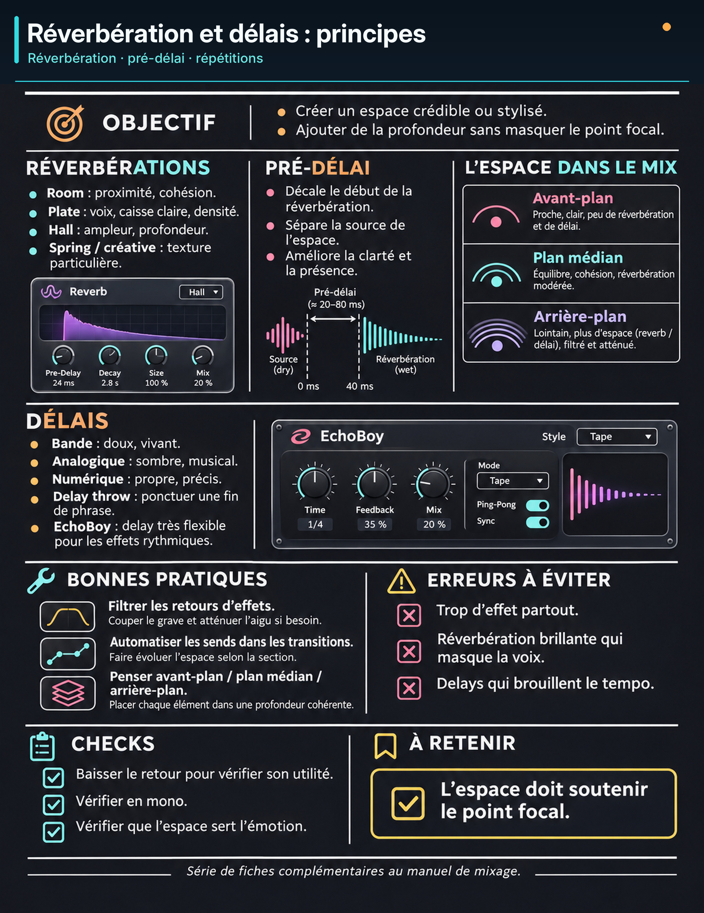

### 8.1 Pré-délai (pre-delay)

> **Termes et concepts essentiels —** **[pré-délai](#glossaire-pre-delai) :** temps séparant le son direct des premières réverbérations simulées · **[réverbération](#glossaire-reverberation) :** ensemble de réflexions qui prolongent un son et donnent une impression d’espace

Le pré-délai est l'écart entre le son sec et sa réverbération. Sans pré-délai, la réverbération masque l'attaque dès le premier instant. Avec lui, l'attaque reste définie et la réverbération s'épanouit derrière.

D'où vient le chiffre : le son parcourt environ **34 cm par milliseconde**. Un mur à 5 m renvoie sa première réflexion en environ 30 ms (aller-retour de 10 m). Plus la salle est grande, plus le pré-délai est long.

| Source                      | Départ approximatif |
| --------------------------- | ------------------- |
| Voix principale             | 20 à 40 ms          |
| Caisse claire               | 10 à 25 ms          |
| Piano / guitare             | 15 à 30 ms          |
| Batterie complète           | 0 à 15 ms           |
| Grande salle, ballade lente | 40 à 80 ms          |

Au-delà d'environ 100 ms, ça ne sonne plus comme une pièce mais comme un écho en slap.

**Astuce tempo** : 60000 ÷ BPM = durée d'un temps en ms. Divisez par 16 pour une soixante-quatrième de note. À 120 BPM : 500 ÷ 16 ≈ 31 ms, un pré-délai qui respire avec le morceau.

Réglage à l'oreille : augmentez jusqu'à ce que l'attaque soit nette, arrêtez-vous avant d'entendre un écho distinct. Le pré-délai change *quand* la réverbération arrive, pas sa quantité : il permet d'en utiliser plus sans perdre de clarté.

### 8.2 Réverbération mono panoramiquée avec la source

> **Termes et concepts essentiels —** **[mono](#glossaire-mono) :** somme ou lecture sur un seul canal plutôt que deux canaux séparés · **[panoramique](#glossaire-panoramique) :** placement d’un son dans le champ gauche-droite

Une réverbération stéréo large peut brouiller la position d'un instrument. Pour garder la position et ajouter de la profondeur :

1. **Créer** : réverbération mono, ou stéréo étroite, sur un envoi (send).
2. **Faire correspondre le panoramique** : panoramiquez le retour au même endroit que la source.
3. **Façonner le retour** : filtrez le grave ou la dureté si nécessaire.
4. **Régler l'envoi** : à l'oreille, jusqu'à ce que la profondeur soit juste.

Mono ou étroit pour : guitares panoramiquées, percussions, chœurs, leads de synthé. Stéréo pour : nappes, ambiances, transitions, effets, et souvent les voix principales, quand la largeur sert la chanson.

**Vérifiez** : la source est-elle toujours bien placée ? La réverbération apporte-t-elle une profondeur utile ? Le retour masque-t-il quelque chose ? La balance tient-elle en mono ?

#### Outils et choix d'effet cités dans les fiches

- **Tape delay** : répétitions souvent assombries, modulées, colorées.
- **Analog/BBD delay (***Bucket-Brigade Device Delay***)** : répétitions filtrées et évolutives selon le modèle.
- **Digital delay** : répétitions plus précises et propres, selon les réglages.
- **Soundtoys EchoBoy** : exemple de plug-in de délai multistyle ; régler le *time*, le *feedback*, le filtrage et le *mix* ou le send pour mettre l’écho au service de l’arrangement.
- **Room / Chamber / Hall / Plate / Ambience** : familles de réverbérations présentant des densités et profondeurs différentes ; les durées et pre-delays sont des repères à écouter.

**Contrôle :** filtrer les retours, comparer au même niveau, vérifier que l’effet ne masque pas la source.

#### Fiche 25 — Réverbérations, délais et espace

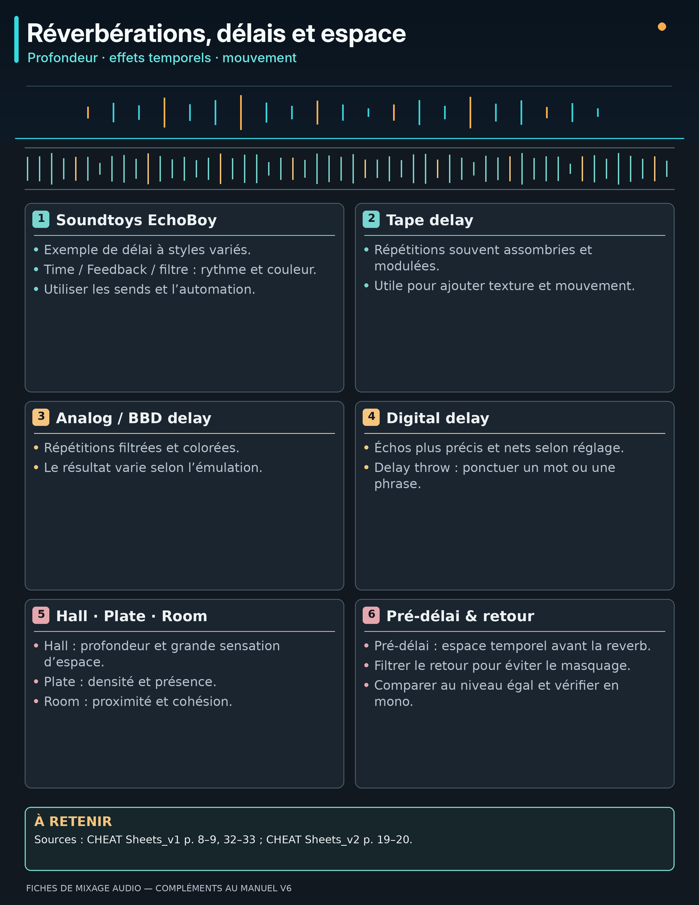

### 8.3 Choisir un délai : à bande, analogique (BBD) ou numérique

**Terminologie — BBD delay :** un *Bucket-Brigade Device* est une ligne de retard analogique à transfert de charges. Il produit souvent des répétitions plus sombres, limitées en bande passante, avec bruit et modulation caractéristiques. À distinguer d’une **émulation de magnétophone à bande**, qui simule un autre principe technique. Voir le [glossaire BBD](#glossaire-bbd).

> **Termes et concepts essentiels —** **[délai](#glossaire-delai) :** décalage temporel d’un signal ou effet répétant un son avec retard · **[réverbération](#glossaire-reverberation) :** ensemble de réflexions qui prolongent un son et donnent une impression d’espace

| Type       | Caractère                                               | Pourquoi                                                                                                                  |
| ---------- | ------------------------------------------------------- | ------------------------------------------------------------------------------------------------------------------------- |
| À bande    | Chaud : répétitions plus sombres, légère modulation     | Chaque répétition repasse par les têtes, saturation et perte de fréquences cumulées                                       |
| Analogique | Riche : répétitions chaudes, déclin doux, moins d'aigus | Le signal traverse une chaîne de condensateurs (puce à transfert de charge) ; le filtrage retire les aigus à chaque étape |
| Numérique  | Propre : répétitions nettes, timing précis              | Chaque répétition est une copie exacte ; seul le volume baisse                                                            |

Points de départ (temps) : slapback 80 à 140 ms ; rythmique synchronisée au tempo en croches ou noires ; dub / reggae 300 à 500 ms avec fort feedback ; nappe ambiante 500 ms et plus avec feedback 60 % et plus. La personnalité se révèle après la première répétition : écoutez la cinquième, pas seulement la première.

### 8.4 Délai avancé (type EchoBoy)

> **Termes et concepts essentiels —** **[délai](#glossaire-delai) :** décalage temporel d’un signal ou effet répétant un son avec retard · **[automation](#glossaire-automation) :** variation enregistrée de paramètres (volume, panorama, envoi, EQ) dans le temps

- **Caler les répétitions** : synchronisez au morceau ; Groove ajoute du swing, Feel pousse ou retarde.
- **Choisir le motif** : simple, double, ping-pong, rythmique.
- **Façonner le ton** : coupe-bas et coupe-haut délimitent la plage de l'écho ; la saturation ajoute densité ou grain. Seuls les échos sont traités, le sec reste intact.
- **Changer la texture** : la diffusion floute les répétitions, le wobble ajoute un mouvement de hauteur.

### 8.5 Types de réverbération

> **Termes et concepts essentiels —** **[réverbération](#glossaire-reverberation) :** ensemble de réflexions qui prolongent un son et donnent une impression d’espace · **[micro d’ambiance](#glossaire-micro-d-ambiance) :** micro captant le son indirect et le caractère acoustique d’un lieu
> 

#### Fiche 26 — Types de réverbération et départ auxiliaire

| Type                | Caractère                                                                                                        | Utile pour                                                                                                                                                    |
| ------------------- | ---------------------------------------------------------------------------------------------------------------- | ------------------------------------------------------------------------------------------------------------------------------------------------------------- |
| Plaque              | Lisse, dense, brillante, un peu métallique ; ajoute brillance et présence                                        | Voix principales qui ont besoin de sustain, caisse claire, percussions, synthés, guitares ; parties qui ont besoin de densité sans impression de grande salle |
| Chambre             | Lisse avec du caractère ; espace naturel, légèrement coloré                                                      | Rock, R&B, jazz, vintage                                                                                                                                      |
| Pièce               | Naturelle, réaliste ; espace serré, sensation organique                                                          | Rap, lo-fi, folk, son live                                                                                                                                    |
| Salle (hall)        | Grande, luxuriante, spacieuse ; longue fin de réverbération, réflexions diffuses, forte impression de profondeur | Cordes et orchestre, nappes, textures atmosphériques, chœurs, cinéma ; sources qui ont besoin de distance                                                     |
| Ambiance            | Subtile et spacieuse ; ajoute largeur, profondeur et cohésion à un mix sec                                       | Voix sèches, pistes mono, superposition, bus de mix                                                                                                           |
| Ressorts (*spring*) | Réverbération colorée, souvent brillante et métallique, à caractère vintage                                      | Guitares, orgues, dub et effets volontaires ; à doser avec parcimonie                                                                                         |
| Shimmer             | Réverbération enrichie de transposition harmonique (souvent à l’octave) ; effet irréaliste et aérien             | Nappes, ambiances, transitions et textures atmosphériques ; peut masquer le signal direct                                                                     |

La salle montre des premières réflexions distinctes puis un déclin diffus ; la plaque, des réflexions denses et un déclin lisse. Repères de la fiche : une durée de décroissance courte (0,5 à 1,5 s) pour un son plus serré, plus longue (2 à 5 s) pour un résultat plus grand ; pré-délai de 10 à 40 ms pour garder le son net et devant (voir [§ 8.1](#sec-8-1)).

**Configuration type d'un départ auxiliaire vers une réverbération.** Le signal direct (*dry*) demeure sur sa piste d'origine. Un départ auxiliaire (*send*) achemine une copie du signal vers un bus d'effet contenant une réverbération réglée à 100 % *wet*. Un égaliseur placé sur le retour d'effet permet de contrôler l'accumulation de basses fréquences et l'excès d'aigus. Le niveau du retour auxiliaire détermine ensuite la quantité de réverbération intégrée au mix. En règle générale, le départ est **post-fader**, de façon que la proportion direct/réverbéré suive les variations du fader de la piste source ; un départ pré-fader est un choix spécial de routage, non une obligation.

Pour comparer salle et plaque, utilisez la même source et égalisez le loudness (niveau sonore perçu) : la réverbération la plus forte paraît facilement plus impressionnante.

### 8.6 Égaliser le retour de réverbération

> **Termes et concepts essentiels —** **[filtre passe-haut](#glossaire-filtre-passe-haut) :** filtre atténuant progressivement les basses fréquences sous une coupure · **[filtre passe-bas](#glossaire-filtre-passe-bas) :** filtre atténuant progressivement les hautes fréquences au-delà d’une coupure

Une réverbération qui ne tient pas dans le mix n'est pas toujours un mauvais préréglage : souvent, son retour n'a jamais été égalisé. Elle capte tout (*mud*, tons de boîte, sibilance) et l'étale dans le mix.

1. **Filtre passe-haut et atténuation des bas-médiums** : maîtrisez les basses fréquences et réduisez les accumulations excessives dans les bas-médiums afin de préserver la définition et la clarté du mix.
2. **Atténuer les résonances excessives dans les bas-médiums (environ 200 à 500 Hz) ou la sibilance** audibles dans le retour.
3. **Passe-bas** : moins d'aigus dans la réverbération la fait reculer dans l'arrangement. C'est l'un des moyens les plus efficaces de créer de la profondeur.

Voir aussi 5.6 pour le passe-haut du retour.

## Étape 9 : Automation, bus principal et finalisation du mix

> **Termes et concepts essentiels —** **[automation](#glossaire-automation)** : variation programmée d'un paramètre au fil du morceau · **[bus](#glossaire-bus)** : voie recevant et sommant plusieurs signaux · **[headroom](#glossaire-headroom)** : marge disponible avant le plafond d'un étage de traitement.

Une balance statique solide précède les ajustements de détail. Cette étape relie **mouvement musical**, **traitement éventuel du bus principal** et **gestion des versions**. Le traitement du bus peut être préparé tôt, mais la finalisation n'exige pas une chaîne de plug-ins complexe.

### 9.1 Automatiser les niveaux, le panoramique et les effets

L'automation permet de guider l'attention : un mot important, une fin de phrase, l'entrée d'un instrument ou le passage d'un couplet au refrain. Les mouvements nécessaires dépendent de l'arrangement, pas d'un nombre imposé de points d'automation.

1. **Écouter une première fois sans interrompre la lecture.** Noter les moments où l'équilibre, la présence ou l'énergie doivent évoluer.
2. **Commencer par la voix ou le soliste.** Ajuster le fader pour maintenir l'intelligibilité sans surcomprimer ; employer, si besoin, le *clip gain* pour les écarts très localisés.
3. **Automatiser les départs d'effets.** Par exemple, lancer un délai sur une fin de phrase plutôt que laisser l'écho occuper tout le couplet.
4. **Créer des contrastes entre sections.** Moduler légèrement le niveau, la largeur ou les effets lorsque le morceau le justifie. Vérifier les transitions et les retours au niveau de départ.
5. **Recontrôler à niveau modéré et en mono.** Une automation efficace doit soutenir la musique sans devenir un effet involontaire.
   

#### Fiche 27 — Automatisation et écoute comparative

*Cette fiche est transversale : sa partie « comparaison sur plusieurs systèmes » complète également l'étape 10.*

### 9.2 Définir le rôle du bus principal

Le **bus principal** (*mix bus*) reçoit l'ensemble du mix. Il peut rester sans traitement ou comporter quelques traitements légers. Deux méthodes sont possibles : **mixer à travers une chaîne de bus préparée dès le départ**, ou **ajouter les traitements en fin de mix**. L'important est de maîtriser l'influence de cette décision sur la balance.

- **Compression de cohésion (*glue*)** : commencer, si nécessaire, par une réduction de gain modérée, de l'ordre de 1 à 3 dB sur les passages les plus forts. Vérifier que les attaques et le groove restent naturels (voir [6.4](#sec-6-4)).
- **Coloration** : émulation de console ou de magnétophone à bande, uniquement si l'effet est audible et pertinent après compensation du niveau.
- **Égalisation** : petits ajustements de l'ensemble ; traiter sur les pistes les problèmes qui ne concernent qu'un instrument.
- **Largeur et contrôle des crêtes** : opérations facultatives, à comparer en mono. Un limiteur de travail peut être utilisé sur une version d'écoute, sans devenir automatiquement un élément du fichier livré au mastering.

Comparer **avec et sans chaîne à volume perçu égal**. Surveiller les crêtes et préserver une marge suffisante pour la sortie choisie ; **−6 dBFS n'est pas une valeur de crête obligatoire pour chaque prémaster**. Une chaîne préparée n'a pas besoin d'être entièrement activée.

### 9.3 Exemple de chaîne de bus légère et réversible

Le schéma suivant présente **des familles de traitement**, pas un ordre universel. L'EQ, la compression et la saturation interagissent : leur ordre se décide à l'écoute.

#### Fiche 28 — Bus principal : chaîne de traitement

| Module facultatif                    | Exemples présents dans les sources du manuel                 | À écouter / vérifier                                                                                                                                                              |
| ------------------------------------ | ------------------------------------------------------------ | --------------------------------------------------------------------------------------------------------------------------------------------------------------------------------- |
| Émulation de console ou de sommation | Waves NLS Buss                                               | Coloration liée au niveau d'entrée ; ne pas confondre avec une sommation analogique physique.                                                                                     |
| Émulation de magnétophone à bande    | Ozone Vintage Tape                                           | Densité et comportement des transitoires ; compenser le niveau.                                                                                                                   |
| Compresseur de bus                   | Compresseur VCA ou autre modèle approprié                    | Compression discrète, rythme du relâchement et conservation de l'impact. Un essai noté dans les sources est **1,5:1, attaque ~40 ms, relâchement ~500 ms**, à adapter au morceau. |
| Réduction ciblée de résonances       | EQ dynamique ; **SpecCraft** (Three-Body Technology)         | Corriger un excès réel ; ne pas supprimer automatiquement le corps du mix ni empiler des instances par principe.                                                                  |
| EQ de caractère                      | Émulation Pultec EQP-1A                                      | Essayer une coloration ou un ajustement large ; l'effet à réglages neutres dépend de l'émulation.                                                                                 |
| Contrôle stéréo                      | Ozone Imager ; EQ *mid/side* léger                           | Contrôler en mono et préserver l'assise centrale des graves.                                                                                                                      |
| Limitation de travail                | Ozone Maximizer, selon l'édition et l'algorithme disponibles | Réserver au contrôle ou à une version d'écoute ; désactiver ou retirer sur la version non limitée destinée à un mastering externe, si demandé.                                    |
|                 |                                                              |                                                                                                                                                                                   |

#### Fiche 29 — Bus principal : outils et usages

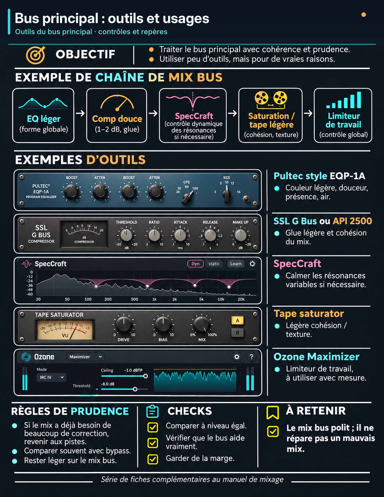

**Outils ponctuels, hors chaîne systématique :** un *transient shaper* sur un bus de batterie, une compression parallèle, une correction dynamique sur une piste ou une séparation de sources (par exemple iZotope RX Music Rebalance) lorsqu'une réparation l'exige. Cette dernière peut introduire des artefacts. Certains noms approximatifs figurant dans les notes de cours (« Oxyde », « sublifter », « WARM junior ») ne permettent pas d'identifier un produit avec certitude et ne sont donc pas présentés ici comme références vérifiées.

**Procédure de validation :** construire d'abord la balance → activer un module à la fois → compenser son gain → comparer en bypass → vérifier les transitoires, les graves et le mono → conserver uniquement ce qui améliore le mix.

### 9.4 Versions, révisions et exports intermédiaires

- **Nommer et sauvegarder des états identifiables**, par exemple `Titre_Mix_v01`, `v02`, etc. Ne pas écraser la dernière version approuvée.
- **Conserver une version de comparaison** avant toute modification importante du bus, du niveau général ou de l'arrangement.
- **Documenter les révisions** : demande, changement réalisé, date ou version correspondante.
- **Vérifier les variantes demandées** : instrumentale, *a cappella*, version courte, stems ou mix sans limiteur, selon le projet.
- **Exporter une version de contrôle** et la réécouter hors de la session, avec les mêmes points de comparaison.

Le numéro de version sert à **retrouver une décision**, pas seulement à compter des exports.

### 9.5 Redonner du mouvement à un mix trop statique

Un mix peut être équilibré sans créer de progression. Avant d'ajouter des effets, chercher **où se situe l'attention musicale** à chaque section.

| Symptôme audible                           | Piste de correction                                                                                                 |
| ------------------------------------------ | ------------------------------------------------------------------------------------------------------------------- |
| Tout reste au même niveau                  | Automatiser un soliste ou les contrastes entre couplet et refrain ; ne pas augmenter systématiquement le bus.       |
| Impression de largeur insuffisante         | Réviser arrangement et panoramique avant un élargisseur stéréo ([3.4](#sec-3-4)).                                   |
| Texture immobile                           | Introduire, si utile, une modulation légère (chorus, trémolo, phaser, auto-pan).                                    |
| Voix ou instrument principal peu expressif | Utiliser quelques mouvements de fader, d'EQ ou de départ d'effet aux moments importants.                            |
| Effets identiques tout au long du morceau  | Automatiser la réverbération et les délais selon les phrases ; créer des instants secs et des instants plus amples. |
| Impact affaibli                            | Réexaminer la compression des pistes et du bus avant de chercher davantage de niveau.                               |

**Deux passes suffisent souvent :** repérer les moments utiles au cours d'une écoute complète, puis appliquer les changements ciblés. Réécouter ensuite **sans observer les courbes d'automation** pour juger l'effet musical.

### 9.6 Savoir terminer le mix

Les méthodes et les plug-ins ne remplacent pas une décision musicale. Lorsque l'équilibre est cohérent, la multiplication des variantes peut faire perdre le point de référence initial.

**Trois questions de fin de mix :**

1. **Quel problème entend-on réellement ?** Si le défaut n'est pas identifiable dans le mix, ne pas ouvrir un nouvel outil par réflexe.
2. **Le traitement améliore-t-il le résultat à niveau égal ?** Comparer au signal non traité et à une version antérieure du mix.
3. **Le résultat reste-t-il convaincant d'un bout à l'autre ?** Écouter une fois sans s'arrêter, puis noter uniquement les corrections réellement nécessaires.

Les discussions des tutoriels sur les « erreurs de débutants » convergent sur un principe : la **balance, l'arrangement, l'écoute et la cohérence des niveaux** importent davantage que la recherche du plug-in parfait ou d'une chaîne de compression sophistiquée.

**Avant l'étape suivante :** exporter un mix de contrôle, enregistrer la dernière version de session et réserver l'analyse sur plusieurs systèmes à l'étape 10.

---

## Étape 10 : Vérifier le rendu sur plusieurs systèmes d'écoute

> **Termes et concepts essentiels —** **[mono](#glossaire-mono)** : sommation des canaux gauche et droit · **[corrélation](#glossaire-correlation)** : indicateur de relation entre canaux · **[référence](#glossaire-reference)** : morceau servant à comparer les équilibres à niveau perçu égal.

L'objectif n'est pas d'obtenir **le même son** sur toutes les enceintes, mais de conserver **la hiérarchie musicale** : voix ou soliste identifiable, graves lisibles, transitoires cohérents, réverbération maîtrisée. La fiche transversale [9A](#sec-9-1) propose également des repères pour cette comparaison.

### 10.1 Vérifier en mono et contrôler les interactions de phase

Passer périodiquement en mono permet de révéler des éléments qui s'affaiblissent à la sommation gauche-droite. Le **bouton mono** ne remplace pas une recherche d'alignement temporel des microphones lorsque celle-ci est nécessaire.

1. Basculer brièvement en mono ; vérifier la présence de la voix, de la caisse claire, des guitares et des claviers.
2. Repérer toute disparition ou perte de définition. Examiner les traitements d'élargissement, les chorus, les délais courts, les réverbérations et les interactions de phase.
3. Corriger d'abord le problème à la source : arrangement, polarité, délai, largeur ou niveau.
4. Revenir en stéréo et vérifier que le correctif n'a pas appauvri l'image sonore.

Un corrélomètre peut aider : des valeurs durablement négatives méritent une écoute attentive, **mais ne constituent pas à elles seules un diagnostic**. Les graves importants gagnent souvent à rester stables et bien identifiables en mono.

### 10.2 Comparer moniteurs, casque, voiture et petits haut-parleurs

Chaque système présente une réponse propre : extension limitée dans le grave, résonances de pièce, écoute de proximité, écouteur unique ou image stéréo différente. **La fréquence de coupure d'un téléphone varie selon le modèle** ; ne pas lui attribuer une limite fixe valable pour tous.

| Système                        | Écoute ciblée                                                                                                 |
| ------------------------------ | ------------------------------------------------------------------------------------------------------------- |
| Moniteurs de studio            | Balance générale, spatialisation, grave et cohérence tonale.                                                  |
| Casque                         | Détails, sibilances, bruits, réverbérations ; attention à la perception différente du grave et de la largeur. |
| Petit haut-parleur / téléphone | Intelligibilité, attaque, audibilité des notes de basse grâce aux harmoniques.                                |
| Voiture ou système domestique  | Équilibre des graves, niveaux relatifs des instruments et fatigue à l'écoute.                                 |
| Mono                           | Conservation de la voix, de l'impact et des éléments importants du centre.                                    |

**Méthode :** écouter une référence de style comparable au **même niveau perçu**, noter les problèmes qui reviennent sur plusieurs systèmes, puis effectuer **une correction à la fois**. Ne pas égaliser exclusivement pour un appareil particulier.

### 10.3 Dix contrôles de cohérence du mix

Les repères numériques ci-dessous viennent des fiches sources et sont **des hypothèses de départ**, jamais des coupes ou accentuations à appliquer systématiquement.

| #   | Contrôle                             | Décision à prendre                                                                                                                   |
| --- | ------------------------------------ | ------------------------------------------------------------------------------------------------------------------------------------ |
| 1   | **Sommation mono**                   | Repérer les éléments qui perdent trop de niveau ou de définition.                                                                    |
| 2   | **Référence musicale**               | Comparer tonalité, présence et dynamique à niveau perçu égal.                                                                        |
| 3   | **Graves inutiles**                  | Envisager un filtre passe-haut sur les pistes qui contiennent des graves indésirables (parfois vers 80–120 Hz, **selon la source**). |
| 4   | **Bas-médiums (≈ 200–500 Hz)**       | Rechercher une accumulation excessive ou des résonances ; atténuer modérément si nécessaire.                                         |
| 5   | **Hauts-médiums (≈ 3–6 kHz)**        | Maîtriser une éventuelle agressivité sans retirer la présence utile.                                                                 |
| 6   | **Présence des éléments principaux** | Voix ou caisse claire insuffisamment lisibles : rechercher masquage, arrangement ou besoin de présence (souvent autour de 1–3 kHz).  |
| 7   | **Articulation de la basse**         | Vérifier les harmoniques sur petits haut-parleurs ; essayer une saturation parallèle légère ([4.4](#sec-4-4), [4.7](#sec-4-7)).      |
| 8   | **Trois écoutes différentes**        | Moniteurs, casque et un appareil de diffusion courant ; repérer les défauts récurrents.                                              |
| 9   | **Journal des problèmes**            | Écrire « voix masquée au refrain », « basse envahissante », etc., plutôt que des commentaires vagues.                                |
| 10  | **Révision contrôlée**               | Modifier le point le plus gênant, réécouter et conserver ou annuler la correction.                                                   |

**Ordre de priorité :** balance → arrangement / panoramique → problèmes de phase → traitements ciblés. Une fiche de contrôle n'est pas une liste d'EQ à appliquer à tous les projets.

### 10.4 Simuler un petit haut-parleur

À défaut d'un appareil disponible, un outil de simulation (par exemple Audified MixChecker Pro, selon les profils offerts) ou une **écoute temporaire en bande limitée** peut aider au diagnostic.

**Exemple d'essai :** filtre passe-haut vers **400 Hz** et passe-bas vers **4,5 kHz**, insérés uniquement dans la chaîne de contrôle, **jamais dans l'export définitif**. Ces limites ne reproduisent pas exactement un téléphone ; elles permettent surtout d'évaluer les informations situées dans les médiums.

- Les notes de basse restent-elles identifiables sans leur fondamentale la plus grave ?
- La voix conserve-t-elle son intelligibilité ?
- La caisse claire et les instruments d'accompagnement gardent-ils une hiérarchie claire ?

Si la basse disparaît, revoir sa saturation harmonique ([4.7](#sec-4-7)) plutôt que monter immédiatement son fader. Terminer obligatoirement la comparaison sur les moniteurs pleine bande et au casque.

**Validation avant mastering :** le mix reste musical en stéréo et en mono, à plusieurs niveaux d'écoute, et ses problèmes majeurs ne réapparaissent pas constamment sur les autres systèmes.

---

## Étape 11 : Préparer et réaliser le mastering

> **Termes et concepts essentiels —** **[mastering](#glossaire-mastering)** : finalisation technique et artistique du mix pour sa livraison · **[LUFS](#glossaire-lufs)** : unité normalisée de sonie (*loudness*, intensité sonore perçue)· **[dBTP](#glossaire-dbtp)** : estimation de la crête vraie, y compris entre les échantillons.

Le mastering complète un mix déjà cohérent : il n'a pas pour fonction de remplacer la balance des pistes. Ses choix dépendent de la destination, du genre, de l'intention musicale et des exigences de livraison.

### 11.1 Cinq vérifications avant le mastering

#### Fiche 30 — Préparation du mastering

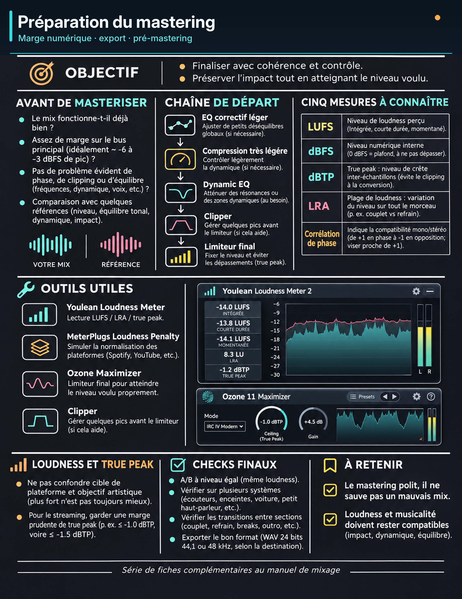

1. **Balance :** les éléments essentiels sont-ils clairement audibles ? Sinon, revenir au mix.
2. **Marge numérique (*headroom*) :** absence d'écrêtage indésirable dans le fichier livré ; un niveau de crête exact de −6 dBFS n'est pas une exigence universelle.
3. **Dynamique :** l'arrangement conserve-t-il ses contrastes et ses attaques ?
4. **Équilibre tonal :** les graves, les bas-médiums et les hauts-médiums ne présentent-ils pas de défaut manifeste ?
5. **Mono et fichiers :** compatibilité de la sommation, début et fin du fichier complets, fréquence d'échantillonnage correcte, absence de bruit ou de coupure non intentionnelle.

**Export pour un mastering externe :** WAV sans perte, généralement **24 bits PCM ou 32-bit float** si le destinataire l'accepte ; fréquence native du projet, pas de conversion inutile. Demander au prestataire s'il souhaite le bus traité ou une version non limitée. Le traitement interne en virgule flottante du DAW ne signifie pas que tous les fichiers finaux doivent être exportés en 32 bits.

### 11.2 Chaîne de mastering de départ

L'ordre ci-dessous est une **possibilité** : un morceau peut ne nécessiter qu'un EQ et un limiteur, ou aucun traitement dynamique supplémentaire.

| Traitement possible             | Rôle                                                                    | Précaution                                                                          |
| ------------------------------- | ----------------------------------------------------------------------- | ----------------------------------------------------------------------------------- |
| EQ correctif                    | Retirer une résonance ou un excès fréquentiel clairement audible.       | Réglages mesurés ; un filtre passe-haut n'est pas systématique ([11.6](#sec-11-6)). |
| Compression légère              | Homogénéiser certains mouvements du mix.                                | Si utile, commencer par environ 1–3 dB de réduction de gain et vérifier le groove.  |
| Saturation / émulation de bande | Apporter une coloration ou de la densité.                               | Comparer à volume égal, surveiller les transitoires et la distorsion.               |
| EQ tonal                        | Ajuster l'équilibre global avec des courbes larges.                     | Éviter de compenser un défaut qui appartient à une seule piste.                     |
| Limiteur *true peak*            | Établir le niveau maximal du fichier et contrôler les dernières crêtes. | Plafond selon la destination ; vérifier le signal **après** le limiteur.            |

Un EQ dynamique, un dé-esseur ou un traitement *mid/side* ne s'ajoutent que pour une raison identifiée. Les mesures LUFS et dBTP servent au diagnostic et à la livraison, **pas à choisir automatiquement la musicalité**.

### 11.3 Écrêtage contrôlé (*clipper*) avant le limiteur

Un *clipper* peut réduire certaines crêtes très brèves avant le limiteur. C'est une méthode facultative, pas une étape obligatoire du mastering.

**Chaîne d'essai :** mix → *clipper* → limiteur → mesure de sortie.

1. Réduire d'abord très légèrement les crêtes (par exemple **1 dB**, puis tester davantage si nécessaire).
2. Laisser le limiteur achever le contrôle du niveau ; comparer plusieurs répartitions de la réduction plutôt que forcer un seul processeur.
3. Vérifier **distorsion, impact, transitoires et véritable niveau de sortie**, avec suréchantillonnage (*oversampling*) lorsque disponible et pertinent.
4. Comparer avec et sans *clipper*, à niveau perçu égal ; revenir en arrière si l'attaque devient moins convaincante.

**Outils cités dans les fiches sources :** *clippers* audio, iZotope Ozone Maximizer et Sonnox Oxford Inflator (ce dernier agit sur la densité / sonie [Intensité sonore (*loudness*)] perçue, mais **n'est pas** un remplacement universel d'un limiteur de crête).

### 11.4 Sonie (*loudness*), LUFS et crêtes vraies

**Mesures et destination :** LUFS intégré, LRA et dBTP ne décrivent pas la même propriété ; le LRA mesure une étendue statistique de sonie, pas simplement la différence entre le maximum et la moyenne. Voir les références [ITU-R BS.1770-5](https://www.itu.int/rec/R-REC-BS.1770-5-202311-I/fr) et [EBU Tech 3341](https://tech.ebu.ch/publications/tech3341/).

**Spotify :** la normalisation de lecture vise habituellement −14 LUFS en mode normal, mais cela **ne signifie pas qu’un master doit obligatoirement être produit à −14 LUFS**. Le site publie des conseils de livraison relatifs à la sonie et au true peak ; la dynamique et l’intention musicale restent déterminantes. [Documentation Spotify](https://support.spotify.com/artists/article/loudness-normalization/).

**Ne pas confondre normalisation en lecture et cible de mastering.** Un service peut ajuster le niveau pendant la lecture, sans imposer aux artistes une valeur de LUFS unique pour créer leur master.

- **LUFS intégré :** estimation de la sonie du programme complet, mesurée avec la pondération et les règles du système utilisé.
- **LUFS à court terme :** sonie sur environ 3 secondes, utile pour examiner les passages forts.
- **dBTP (*true peak*) :** estimation des crêtes du signal reconstruit ; il peut dépasser la valeur des crêtes d'échantillons.
- **Plafond de sortie :** environ **−1 dBTP** constitue un repère fréquent pour la diffusion avec encodage, **pas une prescription valable pour toutes les destinations**. Vérifier les exigences actualisées du distributeur.
- **PLR :** écart entre crête vraie et LUFS intégré, utile pour observer un aspect de la dynamique ; il ne remplace pas l'écoute ni le LRA.

**Cadre documentaire cité dans le manuel :** AES TD1008 (streaming audio), EBU R128 et ses suppléments, recommandation ITU-R BS.1770 pour les mesures, et spécifications des plateformes. Les indications de lecture, comme le mode « Normal » de Spotify souvent décrit autour de **−14 LUFS**, doivent être distinguées des choix artistiques de mastering. Les règles peuvent évoluer : **vérifier les publications officielles à la date de livraison**.

**Contrôle final :** absence d'écrêtage non souhaité → cohérence tonale → LUFS intégré → dBTP → référence à niveau égal → vérification d'une éventuelle normalisation en lecture.

### 11.5 Les cinq mesures essentielles

#### Fiche 31 — Mastering : mesures et contrôles

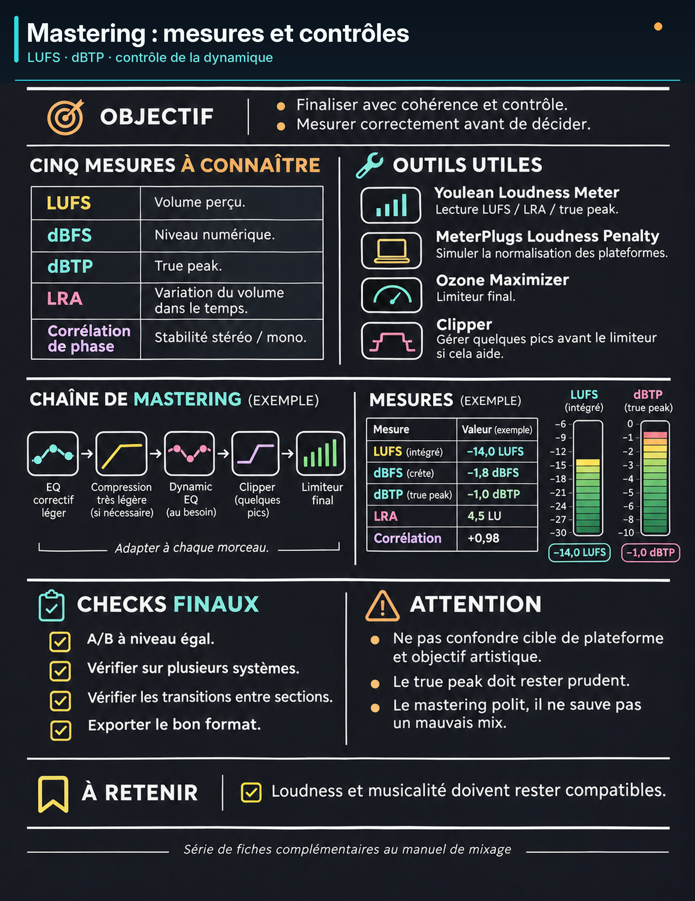

| Mesure                                             | Ce qu'elle indique                                                | Utilisation pratique                                      |
| -------------------------------------------------- | ----------------------------------------------------------------- | --------------------------------------------------------- |
| **LUFS** (*momentary*, *short-term*, *integrated*) | Sonie pondérée du signal, selon trois fenêtres temporelles.       | Évaluer le passage fort et le titre entier.               |
| **dBFS** (*sample peak*)                           | Amplitude des échantillons par rapport au plein niveau numérique. | Repérer un dépassement numérique sur les sorties PCM.     |
| **dBTP** (*true peak*)                             | Estimation de la crête du signal reconstruit.                     | Vérifier le plafond de livraison.                         |
| **LRA**                                            | Étendue statistique des variations de sonie.                      | Observer les contrastes à l'échelle du morceau.           |
| **Corrélation de phase**                           | Similarité relative des deux canaux.                              | Compléter l'écoute mono ; alerte si durablement négative. |

Pour distinguer **VU, RMS, dBFS, LUFS et dB SPL**, consulter le [tableau de référence de la section 0.2](#sec-0-2). Ces mesures décrivent des phénomènes différents et ne se convertissent pas directement entre elles sans contexte.

### 11.6 Filtre passe-haut au mastering : uniquement si nécessaire

Un filtre passe-haut peut retirer un grondement très bas ou une composante infragrave indésirable, mais il peut également modifier la phase et réduire l'assise du mix. Un point d'essai vers **20–30 Hz** est parfois utile ; **ne pas appliquer de coupure par défaut** et vérifier l'effet sur le système pleine bande.

Les points de départ plus élevés évoqués pour certaines **pistes individuelles** à la section [10.3](#sec-10-3) ne s'appliquent pas automatiquement au fichier stéréo final.

### 11.7 Mesurer tout le morceau, et pas seulement son refrain

Le tutoriel « Ne commettez pas cette erreur de volume sonore LUFS » souligne une erreur fréquente : **prendre la mesure d'un passage fort pour celle de l'ensemble du morceau**.

1. Mesurer en **LUFS à court terme** pour situer les sections les plus fortes, sans en déduire immédiatement le LUFS intégré.
2. Réinitialiser le mesureur, lire **le titre entier** (y compris intro, silences voulus et fin de réverbération), puis relever le **LUFS intégré**.
3. Noter également **LRA, dBTP et PLR** si disponibles ; comparer la version exportée à la lecture dans la session.
4. Écouter une simulation de normalisation si elle est disponible, sans considérer son résultat comme une garantie du comportement de chaque service.

L'exemple du tutoriel compare une mesure sur passage fort à un résultat d'environ **−16,8 LUFS intégré** après lecture complète. Il illustre l'écart entre fenêtres de mesure : **ce n'est pas une cible à reproduire**. Dans Cubase, SuperVision ou un mesureur équivalent (par exemple Youlean Loudness Meter) peut servir à cette vérification.

### 11.8 Crêtes inter-échantillons et dernier contrôle

Le terme relevé dans certaines notes, **« inner sampler peak »**, renvoie vraisemblablement à ***intersample peak*** ou **crête inter-échantillons** : un maximum possible du signal reconstruit **entre** deux échantillons. Le niveau *true peak* (en dBTP) sert à en estimer l'importance.

Il ne faut pas déduire d'une seule mesure de LUFS plus négative que le morceau est nécessairement « plus dynamique ». Pour apprécier le contraste, tenir compte de **LRA, PLR, de l'arrangement et de l'écoute**.

**Avant la livraison :** vérifier le fichier WAV exporté, mesurer le titre complet, confirmer le plafond *true peak*, la résolution et la fréquence d'échantillonnage demandées, puis écouter les premières et dernières secondes du fichier. La comparaison finale doit porter sur **le fichier livré**, et pas seulement sur l'état de la session.[Les mesures numériques et leurs horizons temporels](illustrations/09-loudness.svg)

## Annexe A : Déroulement rapide d'une session

1. Position d'écoute et niveau de référence en place.
2. [Gain staging](#glossaire-gain-staging) : moyenne vers -18 dBFS, crêtes vers -10 à -6.
3. Balance aux faders, avec écoute à bas volume.
4. Panoramique modéré, loi de panoramique vérifiée.
5. Timing kick et basse, [phase](#glossaire-phase) [DI](#glossaire-di) et ampli.
6. Compression basse, puis batterie, voix, bus.
7. EQ avec raison, vérifié en bypass à niveau égal.
8. Saturation (sur copie parallèle pour les graves), puis filtre.
9. Réverbération et délais : pré-délai, retours panoramiqués, filtrage.
10. Contrôle mono toutes les 15 à 30 minutes, test téléphone, casque.
11. Vérifications avant mastering, puis chaîne de mastering.

## Annexe B : Liste de contrôle finale

- Le niveau d'écoute est calibré et marqué.
- Aucune piste ni aucun bus ne reçoit de signal écrêté.
- La balance tient à bas volume, à niveau de référence et à haut volume.
- Voix, kick, caisse claire et basse sont solides en mono.
- Chaque EQ et chaque compresseur a passé le test du bypass à niveau égal.
- Le grave est audible sur téléphone (harmoniques) sans devenir flou ou trop prononcé.
- Les retours de réverbération ne masquent rien.
- Le mix a été écouté sur au moins deux autres systèmes (casque, téléphone, voiture).
- Le mix conserve son impact : dynamique préservée, aucune sensation d'écrasement.
- Les exigences de livraison (*[true peak](#glossaire-true-peak)*, format) sont vérifiées.

## Annexe C : Les mots d'ordre à retenir

- Même niveau, meilleurs mix.
- Faders d'abord, pas d'EQ tout de suite.
- [Headroom](#glossaire-headroom) d'abord, volume en dernier.
- Le chevauchement est normal, le masquage est le problème.
- Utiliser l'EQ quand il aide, le laisser quand il n'aide pas.
- Contrôler les crêtes, garder l'interprétation.
- Placer avec intention, élargir avec un but.
- Resserrer d'abord, élargir ensuite.
- Le mastering polit, il ne sauve pas.

## Annexe D : Ce que la révision a ajouté

| Ajout                                                                                                        | Pourquoi                                    | Source                          |
| ------------------------------------------------------------------------------------------------------------ | ------------------------------------------- | ------------------------------- |
| Précision sur la calibration (83 [dB SPL](#glossaire-db-spl), une enceinte à la fois, [RMS](#glossaire-rms)) | La fiche ne donne qu'une plage              | Bob Katz (Digido), Meter Plugs  |
| Écoute complémentaire (0.4)                                                                                  | Un seul système ne suffit pas               | Senior, chapitre 2              |
| Préparation de la session (0.5)                                                                              | Étape absente des fiches                    | Senior, partie 2 ; MasteringBOX |
| Références et objectifs (0.6)                                                                                | Étape absente des fiches                    | Senior, chapitre 4 ; iZotope    |
| Précisions de [gain staging](#glossaire-gain-staging)                                                        | Les repères varient selon l'étape           | iZotope ; MasteringBOX          |
| Compresser pour une raison, dé-essage, [sidechain](#glossaire-sidechain) (6.7)                               | Compléments de la partie dynamique          | Senior, chapitres 9, 13 et 14   |
| Automation, bus principal, versions (Étape 9)                                                                | Étape absente des fiches                    | Senior, chapitre 19             |
| Précisions sur le volume et le *[true peak](#glossaire-true-peak)* (10.4)                                    | Les fiches donnent des chiffres sans source | AES, EBU, Spotify               |

### Points où les fiches divergent

- **Téléphones** : une fiche dit que la plupart coupent sous environ 150 à 200 Hz, une autre sous environ 500 Hz. Cela varie selon l'appareil : testez le vôtre.
- **Volume de mastering** : une fiche propose environ -6 à -10 [LUFS](#glossaire-lufs) (selon le genre), une autre déconseille de viser un chiffre. Les recommandations et modes de normalisation AES et EBU concernent **des chaînes et des cas d'usage spécifiques** ; ils ne constituent pas une cible de mastering obligatoire pour chaque œuvre musicale.
- **Niveau d'écoute** : la fiche donne 73 à 79 [dB SPL](#glossaire-db-spl), la méthode de Katz 83 dB SPL par enceinte.

### Deuxième série de fiches : ajouts et divergences

Aucune des fiches de la deuxième série n'était un doublon exact des premières. Plusieurs recoupaient des sections existantes (bus de batterie, kick au 1176, réverbérations, rendu sur différents systèmes) et ont été fusionnées dans la section concernée.

| Fiche                                                                                                                                             | Intégrée en   |
| ------------------------------------------------------------------------------------------------------------------------------------------------- | ------------- |
| [Mid/side](#glossaire-mid-side) pour un centre faible                                                                                             | 3.3           |
| Note de basse qui ressort ; séparer la basse en deux ; compression de basse (réglages par genre)                                                  | 4.5, 4.6, 4.3 |
| Ajouter du grave en coupant les bas-médiums ; EQ avant ou après ; usages du passe-haut ; SpecCraft                                                | 5.4 à 5.7     |
| Compresseur par source ; kick au 1176 ; écrêter le kick ; bus de batterie ; micros d'ambiance ; compresseur ou limiteur ; SSL 4000 E ; API Vision | 6.8 à 6.12    |
| Saturer le click du kick ; bande ou lampes                                                                                                        | 7.5, 7.6      |
| Types de réverbération ; salle ou plaque                                                                                                          | 8.5           |
| Dix contrôles du rendu sur différents systèmes                                                                                                    | 9.3           |
| Cinq mesures ; passe-haut en mastering                                                                                                            | 10.5, 10.6    |
| Équivalents gratuits de plugins                                                                                                                   | Annexe E      |

Origine : la plupart portent la mention audiospectra.net/cheat ou pauseplayrepeat.com. Quatre sont sans signature : « Types of reverb », « Bass compression cheat sheet », « The worst mastering tip » et « Paid plugins vs free alternatives ». Traitez-les avec un peu plus de prudence.

Nouvelles divergences :

- **Compression de basse** : la fiche sans signature propose 6 à 10 dB de réduction pour une basse [DI](#glossaire-di) et des attaques de 10 à 30 ms ; la première fiche proposait 3 à 6 dB et 20 à 40 ms (4.3).
- **Bus de batterie** : 1 à 3 dB (environ 2 dB) contre 2 à 4 dB dans le tableau 6.2.
- **Bus de mix** : 1 à 2 dB (fiche sur les sept sources) contre 1 à 3 dB (6.2).
- **Passe-haut** : 80 à 120 Hz sur les pistes non-basses (9.3), environ 100 Hz pour séparer la basse (4.6), 20 à 30 Hz seulement au mastering (10.6). Les contextes diffèrent.
- **Attaque du 1176** : toujours sous 1 ms, donc les attaques en millisecondes des tableaux génériques ne s'y règlent pas directement (6.9).

### Troisième série : transcriptions de tutoriels

| Tutoriel                                                                                                                                                                                  | Intégré en              |
| ----------------------------------------------------------------------------------------------------------------------------------------------------------------------------------------- | ----------------------- |
| Eliminate [Gain Staging](#glossaire-gain-staging) Guesswork For Good ; Gain Staging is IMPORTANT!                                                                                         | 1.1                     |
| Le secret pour finaliser vos mix ; Une fois que vous savez cela, le mélange est beaucoup plus facile                                                                                      | 2.1, 2.2, 9.6           |
| 5 signes que votre mix est « ennuyeux »                                                                                                                                                   | 3.4, 9.5                |
| Eliminate Muddy Bass Guitar For Good                                                                                                                                                      | 4.7, 9.4                |
| Les 4 fréquences qui gâchent vos mix ; 7 leçons d'égalisation ; 5 choses qui obsèdent les débutants                                                                                       | 5.5, 5.8, 5.9, 8.6, 9.6 |
| Comprendre les types de compresseurs ; En finir avec la confusion liée aux tranches de console ; Pourquoi les pros utilisent des plugins de tranche de console ; Effortless Guitar Mixing | 6.13 à 6.15             |
| Ne commettez pas cette erreur de volume sonore [LUFS](#glossaire-lufs)                                                                                                                    | 10.7                    |

Nouvelles divergences :

- **Gain staging** : -14 dBFS pour 0 [VU](#glossaire-vu) (méthode VU), -18 dBFS = 0 VU avec crêtes de batterie à -6 dBFS (autre tutoriel), mix à -18 LUFS ou [RMS](#glossaire-rms) (iZotope), pistes à -12 à -18 dBFS de crête (MasteringBOX). Les bus stéréo visent aussi des niveaux différents : environ -13 à -14 LUFS au départ puis -12 en fin de mix, ou environ -18 RMS avec crêtes à -3 ou -2 dBFS. Ces méthodes ne s'additionnent pas : choisissez-en une.
- **Limiteur sur le bus principal** : un tutoriel en laisse un, transparent, comme sécurité de travail ; la fiche 6.11 déconseille de le laisser sur un mix destiné au mastering.
- **Passe-haut sur les sources graves** : un tutoriel recommande un shelf bas plutôt qu'un passe-haut sur kick et basse, et environ 40 Hz en cas de doute ; d'autres montrent un passe-haut à 55 Hz et 70 Hz sur la basse, et à 50 Hz sur des guitares ; la fiche donne 80 à 120 Hz sur les pistes qui ne sont pas des basses.
- **Ordre par défaut d'une SSL 4000E** : dynamique, EQ, filtres (tutoriel) contre dynamique, filtres, EQ (fiche 6.12).
- **EQ avant ou après la compression** : la fiche associe l'EQ correctif avant et le tonal après ; le tutoriel de console compresse d'abord par défaut ; le tutoriel pour débutants dit qu'il n'y a pas de bon ordre.
- **Volume de mastering** : environ -10 à -9 LUFS court terme (tutoriel), -6 à -10 LUFS (fiche), environ -16 LUFS (AES et EBU pour le streaming).

## Annexe E : Équivalents gratuits de plugins (selon une fiche)

La fiche d'origine est sans signature et je n'ai pas vérifié ces produits ni leur disponibilité actuelle. Vérifiez avant d'en dépendre.

| Fonction      | Payant                | Gratuit proposé                                    |
| ------------- | --------------------- | -------------------------------------------------- |
| EQ            | FabFilter Pro-Q 4     | TDR Nova ([EQ dynamique](#glossaire-eq-dynamique)) |
| Saturation    | Soundtoys Decapitator | Softube Saturation Knob                            |
| Limiteur      | FabFilter Pro-L 2     | Limiter No6                                        |
| Réverbération | Valhalla VintageVerb  | Valhalla Supermassive                              |

Conseil de la fiche : on n'a pas besoin de plugins coûteux pour faire des mixes professionnels ; apprenez les outils, comprenez les techniques et concentrez-vous sur l'oreille.

## Annexe F : Notes de masterclass — registre de provenance

**Convention de provenance :** « Notes de masterclass » signale un contenu tiré des notes personnelles et non d'une publication professionnelle vérifiée. Les données techniques ont été confrontées, lorsque possible, à des sources indépendantes ; ce recoupement **ne permet pas d'attribuer sans réserve un réglage précis à l'intervenant**. Les intitulés de produits incertains restent signalés comme tels.

| Notes conservées                                                                                           | Où les retrouver | Statut                                                 |
| ---------------------------------------------------------------------------------------------------------- | ---------------- | ------------------------------------------------------ |
| [Polarité](#glossaire-polarite), mono, ajouter les micros un à un, *[bleed](#glossaire-bleed)*, Auto-Align | 0.7              | Principe établi ; choix tonal contextuel               |
| Règle de prise de son « 3 »                                                                                | 0.7              | Règle 3:1 Shure, heuristique, pas garantie             |
| « Pacing » : début et fin des pièces                                                                       | 0.8              | Interprétation éditoriale à confirmer                  |
| Rough mix, faders, « −10 puis −6 dB »                                                                      | 1.2 et 2.3       | Échelle/emplacement de mesure inconnus                 |
| Bus master préparé dès le départ, NLS, bande, compresseurs, EQs, Pultec, Ozone                             | 9.3              | Approche facultative ; paramètres à valider à l'écoute |
| Brillance sides, centre adouci, rondeur sides                                                              | 9.3, 3.3         | Proposition créative, non règle                        |
| Ozone Imager, [EQ dynamique](#glossaire-eq-dynamique), parallèle, Neutron, RX Music Rebalance              | 6.16, 9.3        | Cas d'usage ponctuels                                  |
| « sublifter », « WARM junior », « Oxyde »                                                                  | 9.3              | Identification de produit à confirmer                  |
| « Inner sampler peak », [LUFS](#glossaire-lufs) et range                                                   | 11.8             | Terminologie corrigée et nuancée                       |

## Annexe G : Glossaire technique A–Z

Les définitions sont synthétiques et adaptées au vocabulaire des interfaces audio professionnelles. Cliquez sur un terme dans le manuel pour revenir à sa définition. Les termes anglais sont conservés lorsqu’ils sont usuels dans les DAW ; les traductions françaises sont proposées sans les imposer.

[Revenir au tableau des niveaux](#sec-0-2) · [Consulter l’index](#annexe-h-index)

-  *glue compression* (compression de cohésion) — compression modérée sur un groupe de pistes afin de réduire légèrement leurs écarts dynamiques et de renforcer leur unité sonore.
-  **A/B**Notes de masterclass — comparaison entre deux traitements, idéalement à niveau perçu égal.
-  **attaque**Notes de masterclass — *Attack* : temps mis par un compresseur pour atteindre sa réduction de gain après une variation du signal, selon sa conception.
-  **automation**Notes de masterclass — variation enregistrée de paramètres (volume, panorama, envoi, EQ) dans le temps.
-  **balance**Notes de masterclass — rapport audible des niveaux des différentes pistes ou instruments.
-  **bande magnétique**Notes de masterclass — support analogique dont les émulations reproduisent certaines non-linéarités.
-  **bas-médiums**Notes de masterclass — Zone du spectre approximativement entre 150 et 500 Hz ; elle peut apporter du corps ou un encombrement selon la source.
-  **BBD delay**Notes de masterclass — *Bucket-Brigade Device* : délai analogique à transfert de charges, dont les répétitions présentent souvent une bande passante limitée et une coloration caractéristique.
-  **bleed**Notes de masterclass — Son d’une source autre que la source visée capté par un microphone (par exemple, la caisse claire captée par le micro de grosse caisse) ; parfois appelé « repisse » en français de studio.
-  **bus**Notes de masterclass — Canal (ou groupe) qui reçoit et additionne plusieurs signaux avant un traitement ou un routage commun.
-  **bus de groupe**Notes de masterclass — Canal audio qui reçoit plusieurs pistes et permet un traitement commun (EQ, compression, saturation) au moyen de ses inserts ; distinct d’un fader VCA.
-  **bus principal (mix bus)**Notes de masterclass — Voie recevant la somme du mix, généralement avant la sortie stéréo et les opérations de mastering.
-  **clip gain**Notes de masterclass — gain appliqué à un segment audio avant le fader et, selon le DAW, les inserts.
-  **clipping**Notes de masterclass — écrêtage du signal lorsque l’étage considéré dépasse sa plage admissible.
-  **comb filtering**Notes de masterclass — Interférences entre des copies corrélées décalées dans le temps : le spectre comporte des creux et des bosses périodiques. En français, on parle aussi de « filtrage en peigne ».
-  **compresseur FET**Notes de masterclass — compresseur utilisant un transistor à effet de champ pour la réduction de gain.
-  **compresseur optique**Notes de masterclass — compresseur dont le contrôle de gain repose sur un élément optique.
-  **compresseur VCA**Notes de masterclass — Compresseur utilisant un *Voltage-Controlled Amplifier* (amplificateur commandé en tension) pour réguler le gain audio. À distinguer du *fader VCA* qui commande plusieurs faders dans un DAW.
-  **compression**Notes de masterclass — traitement qui réduit, modifie ou modèle la plage dynamique du signal.
-  **compression de cohésion (glue compression)**Notes de masterclass — Compression généralement modérée appliquée à un groupe de sources pour favoriser une dynamique commune ; ne garantit pas une cohérence de phase.
-  **compression en série**Notes de masterclass — Deux compresseurs ou plus placés successivement : chacun reçoit la sortie du précédent.
-  **compression parallèle**Notes de masterclass — Traitement parallèle : combinaison d’un signal non traité et d’une copie fortement ou légèrement compressée.
-  **corrélation**Notes de masterclass — indicateur de similarité entre deux signaux, notamment les canaux stéréo.
-  **crossover**Notes de masterclass — filtre de séparation du spectre entre deux bandes de traitement.
-  **DAW**Notes de masterclass — station audionumérique (Digital Audio Workstation), ex. Cubase ou Reaper.
-  **dB**Notes de masterclass — décibel, unité logarithmique de rapport de niveaux.
-  **dB SPL**Notes de masterclass — *Sound Pressure Level* : niveau de pression acoustique mesuré dans l’air, typiquement avec un sonomètre au point d’écoute. Référence acoustique standard de 20 µPa.
-  **dB(A)**Notes de masterclass — Niveau de pression acoustique avec pondération fréquentielle A, utilisé notamment pour l’évaluation du bruit.
-  **dB(C)**Notes de masterclass — Niveau de pression acoustique avec pondération fréquentielle C, souvent utilisé pour calibrer une écoute de studio.
-  **dBFS**Notes de masterclass — *Decibels relative to Full Scale* : niveau d’amplitude numérique rapporté à la pleine échelle ; le *sample peak* est exprimé en dBFS.
-  **dBFS RMS**Notes de masterclass — Mesure RMS dont la valeur est exprimée en dBFS (référence : pleine échelle numérique). **RMS est la méthode de calcul**, dBFS la référence ; ne pas confondre avec LUFS.
-  **dBTP**Notes de masterclass — *Decibels True Peak* : niveau *true peak* (crête estimée après reconstruction), y compris les dépassements entre échantillons.
-  **dé-esseur (*de-esser*)**Notes de masterclass — processeur atténuant de façon sélective certaines sifflantes.
-  **délai**Notes de masterclass — décalage temporel d’un signal ou effet répétant un son avec retard.
-  **DI**Notes de masterclass — boîte ou prise directe qui capte un instrument sans microphone d’amplificateur.
-  **dithering (bruit de quantification ajouté)**Notes de masterclass — Ajout contrôlé d’un bruit de très faible niveau avant une réduction de résolution PCM, afin de décorréler les erreurs de quantification.
-  **dynamique**Notes de masterclass — écart et évolution entre les niveaux faibles et forts.
-  **édition**Notes de masterclass — modification de prises, coupes, raccords, niveaux ponctuels ou alignement.
-  **EQ**Notes de masterclass — égaliseur modifiant le niveau de différentes bandes de fréquences.
-  **EQ dynamique**Notes de masterclass — égaliseur dont le gain de bande change selon le signal ou un déclencheur.
-  **fader**Notes de masterclass — curseur de niveau d’une piste ou d’un bus.
-  **fader VCA**Notes de masterclass — Commande de niveau commune à plusieurs faders de pistes (*Voltage-Controlled Amplifier*) ; dans Cubase, elle ne fait pas passer ni additionner le son et n’offre pas d’inserts de traitement audio. Ne pas confondre avec un compresseur VCA.
-  **filtre passe-bas, Low-Pass Filter (LPF) ou High-Cut Filter**Notes de masterclass — filtre atténuant progressivement les hautes fréquences au-delà d’une coupure.
-  **filtre passe-haut, High-Pass Filter (HPF) ou Low-Cut Filter**Notes de masterclass — filtre atténuant progressivement les basses fréquences sous une coupure.
-  **floating point**Notes de masterclass — Architecture de calcul numérique à virgule flottante (par exemple 32 ou 64 bits) utilisée dans de nombreux moteurs audio de DAW ; elle ne garantit pas l’absence d’écrêtage aux sorties ou dans les plugins non linéaires.
-  **fréquence**Notes de masterclass — Nombre de cycles par seconde d’une composante périodique ; exprimé en hertz (Hz).
-  **fréquence de coupure**Notes de masterclass — Fréquence caractéristique à partir de laquelle le filtre atténue progressivement le signal, suivant sa pente et son type.
-  **gain reduction**Notes de masterclass — Atténuation appliquée par un compresseur ou limiteur ; souvent notée GR et affichée en dB.
-  **gain staging**Notes de masterclass — gestion des niveaux d’entrée et de sortie à chaque étage du routage.
-  **gate**Notes de masterclass — traitement qui atténue un signal lorsqu’il passe sous un seuil.
-  **harmoniques**Notes de masterclass — composantes de fréquence liées à une fondamentale ; certaines saturations en ajoutent.
-  **headroom**Notes de masterclass — Marge de niveau disponible avant la limite d’un étage donné ; la marge interne du DAW et celle d’un convertisseur ne sont pas identiques.
-  **intersample peak**Notes de masterclass — Crête entre échantillons : valeur qui peut apparaître lors de la reconstruction d’un signal numérique ; les mesures *true peak* en tiennent compte.
-  **IRC IV**Notes de masterclass — algorithme de limitation Intelligent Release Control d’iZotope, avec plusieurs styles.
-  **K-System**Notes de masterclass — Système de calibration du monitoring et de mesure des niveaux décrit par Bob Katz ; les conventions K-20, K-14 et K-12 dépendent de l’usage.
-  **latence**Notes de masterclass — retard introduit par l’acquisition, le routage ou certains traitements.
-  **limiteur**Notes de masterclass — processeur limitant les niveaux les plus forts, généralement à ratio très élevé.
-  **loudness**Notes de masterclass — Mesure du niveau sonore perçu ; les mesures normalisées de programme sont exprimées en LUFS. Le terme français technique est « sonie ».
-  **loudness meter**Notes de masterclass — Outil de mesure de loudness, présentant notamment les valeurs Momentary, Short-term et Integrated en LUFS.
-  **LRA**Notes de masterclass — Loudness Range, estimation statistique de variation de sonie, en LU.
-  **LU**Notes de masterclass — *Loudness Unit* : unité relative de variation de loudness ; un écart de 1 LU équivaut à un écart de 1 dB selon la mesure normalisée.
-  **LUFS**Notes de masterclass — *Loudness Units relative to Full Scale* : unité de loudness mesurée avec pondération K, selon ITU-R BS.1770 / EBU R 128.
-  **magnétophone à bande**Notes de masterclass — Appareil analogique d’enregistrement ou de lecture sur bande magnétique ; distinct de l’émulation numérique de ses comportements.
-  **marge numérique**Notes de masterclass — Réserve de niveau entre le signal et le plafond d’un étage donné, à distinguer de la marge acoustique et de la plage de calcul flottant.
-  **masquage**Notes de masterclass — situation où un son rend perceptuellement plus difficile l’écoute d’un autre.
-  **mastering**Notes de masterclass — traitement et contrôle technique du mix final pour sa diffusion.
-  **micro d’ambiance**Notes de masterclass — micro captant le son indirect et le caractère acoustique d’un lieu.
-  **mid/side**Notes de masterclass — représentation stéréo en composante commune M et différence S.
-  **mono**Notes de masterclass — somme ou lecture sur un seul canal plutôt que deux canaux séparés.
-  **normalisation**Notes de masterclass — ajustement de niveau selon une règle, tel un objectif de sonie en lecture.
-  **overheads**Notes de masterclass — microphones au-dessus d’une batterie, captant l’ensemble du kit.
-  **pacing**Notes de masterclass — Dans les notes de masterclass, désigne la sélection des débuts et fins de morceaux ; pour cette opération, utiliser « délimitation/édition des débuts et fins » dans le texte courant. Son sens habituel en production peut aussi concerner le rythme narratif.
-  **pan law**Notes de masterclass — règle de gain appliquée lors du déplacement d’une source entre gauche et droite.
-  **panoramique**Notes de masterclass — placement d’un son dans le champ gauche-droite.
-  **peak meter**Notes de masterclass — Indicateur de niveau de crête. Vérifier s’il mesure le *sample peak* ou le *true peak*, et à quel point du routage.
-  **phase**Notes de masterclass — Relation temporelle entre composantes d’un signal ; un écart de temps entre micros peut modifier l’équilibre spectral lorsqu’on les additionne.
-  **PLR**Notes de masterclass — Peak-to-Loudness Ratio, écart entre crête vraie et sonie intégrée, en dB.
-  **polarité**Notes de masterclass — orientation positive/négative d’un signal ; inverser la polarité n’est pas décaler le temps.
-  **pré-délai**Notes de masterclass — temps séparant le son direct des premières réverbérations simulées.
-  **pré-oscillation (pre-ringing)**Notes de masterclass — Oscillations pouvant précéder un transitoire après certains traitements à phase linéaire.
-  **Q**Notes de masterclass — facteur définissant la largeur relative d’une bande d’égalisation.
-  **ratio**Notes de masterclass — rapport de compression entre changement de niveau en entrée et en sortie au-dessus du seuil.
-  **référence**Notes de masterclass — morceau commercial utilisé pour comparer les choix de tonalité et de balance à niveau égal.
-  **release**Notes de masterclass — Temps de retour vers le niveau non compressé après une réduction de gain ; paramètre du compresseur.
-  **résonance**Notes de masterclass — Concentration d’énergie autour d’une fréquence ou d’une bande étroite ; elle peut résulter de la source, d’un instrument ou d’un mode de la pièce.
-  **réverbération**Notes de masterclass — ensemble de réflexions qui prolongent un son et donnent une impression d’espace.
-  **RMS**Notes de masterclass — *Root Mean Square* : mesure du niveau efficace (moyenne quadratique) sur une fenêtre temporelle donnée ; à distinguer de la loudness pondérée.
-  **RMS meter**Notes de masterclass — Indicateur du niveau efficace du signal sur une durée définie. Son affichage dépend de la méthode et de la calibration.
-  **rough mix**Notes de masterclass — première balance musicale, généralement réalisée avant la majorité des traitements.
-  **sample peak**Notes de masterclass — Niveau de la plus grande amplitude d’échantillon du signal numérique ; peut être plus faible que le *true peak*.
-  **saturation**Notes de masterclass — non-linéarité ajoutant des harmoniques et parfois de la compression douce.
-  **sidechain**Notes de masterclass — signal de détection qui commande un processeur, parfois venu d’une autre piste.
-  **sommation**Notes de masterclass — Addition de signaux audio, par exemple lorsque des pistes sont routées vers un bus ; selon le contexte, dire simplement « addition des signaux ».
-  **sonie**Notes de masterclass — Sensation subjective d’intensité sonore (*loudness*). Les LUFS constituent une mesure normalisée du niveau sonore d’un programme, mais ne sont pas des sones.
-  **SpecCraft**Notes de masterclass — plug-in de Three-Body Technology combinant suppression dynamique des résonances et traitement spectral.
-  **spectre**Notes de masterclass — répartition de l’énergie selon la fréquence.
-  **stéréo**Notes de masterclass — reproduction à deux canaux pouvant créer largeur et localisation.
-  **sustain**Notes de masterclass — Maintien du son après son attaque ; dans un processeur de transitoires, commande agissant sur la phase de maintien ou de décroissance.
-  **tape simulator** (émulateur de magnétophone à bande) — émulateur numérique de certains effets de bande magnétique.
-  **threshold**Notes de masterclass — seuil à partir duquel un compresseur, gate ou limiteur commence à agir.
-  **transient shaper**Notes de masterclass — processeur qui amplifie ou atténue l’attaque et/ou le maintien d’un son.
-  **transitoire**Notes de masterclass — événement très bref à l’attaque d’un son (coup de caisse claire, consonne).
-  **trim**Notes de masterclass — réglage de gain à un point de la chaîne, souvent avant les traitements.
-  **true peak**Notes de masterclass — Crête estimée du signal audio reconstruit, y compris entre deux échantillons ; résultat généralement exprimé en dBTP.
-  **VU**Notes de masterclass — *Volume Unit* : graduation d’un VU-mètre. Sa correspondance avec le dBFS dépend de la calibration choisie.
-  **VU-mètre**Notes de masterclass — *VU meter* : afficheur de niveau à réponse relativement lente (environ 300 ms), nécessitant une calibration pour l’usage dans un DAW.

## Annexe H : Index des termes et de leurs applications

Chaque lien mène à une définition du glossaire. Les applications repérées dans le manuel sont indiquées lorsque disponibles.

- [A/B](#glossaire-a-b) · Applications : [0.6](#sec-0-6), [2.1](#sec-2-1), [5.9](#sec-5-9)
- [attaque](#glossaire-attaque) · Applications : [6.2](#sec-6-2)
- [automation](#glossaire-automation) · Applications : [3.4](#sec-3-4), [6.3](#sec-6-3), [8.4](#sec-8-4)
- [balance](#glossaire-balance) · Applications : [Étape 2](#sec-2), [2.1](#sec-2-1), [5.1](#sec-5-1)
- [bande magnétique](#glossaire-bande-magnetique)
- [bas-médiums](#glossaire-bas-mediums) · Applications : [5.4](#sec-5-4), [5.8](#sec-5-8)
- [bleed](#glossaire-bleed) · Applications : [0.7](#sec-0-7), [2.2](#sec-2-2), [5.6](#sec-5-6)
- [bus](#glossaire-bus) · Applications : [1.3](#sec-1-3), [6.4](#sec-6-4), [6.10](#sec-6-10)
- [bus de groupe](#glossaire-bus-de-groupe) · Applications : [1.1](#sec-1-1), [1.2](#sec-1-2)
- [clip gain](#glossaire-clip-gain)
- [clipping](#glossaire-clipping) · Applications : [10.3](#sec-10-3)
- [comb filtering](#glossaire-comb-filtering) · Applications : [0.7](#sec-0-7), [2.2](#sec-2-2)
- [compresseur FET](#glossaire-compresseur-fet) · Applications : [6.1](#sec-6-1), [6.8](#sec-6-8)
- [compresseur optique](#glossaire-compresseur-optique) · Applications : [6.1](#sec-6-1)
- [compresseur VCA](#glossaire-compresseur-vca) · Applications : [6.1](#sec-6-1), [6.8](#sec-6-8), [6.12](#sec-6-12)
- [compression](#glossaire-compression) · Applications : [5.5](#sec-5-5), [Étape 6](#sec-6), [6.3](#sec-6-3)
- [compression parallèle](#glossaire-compression-parallele) · Applications : [6.7](#sec-6-7), [6.16](#sec-6-16)
- [corrélation](#glossaire-correlation) · Applications : [Étape 9](#sec-9), [9.1](#sec-9-1)
- [crossover](#glossaire-crossover) · Applications : [4.6](#sec-4-6), [7.2](#sec-7-2)
- [DAW](#glossaire-daw) · Applications : [Étape 0](#sec-0), [0.3](#sec-0-3), [0.5](#sec-0-5)
- [dB](#glossaire-db) · Applications : [0.2](#sec-0-2)
- [dB SPL](#glossaire-db-spl) · Applications : [0.2](#sec-0-2)
- [dB(A)](#glossaire-ponderation-a) · Applications : [0.2](#sec-0-2)
- [dB(C)](#glossaire-ponderation-c) · Applications : [0.2](#sec-0-2)
- [dBFS](#glossaire-dbfs) · Applications : [Étape 1](#sec-1), [1.1](#sec-1-1), [1.2](#sec-1-2)
- [dBFS RMS](#glossaire-dbfs-rms) · Applications : [0.2](#sec-0-2), [1.2](#sec-1-2)
- [dBTP](#glossaire-dbtp) · Applications : [9.3](#sec-9-3), [10.4](#sec-10-4), [11.5](#sec-11-5)
- [délai](#glossaire-delai) · Applications : [Étape 8](#sec-8), [8.3](#sec-8-3), [8.4](#sec-8-4)
- [dé-esseur](#glossaire-desesseur) · Applications : [6.7](#sec-6-7)
- [DI](#glossaire-di) · Applications : [Étape 4](#sec-4), [4.2](#sec-4-2)
- [dynamique](#glossaire-dynamique) · Applications : [9.5](#sec-9-5)
- [édition](#glossaire-edition) · Applications : [0.5](#sec-0-5), [0.8](#sec-0-8)
- [EQ](#glossaire-eq) · Applications : [Étape 5](#sec-5), [5.1](#sec-5-1), [5.5](#sec-5-5)
- [EQ dynamique](#glossaire-eq-dynamique) · Applications : [4.5](#sec-4-5), [5.2](#sec-5-2), [5.7](#sec-5-7)
- [fader](#glossaire-fader) · Applications : [1.3](#sec-1-3), [Étape 2](#sec-2), [2.3](#sec-2-3)
- [fader VCA](#glossaire-fader-vca) · Applications : [1.1](#sec-1-1)
- [filtre passe-bas](#glossaire-filtre-passe-bas) · Applications : [4.6](#sec-4-6), [8.6](#sec-8-6), [9.4](#sec-9-4)
- [filtre passe-haut](#glossaire-filtre-passe-haut) · Applications : [4.6](#sec-4-6), [5.6](#sec-5-6), [8.6](#sec-8-6)
- [floating point](#glossaire-floating-point) · Applications : [Étape 1](#sec-1), [1.1](#sec-1-1)
- [gain reduction](#glossaire-gain-reduction) · Applications : [6.2](#sec-6-2)
- [gain staging](#glossaire-gain-staging) · Applications : [Étape 1](#sec-1), [1.1](#sec-1-1), [6.14](#sec-6-14)
- [gate](#glossaire-gate) · Applications : [6.6](#sec-6-6)
- [harmoniques](#glossaire-harmoniques) · Applications : [4.4](#sec-4-4), [4.7](#sec-4-7), [Étape 7](#sec-7)
- [headroom](#glossaire-headroom) · Applications : [Étape 1](#sec-1), [1.2](#sec-1-2), [2.3](#sec-2-3)
- [intersample peak](#glossaire-intersample-peak) · Applications : [11.8](#sec-11-8)
- [IRC IV](#glossaire-irc-iv) · Applications : [9.3](#sec-9-3)
- [K-System](#glossaire-k-system) · Applications : [Étape 0](#sec-0), [0.2](#sec-0-2)
- [latence](#glossaire-latence) · Applications : [4.2](#sec-4-2), [6.16](#sec-6-16)
- [limiteur](#glossaire-limiteur) · Applications : [6.9](#sec-6-9), [6.11](#sec-6-11), [10.2](#sec-10-2)
- [loudness](#glossaire-loudness) · Applications : [0.2](#sec-0-2), [10.4](#sec-10-4)
- [loudness meter](#glossaire-loudness-meter) · Applications : [0.2](#sec-0-2), [11.7](#sec-11-7)
- [LRA](#glossaire-lra) · Applications : [11.5](#sec-11-5), [11.8](#sec-11-8)
- [LU](#glossaire-lu) · Applications : [0.2](#sec-0-2), [11.5](#sec-11-5)
- [LUFS](#glossaire-lufs) · Applications : [10.4](#sec-10-4), [11.5](#sec-11-5), [11.7](#sec-11-7)
- [masquage](#glossaire-masquage) · Applications : [4.7](#sec-4-7), [Étape 5](#sec-5), [5.3](#sec-5-3)
- [mastering](#glossaire-mastering) · Applications : [Étape 9](#sec-9), [11.1](#sec-11-1), [11.6](#sec-11-6)
- [micro d’ambiance](#glossaire-micro-d-ambiance) · Applications : [2.2](#sec-2-2), [6.10](#sec-6-10), [8.5](#sec-8-5)
- [mid/side](#glossaire-mid-side) · Applications : [3.3](#sec-3-3)
- [mono](#glossaire-mono) · Applications : [0.4](#sec-0-4), [3.2](#sec-3-2), [3.3](#sec-3-3)
- [normalisation](#glossaire-normalisation) · Applications : [10.4](#sec-10-4)
- [overheads](#glossaire-overheads)
- [pacing](#glossaire-pacing) · Applications : [0.8](#sec-0-8)
- [pan law](#glossaire-pan-law) · Applications : [0.3](#sec-0-3), [Étape 3](#sec-3), [3.2](#sec-3-2)
- [panoramique](#glossaire-panoramique) · Applications : [Étape 3](#sec-3), [3.1](#sec-3-1), [3.4](#sec-3-4)
- [peak meter](#glossaire-peak-meter) · Applications : [1.2](#sec-1-2)
- [phase](#glossaire-phase) · Applications : [0.7](#sec-0-7), [5.6](#sec-5-6)
- [PLR](#glossaire-plr) · Applications : [11.8](#sec-11-8)
- [polarité](#glossaire-polarite) · Applications : [0.7](#sec-0-7), [4.2](#sec-4-2)
- [pré-délai](#glossaire-pre-delai) · Applications : [Étape 8](#sec-8), [8.1](#sec-8-1)
- [Q](#glossaire-q) · Applications : [4.5](#sec-4-5), [5.2](#sec-5-2), [5.9](#sec-5-9)
- [ratio](#glossaire-ratio) · Applications : [4.3](#sec-4-3), [Étape 6](#sec-6), [6.2](#sec-6-2)
- [référence](#glossaire-reference) · Applications : [Étape 0](#sec-0), [0.1](#sec-0-1), [0.4](#sec-0-4)
- [release](#glossaire-release) · Applications : [4.3](#sec-4-3), [6.2](#sec-6-2)
- [réverbération](#glossaire-reverberation) · Applications : [0.8](#sec-0-8), [Étape 8](#sec-8), [8.1](#sec-8-1)
- [RMS](#glossaire-rms) · Applications : [0.2](#sec-0-2), [1.2](#sec-1-2), [4.3](#sec-4-3)
- [RMS meter](#glossaire-rms-meter) · Applications : [1.2](#sec-1-2)
- [rough mix](#glossaire-rough-mix) · Applications : [Étape 2](#sec-2), [2.3](#sec-2-3), [9.6](#sec-9-6)
- [sample peak](#glossaire-sample-peak) · Applications : [0.2](#sec-0-2), [11.8](#sec-11-8)
- [saturation](#glossaire-saturation) · Applications : [4.4](#sec-4-4), [6.15](#sec-6-15), [Étape 7](#sec-7)
- [sidechain](#glossaire-sidechain) · Applications : [Étape 4](#sec-4), [4.1](#sec-4-1), [6.6](#sec-6-6)
- [sommation](#glossaire-sommation)
- [SpecCraft](#glossaire-speccraft) · Applications : [5.7](#sec-5-7), [9.3](#sec-9-3)
- [spectre](#glossaire-spectre) · Applications : [Étape 5](#sec-5), [5.3](#sec-5-3), [5.8](#sec-5-8)
- [stéréo](#glossaire-stereo) · Applications : [0.1](#sec-0-1), [Étape 3](#sec-3), [3.1](#sec-3-1)
- [tape simulator](#glossaire-tape-simulator) · Applications : [Étape 7](#sec-7), [7.6](#sec-7-6)
- [threshold](#glossaire-threshold) · Applications : [Étape 6](#sec-6)
- [transient shaper](#glossaire-transient-shaper) · Applications : [7.3](#sec-7-3)
- [transitoire](#glossaire-transitoire) · Applications : [Étape 4](#sec-4), [4.1](#sec-4-1), [6.5](#sec-6-5)
- [trim](#glossaire-trim) · Applications : [1.2](#sec-1-2), [1.3](#sec-1-3), [6.12](#sec-6-12)
- [true peak](#glossaire-true-peak)
- [VU](#glossaire-vu) · Applications : [1.1](#sec-1-1)
- [VU-mètre](#glossaire-vu-metre)

## Webographie professionnelle — sources ouvertes et critères de validation

**Principe de preuve.** Les normes et manuels d’instruments sont prioritaires pour définir des unités et le fonctionnement des outils. Les articles professionnels documentent des méthodes et leurs limites. Les recommandations de fabricants tiennent compte de leurs produits. Les forums fournissent des témoignages, **pas des normes**.

### Normes, métrologie et livraison

- **ITU-R**, [Recommandation BS.1770-5 (2023) — algorithmes de mesure de la sonie et de crête vraie](https://www.itu.int/rec/R-REC-BS.1770-5-202311-I/fr). Utilisé pour [§ 0.2](#sec-0-2) et [§ 11.4–11.8](#sec-11-4).
- **EBU**, [Tech 3341 (2023), métrologie Momentary, Short-term, Integrated et LRA](https://tech.ebu.ch/publications/tech3341/) ; [Tech 3342 — Loudness Range](https://tech.ebu.ch/publications/tech3342). Utilisé pour [§ 11.5](#sec-11-5).
- **Spotify for Artists**, [Loudness Normalization (consulté le 13 novembre 2026)](https://support.spotify.com/artists/article/loudness-normalization/). Pratiques de normalisation et conseils de livraison ; **ne pas confondre cible de normalisation et prescription artistique**.

### Fabricants, documentation technique et prise de son

- **Steinberg**, [Cubase Pro 15 — traitement 32/64-bit float](https://www.steinberg.help/r/cubase-pro/15.0/en/cubase_nuendo/topics/setting_up/setting_up_audio_vst_audio_system_r.html). Voir [§ 0.3](#sec-0-3) et [§ 1.2](#sec-1-2).
- **FabFilter**, [Pro-Q 4 — modes de phase, latence et pré-oscillation](https://prod.fabfilter.com/help/pro-q/using/processingmode) et [Pro-C 3 — commandes et mesure](https://www.fabfilter.com/help/pro-c/using/overview). Voir [§ 5.5](#sec-5-5) et [§ 6.1](#sec-6-1).
- **Three-Body Technology**, [SpecCraft — suppression dynamique de résonances et traitement spectral](https://www.threebodytech.com/en/products/speccraft). Voir [§ 5.7](#sec-5-7). **SpecCraft n’est pas un produit oeksound.**
- **Klanghelm**, [MJUC — présentation](https://klanghelm.com/contents/products/MJUC), [manuel français](https://klanghelm.com/docs/MJUC-manuel_FR.pdf). Voir [§ 6.1 bis](#sec-6-1-bis).
- **Shure**, [Microphone Techniques for Recording — règle 3:1](https://www.shure.com/en-US/docs/education/Microphone-Techniques-for-Recording). Voir [§ 0.7](#sec-0-7).
- **Sound Radix**, [Auto-Align 2](https://www.soundradix.com/products/auto-align/). La pertinence de l’alignement doit être confirmée en contexte, pas automatiquement.

### Presse et ressources pédagogiques

- **Sound On Sound**, [Gain Staging In Your DAW Software](https://www.soundonsound.com/techniques/gain-staging-your-daw-software), [Phase Demystified](https://www.soundonsound.com/techniques/phase-demystified), [Mix Secrets](https://www.soundonsound.com/mix-secrets). Articles approfondis, accessibilité variable selon la date.
- **Tape Op**, [Archives des numéros](https://tapeop.com/issues/). Articles et entretiens consultables selon leur statut ; **ne pas présumer que l’intégralité des archives est gratuite**.
- **Mix Magazine**, [Mix Online](https://www.mixonline.com/). Reportages, dossiers et études de cas.
- **Recording Magazine**, [On Mixing](https://www.recordingmag.com/resources/recording-info/on-mixing/). Conseils de prise de son et de mixage.
- **iZotope**, [Learn](https://www.izotope.com/en/learn). Tutoriels gratuits ; vérifier les paramètres dans la documentation propre à la version utilisée.
- **Audiofanzine**, [Dossiers prise de son et mixage](https://fr.audiofanzine.com/prise-de-son-mixage/editorial/dossiers/). Vocabulaire professionnel en français.
- **r/mixingmastering**, [Wiki](https://www.reddit.com/r/mixingmastering/wiki/index/) et **Gearspace**, [forums](https://gearspace.com/forums/). Retours d’expérience à corroborer, non documents normatifs.

### Tutoriels et transcriptions fournies

- **Sara Carter — Simply Mixing**, [chaîne YouTube officielle](https://www.youtube.com/@SaraCarterSimplyMixing). **Source majeure des transcriptions remises pour cette édition** ; approche pédagogique du mixage, des traitements et du *gain staging*. Son tutoriel [Gain Staging In 5 Easy Steps](https://www.youtube.com/watch?v=oETuEXuY8Kg) est publiquement identifiable.
- **Eliminate Gain Staging Guesswork For Good**, [lien vidéo fourni](https://youtu.be/VVAKRvvV6vo) ; associé par les informations disponibles à Sara Carter — Simply Mixing. Les variantes de calibration VU sont consignées comme méthodes de tutoriel, pas comme normes.
- **Gain Staging is IMPORTANT! But luckily it can be quick and easy**, [lien vidéo fourni](https://youtu.be/xCfahEToTjY). **Attribution distincte/non confirmée** : ne pas attribuer d’office cette transcription à Sara Carter.
- **Autres transcriptions remises** : titres archivés dans la section « Transcriptions de tutoriels fournies » ; **attribution vidéo par vidéo à confirmer** lorsque le fichier ne porte pas d’URL ou de signature vérifiable. Une transcription ne vaut pas autorisation de reproduire intégralement le tutoriel.

### Ouvrages de référence mentionnés mais non librement reproductibles

- **Mike Senior**, *Mixing Secrets for the Small Studio* (Focal Press) : ouvrage de référence cité ; les ressources associées sont publiques, **pas le livre complet**. [Sommaire et ressources](https://www.cambridge-mt.com/ms/contents).

## Sources consultées

**Références normatives complémentaires pour la terminologie des niveaux (v4)** : [ITU-R BS.1770-5 — algorithme de loudness et true peak](https://www.itu.int/rec/R-REC-BS.1770-5-202311-I/fr) ; [EBU R 128 (2023)](https://tech.ebu.ch/publications/r128) ; [EBU Tech 3341 — mesure Momentary, Short-term, Integrated](https://tech.ebu.ch/publications/tech3341/). Ces sources concernent la métrologie ; elles ne valident pas toutes les recettes de mixage issues des fiches.

Les références de normes et documents fabricants ont été confrontées aux pages officielles accessibles ; la totalité des articles et anciennes archives citées n’a pas fait l’objet d’une vérification ligne par ligne.

- Mike Senior, *Mixing Secrets for the Small Studio* : [table des matières](https://www.cambridge-mt.com/ms/contents), [ressources du chapitre 19](https://cambridge-mt.com/ms/ch19), [compte rendu de Sound On Sound](https://www.soundonsound.com/reviews/mixing-secrets-small-studio)
- Bob Katz, [Monitor Calibration with K-System](https://www.digido.com/ufaqs/monitor-calibration-with-k-system/) ; Meter Plugs, [K-System Metering 101](https://meterplugs.com/blog/2016/10/14/k-system-metering-101.html)
- [AES TD1008, Recommendations for Loudness of Internet Audio Streaming and On-Demand Distribution](https://www.aes.org/technical/documentDownloads.cfm?docID=731)
- [EBU R128 s2, Loudness in Streaming](https://knowledgehub.ebu.ch/files/live/sites/tech/files/shared/r/r128s2v1_0.pdf)
- Production Expert, [AES Update Loudness Recommendations For Audio Only Streaming](https://www.production-expert.com/production-expert-1/aes-update-loudness-recommendations-for-audio-only-streaming)
- [Spotify, Loudness normalization](https://support.spotify.com/artists/article/loudness-normalization/)
- iZotope, [How to mix a song from start to finish](https://www.izotope.com/en/learn/how-to-mix-a-track-from-start-to-finish) ; [MasteringBOX, Mastering vs mixing](https://www.masteringbox.com/mastering-and-mixing-difference/)

### Lots fournis pour cette édition

- **Lot 1** : manuel d'origine en `.md` ; `An Audio Glossary For Home Studio Musicians` (Simply Mixing), `Compression-Masterclass-Day-1.pdf`, `Mix Fix Checklist` (Simply Mixing), et 14 transcriptions de tutoriels au format `.docx`.
- **Lot 2** : `Compression Cheat Sheet.pdf` (Audio Spectra, 2023, 28 p.) ; `CHEAT Sheets_v1.pdf` (43 p.) ; `CHEAT Sheets_v2.pdf` (24 p.). Certaines fiches comportent des schémas/chiffres techniques (notamment les niveaux du gain staging et le découpage de basse) qui sont **des exemples**, pas des exigences. Les anciennes illustrations SVG autonomes ont été retirées dans cette édition.
- **Notes personnelles du masterclass** : fournies directement avec le lot 2 ; identifiées systématiquement [notes de masterclass](#annexe-f-notes) dans ce document.

### Références professionnelles indépendantes vérifiées lors de cette édition

- Shure, [Microphone Techniques for Recording — règle 3:1](https://www.shure.com/en-US/docs/education/Microphone-Techniques-for-Recording).
- Sound On Sound, [Phase Demystified](https://www.soundonsound.com/techniques/phase-demystified) et [Gain Staging In Your DAW Software](https://www.soundonsound.com/techniques/gain-staging-your-daw-software).
- Sound Radix, [Auto-Align 2](https://www.soundradix.com/products/auto-align/).
- Waves, [NLS Non-Linear Summer](https://www.waves.com/console-mixing-in-the-box-with-nls).
- Soundtoys, [Sie-Q](https://www.soundtoys.com/product/sie-q/).
- FabFilter, [Pro-Q 4 : EQ dynamique](https://prod.fabfilter.com/help/pro-q/using/dynamic-eq).
- ITU-R, [BS.1770-5, algorithmes de sonie et vrai pic](https://www.itu.int/rec/R-REC-BS.1770).
- EBU, [Tech 3341, mesures Momentary 400 ms / Short-term 3 s](https://tech.ebu.ch/docs/tech/tech3341.pdf).
- Spotify, [Loudness normalization](https://support.spotify.com/artists/article/loudness-normalization/).
- Bob Katz, [Monitor Calibration with K-System](https://www.digido.com/ufaqs/monitor-calibration-with-k-system/).

### Transcriptions de tutoriels fournies

Une grande partie de ces transcriptions provient du canal [Sara Carter — Simply Mixing](https://www.youtube.com/@SaraCarterSimplyMixing). L’attribution est indiquée **au niveau du corpus**, sans prétendre avoir identifié chaque vidéo individuellement ; d’autres auteurs sont présents et ne doivent pas être attribués à Sara Carter sans preuve. Les URL fournies avec les fichiers sont conservées ci-dessous.

- 7 leçons d'égalisation que j'aurais aimé connaître à mes débuts
- 5 choses qui obsèdent les débutants mais qui ne sont pas encore importantes
- Eliminate Muddy Bass Guitar For Good
- Ne commettez pas cette erreur de volume sonore LUFS
- Le secret pour finaliser vos mix
- 5 signes que votre mix est « ennuyeux » (et comment y remédier)
- Comprendre les types de compresseurs : quand utiliser Optical, VCA, FET, Vari-Mu et Diode Bridge
- Effortless Guitar Mixing Using My 5-Plugin Strategy
- [Eliminate Gain Staging Guesswork For Good](https://youtu.be/VVAKRvvV6vo)
- En finir une fois pour toutes avec la confusion liée aux tranches de console
- [Gain Staging is IMPORTANT! But luckily it can be quick and easy](https://youtu.be/xCfahEToTjY)
- Les 4 fréquences qui gâchent vos mix et comment les identifier
- Pourquoi les pros utilisent des plugins de tranche de console
- Une fois que vous savez cela, le mélange est beaucoup plus facile

## Annexe I : Répertoire des équipements, plug-ins et fiches complémentaires

Ce répertoire établit la correspondance entre **les deux PDF originaux** (v1, 43 pages ; v2, 24 pages), les fonctions réelles des outils et les étapes du présent manuel. Les pages indiquées correspondent aux PDF fournis, et **non** à une recommandation commerciale. Les versions de produits peuvent changer.

| Étape | Outil ou famille                                                                                 | Usage pédagogique                                        | Fiche complémentaire  | Source originale                                                           |
| ----- | ------------------------------------------------------------------------------------------------ | -------------------------------------------------------- | --------------------- | -------------------------------------------------------------------------- |
| 0.7   | Sound Radix Auto-Align 2 ; fonction Ø ; édition de formes d'onde                                 | Vérifier les groupes de microphones, phase et décalages  | [Fiche 2](#fiche-2)   | Notes, pas les deux PDF                                                    |
| 4     | dbx 160 ; LA-2A ; 1176 ; EQ dynamique                                                            | Maîtriser la basse et les transitoires                   | [Fiche 7](#fiche-7)   | PDF v1 p. 15–17 ; v2 p. 1–5, 17                                            |
| 5     | EQ paramétrique, console, dynamique, Pultec                                                      | Choisir les courbes et la précision nécessaires          | [Fiche 10](#fiche-10) | PDF v1 p. 10–12                                                            |
| 5–6   | SSL 4000 E                                                                                       | Tranche avec EQ, filtres et dynamique                    | [Fiche 10](#fiche-10) | PDF v2 p. 7                                                                |
| 5     | Three-Body Technology SpecCraft                                                                  | Atténuation dynamique des résonances                     | [Fiche 10](#fiche-10) | Choix de l’édition v7 ; même famille qu’un outil cité dans le PDF v2 p. 12 |
| 6     | 1176 ; Distressor ; LA-2A ; LA-3A ; Pro-C 3                                                      | Caractère des compressions et chaîne vocale              | [Fiche 13](#fiche-13) | PDF v1 p. 22–27 ; v2 p. 13, 17                                             |
| 6     | dbx 160 ; API 2500 ; SSL G-Series                                                                | Kick, bus batterie, bus stéréo                           | [Fiche 14](#fiche-14) | PDF v1 p. 28–29 ; v2 p. 15–18                                              |
| 7     | Decapitator ; Transient Shaper ; tape/tube                                                       | Développer la couleur, préserver le grave                | [Fiche 23](#fiche-23) | PDF v1 p. 34–35 ; v2 p. 21                                                 |
| 7, 10 | Sonnox Oxford Inflator                                                                           | Densité et sonie perçue sans assimilations à un limiteur | [Fiche 23](#fiche-23) | PDF v1 p. 30                                                               |
| 8     | Soundtoys EchoBoy ; tape/analog/digital delay                                                    | Répétitions, temps et caractère                          | [Fiche 25](#fiche-25) | PDF v1 p. 32–33                                                            |
| 8     | Room, Hall, Plate, Chamber, Ambience                                                             | Choisir la profondeur et la densité d'une reverb         | [Fiche 25](#fiche-25) | PDF v2 p. 19–20                                                            |
| 9     | Waves NLS Buss, Ozone Vintage Tape, Pultec, SpecCraft, Ozone Imager, Neutron, RX Music Rebalance | Chaîne de bus facultative et outils ponctuels            | [Fiche 28](#fiche-28) | Notes, pas les deux PDF                                                    |
| 11    | Compresseur, clipper, limiteur, Oxford Inflator, Ozone Maximizer ; mesure LUFS et dBTP           | Finaliser selon la destination                           | [Fiche 31](#fiche-31) | PDF v1 p. 30, 38–42 ; v2 p. 22–23                                          |

**Important — absence de source dans PDF v1/v2 :** Auto-Align, Waves NLS Buss, Ozone Vintage Tape, Ozone Imager, Neutron et RX Music Rebalance proviennent des notes de masterclass, pas des deux cheat sheets PDF. Ce répertoire n’attribue donc pas artificiellement ces outils aux PDF.

**Outils à confirmer avant toute procédure détaillée :** « Oxyde », « sublifter » et « WARM junior » dans les notes. Aucun nom de produit n’est inventé.

### Références complémentaires vérifiées

- Sound Radix, [Auto-Align 2](https://www.soundradix.com/products/auto-align/).
- Universal Audio, [1176 Classic Limiter Collection — manuel](https://help.uaudio.com/hc/en-us/articles/4419447352980-UA-1176-Classic-Limiter-Collection-Manual).
- Three-Body Technology, [SpecCraft — fiche technique et documentation](https://www.threebodytech.com/en/products/speccraft).
- FabFilter, [Pro-C 3 — documentation](https://www.fabfilter.com/help/pro-c/intro/fabfilterproc3).
- Sonnox, [Oxford Inflator et différence avec le Limiter](https://support.sonnox.com/hc/en-gb/articles/33950872473362-What-s-the-Difference-Between-the-Oxford-Inflator-and-the-Oxford-Limiter-s-Enhance-Fader).

## Notes de concordance des éditions antérieures

- **Fiches consacrées au kick et à la basse :** paramètres et méthode d'une part, outils et usages d'autre part.
- **Fiches sur la compression :** paramètres et repères d'un côté, compresseurs nommés et familles de l'autre. Les fiches incluent **Klanghelm MJUC Mk1/Mk2/Mk3**, les applications par source et les bus.
- **Fiches sur l’automation et le bus principal :** automation et vérifications sur plusieurs systèmes d'écoute, puis chaîne de mix bus et plug-ins.
- **Fiche des quatre zones fréquentielles :** reconnaissance des zones 100, 250, 500 Hz et 4 kHz, résumée d'après la transcription fournie.
- **SpecCraft** a été retenu pour les sections sur la correction dynamique de résonances : [fabricant](https://www.threebodytech.com/en/products/speccraft).
- **MJUC** : caractéristiques des trois modèles vérifiées dans la [présentation fabricant](https://klanghelm.com/contents/products/MJUC) et le [manuel français](https://klanghelm.com/docs/MJUC-manuel_FR.pdf).
- Les exemples de chaînes, plages de fréquences et réglages sont des **points de départ** dépendants des sources sonores, de l'arrangement et de la destination.

## Annexe J : Répertoire des fiches visuelles

Les images n’intègrent plus de numéro de fiche dans leur en-tête. Les numéros ci-dessous sont attribués par l’ordre de leur apparition dans ce manuel. Les noms de fichiers sont indépendants de cet ordre.

| Fiche                 | Sujet                                          | Image                                                            |
| --------------------- | ---------------------------------------------- | ---------------------------------------------------------------- |
| [Fiche 1](#fiche-1)   | Préparer la pièce et l’écoute                  | [JPEG](fiches/preparer-la-piece-et-lecoute.jpg)                  |
| [Fiche 2](#fiche-2)   | Cohérence des prises multi-microphones         | [JPEG](fiches/coherence-des-prises-multi-microphones.jpg)        |
| [Fiche 3](#fiche-3)   | Gain staging : méthode VU                      | [JPEG](fiches/gain-staging-methode-vu.jpg)                       |
| [Fiche 4](#fiche-4)   | Construire une balance aux faders              | [JPEG](fiches/construire-une-balance-aux-faders.jpg)             |
| [Fiche 5](#fiche-5)   | Panoramique et largeur stéréo                  | [JPEG](fiches/panoramique-et-largeur-stereo.jpg)                 |
| [Fiche 6](#fiche-6)   | Kick et basse : principes et paramètres        | [JPEG](fiches/kick-et-basse-principes-et-parametres.jpg)         |
| [Fiche 7](#fiche-7)   | Kick et basse : outils et traitements          | [JPEG](fiches/kick-et-basse-outils-et-traitements.jpg)           |
| [Fiche 8](#fiche-8)   | Basse : DI, compression et harmoniques         | [JPEG](fiches/basse-di-compression-et-harmoniques.jpg)           |
| [Fiche 9](#fiche-9)   | Égalisation : principes fondamentaux           | [JPEG](fiches/egalisation-principes-fondamentaux.jpg)            |
| [Fiche 10](#fiche-10) | Égalisation : outils et applications           | [JPEG](fiches/egalisation-outils-et-applications.jpg)            |
| [Fiche 11](#fiche-11) | Quatre zones fréquentielles à surveiller       | [JPEG](fiches/quatre-zones-frequentielles-a-surveiller.jpg)      |
| [Fiche 12](#fiche-12) | Compression : paramètres essentiels            | [JPEG](fiches/compression-parametres-essentiels.jpg)             |
| [Fiche 13](#fiche-13) | Compresseurs : familles et modèles             | [JPEG](fiches/compresseurs-familles-et-modeles.jpg)              |
| [Fiche 14](#fiche-14) | Compression : points de départ selon la source | [JPEG](fiches/compression-points-de-depart-selon-la-source.jpg)  |
| [Fiche 15](#fiche-15) | Compression sur les bus de groupes             | [JPEG](fiches/compression-sur-les-bus-de-groupes.jpg)            |
| [Fiche 16](#fiche-16) | Compresseur et limiteur : différences          | [JPEG](fiches/compresseur-et-limiteur-differences.jpg)           |
| [Fiche 17](#fiche-17) | Tranches de console : SSL et API               | [JPEG](fiches/tranches-de-console-ssl-et-api.jpg)                |
| [Fiche 18](#fiche-18) | Choisir une famille de compresseurs            | [JPEG](fiches/choisir-une-famille-de-compresseurs.jpg)           |
| [Fiche 19](#fiche-19) | Tranches de console : méthode et choix         | [JPEG](fiches/tranches-de-console-methode-et-choix.jpg)          |
| [Fiche 20](#fiche-20) | Guitares : chaîne en cinq étapes               | [JPEG](fiches/guitares-chaine-en-cinq-etapes.jpg)                |
| [Fiche 21](#fiche-21) | Compression parallèle et compression en série  | [JPEG](fiches/compression-parallele-et-compression-en-serie.jpg) |
| [Fiche 22](#fiche-22) | Saturation et couleur sonore                   | [JPEG](fiches/saturation-et-couleur-sonore.jpg)                  |
| [Fiche 23](#fiche-23) | Outils de saturation et de coloration          | [JPEG](fiches/outils-de-saturation-et-de-coloration.jpg)         |
| [Fiche 24](#fiche-24) | Réverbération et délais : principes            | [JPEG](fiches/reverberation-et-delais-principes.jpg)             |
| [Fiche 25](#fiche-25) | Réverbérations, délais et espace               | [JPEG](fiches/reverberations-delais-et-espace.jpg)               |
| [Fiche 26](#fiche-26) | Types de réverbération et départ auxiliaire    | [JPEG](fiches/types-de-reverberation-et-depart-auxiliaire.jpg)   |
| [Fiche 27](#fiche-27) | Automatisation et écoute comparative           | [JPEG](fiches/automatisation-et-ecoute-comparative.jpg)          |
| [Fiche 28](#fiche-28) | Bus principal : chaîne de traitement           | [JPEG](fiches/bus-principal-chaine-de-traitement.jpg)            |
| [Fiche 29](#fiche-29) | Bus principal : outils et usages               | [JPEG](fiches/bus-principal-outils-et-usages.jpg)                |
| [Fiche 30](#fiche-30) | Préparation du mastering                       | [JPEG](fiches/preparation-du-mastering.jpg)                      |
| [Fiche 31](#fiche-31) | Mastering : mesures et contrôles               | [JPEG](fiches/mastering-mesures-et-controles.jpg)                |
